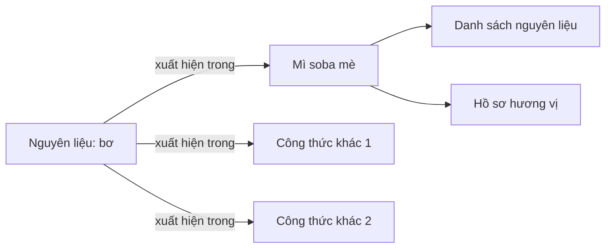
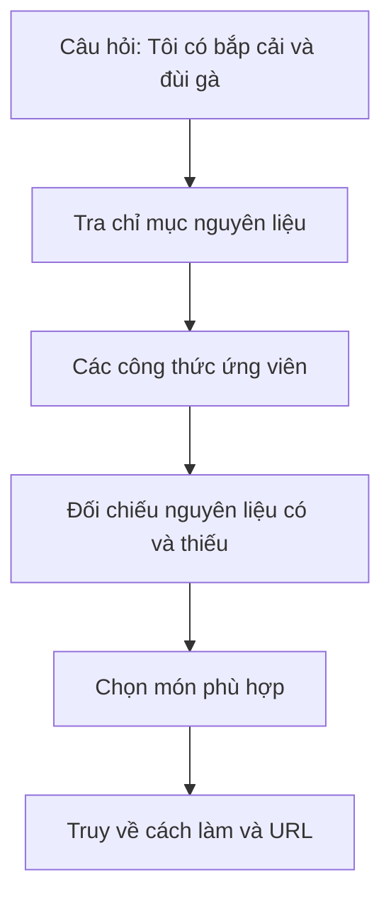

# Bài 04 — Liên kết tri thức và chiến lược tìm kiếm đa chỉ mục

## 1. Tóm tắt

Ngoài các biểu diễn riêng lẻ, hệ thống cần biết **chúng liên hệ với nhau như thế nào**. Trong Pinecone Nexus, những mối liên kết giữa các nhóm thông tin có thể hỗ trợ agent đi từ một nguyên liệu, hương vị hay hồ sơ món tới công thức thích hợp.

## 2. Mục tiêu học tập

Người học có thể:

1. Giải thích sự khác nhau giữa nút tri thức và cạnh liên kết.
2. Minh họa đường tìm kiếm từ nguyên liệu đến công thức.
3. Nêu giới hạn của cách tìm chỉ dựa trên một biểu diễn ngữ nghĩa.
4. Thiết kế đường truy xuất phù hợp với từng mục tiêu.

## 3. Nút và cạnh trong tri thức công thức

Một **nút** có thể biểu diễn nguyên liệu “bơ”, hồ sơ món “mì soba mè” hoặc một tài liệu công thức. **Cạnh** thể hiện quan hệ: món chứa nguyên liệu, tóm tắt gắn với danh sách nguyên liệu, hồ sơ món gắn với hồ sơ hương vị.

Các nút “công thức khác 1/2” chỉ đại diện những kết quả bổ sung chưa có tên cụ thể. Sơ đồ không mặc định mọi món mì soba đều chứa bơ.

## 4. Khám phá cơ sở tri thức

Một cách kiểm tra tổ chức dữ liệu là mở khu vực **Knowledge** và chọn **ingredient index**. Khi xem mục “bơ”, hệ thống có thể hiển thị danh sách công thức được nối với nguyên liệu này, trong đó có ví dụ mì soba mè. Tương tự, duyệt các nhóm hương vị cho thấy món ăn được phân nhóm để truy tìm theo cảm giác.

Thực hành khám phá cần xác minh cả chiều đi và chiều về:

- Bắt đầu từ nguyên liệu, tìm danh sách món liên quan.
- Mở một món, kiểm tra danh sách nguyên liệu gốc.
- Đi từ hồ sơ món sang mô tả hương vị.
- Truy về công thức ban đầu để đọc đầy đủ hướng dẫn.

## 5. Vì sao không dùng một lần tìm kiếm ngữ nghĩa cho mọi trường hợp?

Tìm kiếm ngữ nghĩa có ích khi truy vấn và nội dung không dùng cùng từ ngữ. Tuy nhiên, yêu cầu “tìm món dùng những nguyên liệu này” còn có thành phần **kiểm tra tập hợp**: món nào có đủ nguyên liệu, thiếu bao nhiêu nguyên liệu, nguyên liệu nào bắt buộc. Một kết quả có điểm tương đồng cao chưa chắc đạt các điều kiện đó.

| Nhu cầu | Cách truy xuất ưu tiên ở mức thiết kế |
| --- | --- |
| “Món gì giàu vị sô-cô-la?” | Hồ sơ hương vị và mô tả công thức |
| “Món nào dùng bơ?” | Chỉ mục nguyên liệu |
| “Món nào làm được từ đồ sẵn có?” | Chỉ mục nguyên liệu + kiểm tra món thiếu gì |
| “Lên thực đơn tuần” | Nhiều lần truy xuất + đối chiếu kế hoạch |

Bảng mô tả **chiến lược giải bài toán**, không tuyên bố rằng Nexus luôn chạy theo đúng thứ tự hay thuật toán ấy.

## 6. Khái niệm truy xuất nhiều bước

Khả năng đi qua các biểu diễn có liên kết giúp phần trả lời giải thích được **vì sao** món được chọn, thay vì chỉ trả một danh sách tên.

## 7. Thực hành và lỗi thường gặp

Tạo bảng cạnh cho ba công thức bất kỳ với ba kiểu quan hệ: `có_nguyên_liệu`, `có_hương_vị`, `tham_chiếu_công_thức`. Viết đường đi từ “sô-cô-la” đến công thức được chọn và từ “đậu gà” đến danh sách món có thể sử dụng. Đảm bảo mỗi gợi ý truy được về một nguồn cụ thể.

Một lỗi dễ mắc là nối hai món chỉ vì chúng gần nhau về từ ngữ rồi coi như chia sẻ cùng nguyên liệu. Mối quan hệ “có nguyên liệu” phải xuất phát từ danh sách thành phần, không được suy từ tên gọi.

## 8. Câu hỏi ôn tập

**Câu 1.** “Món A chứa nguyên liệu B” thể hiện điều gì?

A. Một mối liên kết giữa hai nút.  
B. Tên người dùng.  
C. Một mật khẩu.  
D. Số phần ăn chắc chắn.

**Đáp án:** A. **Giải thích:** Cạnh ghi nhận quan hệ giữa món và nguyên liệu.

**Câu 2.** Khi tìm món từ đồ sẵn có, chỉ số tương đồng ngữ nghĩa cao đã đủ chưa?

A. Đủ, không cần xem thành phần.  
B. Đủ, nếu tên món dài.  
C. Chưa; cần so khớp tập nguyên liệu và các điều kiện.  
D. Đủ, nếu có ảnh.

**Đáp án:** C. **Giải thích:** Điều kiện nguyên liệu cần được kiểm tra bằng dữ liệu nguyên liệu cụ thể.

**Câu 3.** Muốn đọc cách nấu chính xác sau khi truy xuất, cần làm gì?

A. Giữ lại duy nhất điểm xếp hạng.  
B. Tạo công thức mới từ tên món.  
C. Xóa liên kết tới tài liệu gốc.  
D. Truy về bản công thức đầy đủ.

**Đáp án:** D. **Giải thích:** Hồ sơ tóm tắt không thay thế các bước làm gốc.

**Câu 4.** Công dụng của việc xem mục “bơ” trong ingredient index là gì?

A. Tăng lượt xem trang.  
B. Khám phá các công thức được liên kết với nguyên liệu bơ.  
C. Thay đổi mọi công thức thành thuần chay.  
D. Tạo kế hoạch tuần không cần điều kiện.

**Đáp án:** B. **Giải thích:** Đây là truy xuất ngược từ nguyên liệu đến các món.

**Câu 5.** Vì sao phải phân biệt quan hệ xác minh được với tương đồng văn bản?

A. Vì văn bản luôn sai.  
B. Vì không cần kiểm tra nguyên liệu.  
C. Vì giống về ngôn từ không chứng minh món có nguyên liệu đó.  
D. Vì mọi chỉ mục đều là bảng tính.

**Đáp án:** C. **Giải thích:** Quan hệ thực phẩm phải dựa trên dữ liệu công thức, không chỉ dựa vào điểm tìm kiếm.

## 9. Tổng kết

Sức mạnh của tổ chức tri thức đa biểu diễn nằm ở **khả năng đi giữa các dạng thông tin**: nguyên liệu, công thức, hương vị và kế hoạch. Truy xuất đúng đường giúp tăng tính liên quan và khả năng giải thích.
