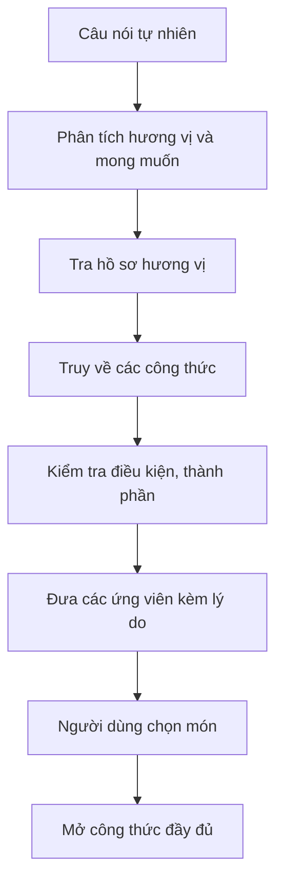

# Bài 05 — Gợi ý món ăn theo mong muốn diễn đạt bằng ngôn ngữ tự nhiên

## 1. Tóm tắt

Có những lúc người dùng không biết tên món nhưng có thể mô tả rất rõ **mình đang thèm gì**. Trợ lý cần chuyển lời diễn đạt đời thường thành tiêu chí truy xuất trong kho công thức, sau đó trả về những lựa chọn kèm lý do và liên kết tới cách làm.

## 2. Mục tiêu học tập

Người học có thể:

1. Tách tín hiệu về hương vị, cảm giác và giới hạn ăn uống từ câu nói tự nhiên.
2. Chọn nhóm tri thức phù hợp để tìm công thức.
3. Soạn câu trả lời có lý do lựa chọn và nguồn công thức.
4. Xác định khi nào nên hỏi thêm thay vì đoán.

## 3. Phân tích mong muốn người dùng

Xét yêu cầu: **“Tuần này tôi muốn một món gì đó sang trọng và có vị sô-cô-la.”** Nó chứa nhiều lớp thông tin:

- **Hương vị / thành phần quan tâm:** sô-cô-la.
- **Trải nghiệm mong muốn:** sang trọng, tạo cảm giác đặc biệt.
- **Ngữ cảnh:** món muốn ăn trong tuần; chưa có ngày giờ cụ thể.
- **Điều chưa biết:** món chính hay món tráng miệng; có hạn chế dinh dưỡng hay không.

Trợ lý có thể bắt đầu bằng việc gợi ý một vài công thức hợp lý thay vì nhất thiết phải hỏi ngay. Khi hạn chế ăn uống hoặc nguyên liệu gây dị ứng là yếu tố quyết định, hệ thống cần xác minh trước khi khẳng định món phù hợp.

## 4. Luồng gợi ý theo cảm giác



Phân tích câu nói và kiểm tra dữ liệu là hai công việc khác nhau. Từ ngữ “sang trọng” có thể giúp chọn ứng viên, nhưng không thay được bằng chứng một công thức thực sự chứa sô-cô-la.

## 5. Ví dụ thực tế

Những lựa chọn có thể được trình bày gồm:

| Gợi ý | Cách giải thích cho người dùng |
| --- | --- |
| Bánh sô-cô-la thuần chay | Phù hợp khi muốn một món tráng miệng đậm vị |
| `Brigadeiros` | Một phương án bánh kẹo sô-cô-la |
| Bánh quy chocolate chip thuần chay | Phù hợp để ăn nhẹ và chia sẻ |
| `Mole` | Một lựa chọn mặn bất ngờ có thể sử dụng sô-cô-la |

Các gợi ý này là **ví dụ ứng viên**: khi xây dựng ứng dụng, chỉ hiển thị món tồn tại trong thư viện công thức đã tra cứu. Đặc biệt, tên “thuần chay” không thay thế việc kiểm tra danh sách nguyên liệu, chất gây dị ứng và cách chế biến.

## 6. Kỹ thuật thiết kế prompt ở mức nguyên tắc

Prompt nên quy định **nhiệm vụ, bằng chứng và định dạng đầu ra**. Ví dụ minh họa:

```text
Vai trò: Bạn là trợ lý tư vấn món ăn dựa trên kho công thức được truy xuất.
Đầu vào: yêu cầu người dùng + danh sách công thức ứng viên có nguồn.
Nhiệm vụ:
- Chọn món đáp ứng hương vị và các hạn chế đã nêu.
- Giải thích vì sao từng món phù hợp.
- Không khẳng định món thỏa điều kiện ăn uống khi chưa xác minh nguyên liệu.
- Không tự bịa tên công thức hoặc liên kết.
Đầu ra: tên món, lý do, điểm cần lưu ý, liên kết đến công thức.
Nếu không có ứng viên phù hợp: nói rõ và hỏi một câu để thu hẹp hoặc đổi yêu cầu.
```

Đây là **prompt do khóa học thiết kế**, không phải prompt chính thức hay API của Pinecone Nexus.

## 7. Ví dụ hội thoại

**Người dùng:** Mình thèm món đậm vị sô-cô-la nhưng không dùng sữa.

**Trợ lý (khi có công thức đã xác minh):** Mình tìm được bánh sô-cô-la thuần chay và bánh quy chocolate chip thuần chay trong thư viện. Cả hai đều được kiểm tra danh sách thành phần theo điều kiện không chứa sữa. Bạn muốn món mềm ẩm hay món giòn?

**Trợ lý (khi chưa thể xác minh):** Mình có vài món sô-cô-la, nhưng chưa đủ thông tin thành phần để chắc rằng chúng không có sữa. Bạn muốn mình chỉ hiển thị công thức đã xác minh, hay xem danh sách nguyên liệu từng món trước?

Không trả lời bằng cách khẳng định tất cả món có nhãn “vegan” chắc chắn an toàn với mọi loại dị ứng.

## 8. Thực hành và lỗi cần tránh

Viết ba phiên bản truy vấn: “món đậm vị”, “món sang trọng có sô-cô-la” và “món sang trọng có sô-cô-la, không dùng sữa”. Với mỗi trường hợp, tạo mẫu đầu ra gồm tối đa ba ứng viên và ghi rõ trường dữ liệu phải xác minh trước khi hiển thị.

Tránh ba lỗi: gán cảm giác “sang trọng” một cách máy móc; trả món không có trong chỉ mục; dùng điểm tìm kiếm như chứng nhận đáp ứng hạn chế ăn uống.

## 9. Câu hỏi ôn tập

**Câu 1.** “Sang trọng” trong yêu cầu món ăn thường nên được xử lý như gì?

A. Tham số kỹ thuật bắt buộc có kiểu số nguyên.  
B. Thuộc tính cảm nhận hỗ trợ gợi ý.  
C. Tên nguyên liệu cụ thể.  
D. Địa chỉ URL.

**Đáp án:** B. **Giải thích:** Đây là mô tả trải nghiệm, không phải nguyên liệu hoặc thông số cố định.

**Câu 2.** Vì sao `mole` là ví dụ đáng chú ý khi tìm món có sô-cô-la?

A. Vì mọi loại mole đều là món tráng miệng.  
B. Vì mole là tên một chỉ mục.  
C. Vì món mặn vẫn có thể liên quan đến sô-cô-la.  
D. Vì chỉ món đó dùng nguyên liệu này.

**Đáp án:** C. **Giải thích:** Truy xuất không nên mặc định sô-cô-la chỉ xuất hiện ở món ngọt.

**Câu 3.** Muốn khẳng định công thức không chứa sữa, căn cứ đáng tin cậy hơn là gì?

A. Thành phần đã được xác minh.  
B. Tên món hấp dẫn.  
C. Ảnh đẹp.  
D. Món được gợi ý đầu tiên.

**Đáp án:** A. **Giải thích:** Giới hạn ăn uống là điều kiện cần đối chiếu thành phần thực tế.

**Câu 4.** Nếu không tìm được công thức phù hợp, cách phản hồi nào tốt hơn?

A. Tự bịa món rồi dẫn link giả.  
B. Im lặng.  
C. Trả kết quả bất kỳ.  
D. Nói rõ giới hạn và hỏi để điều chỉnh yêu cầu.

**Đáp án:** D. **Giải thích:** Thông báo trung thực và hỏi đúng điểm thiếu giúp tiếp tục hội thoại.

**Câu 5.** Vì sao nên đưa liên kết đến công thức trong câu trả lời?

A. Vì liên kết thay thế việc kiểm tra nguyên liệu.  
B. Vì người dùng có thể xem hướng dẫn đầy đủ và nguồn.  
C. Vì mọi liên kết đều an toàn và hoạt động.  
D. Vì không cần giải thích món.

**Đáp án:** B. **Giải thích:** Gợi ý dẫn tới công thức đầy đủ là đầu ra hữu ích, có thể kiểm chứng.

## 10. Tổng kết

Tìm món theo mong muốn yêu cầu phối hợp **hiểu ngôn ngữ tự nhiên** với **dữ liệu công thức đã tổ chức**. Chất lượng tư vấn được đánh giá không chỉ bằng số món tìm thấy mà còn bởi tính phù hợp, khả năng giải thích và độ tin cậy của thông tin.
