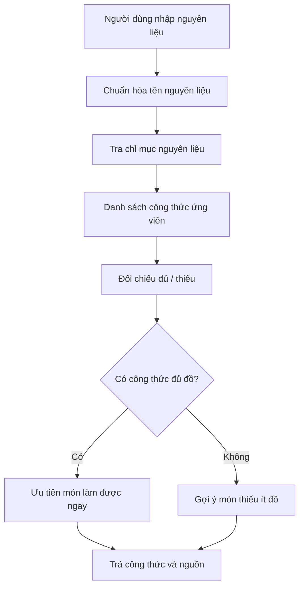

# Bài 06 — Gợi ý món ăn từ nguyên liệu có sẵn

## 1. Tóm tắt

Tình huống mở tủ lạnh có nhiều đồ nhưng chưa biết nấu món gì là một bài toán truy xuất theo **tập nguyên liệu**. Một trợ lý hữu ích phải tìm những công thức gần với đồ đang có, chỉ rõ còn thiếu gì và tránh khiến người dùng phải mua sắm quá nhiều.

## 2. Mục tiêu học tập

Người học có thể:

1. Chuyển danh sách nguyên liệu thành điều kiện truy xuất.
2. Phân biệt món làm được ngay và món cần mua thêm.
3. Thiết kế đầu ra nêu nguyên liệu dùng được và nguyên liệu còn thiếu.
4. Giải thích vai trò của `ingredient index` trong tìm kiếm.

## 3. Từ tủ lạnh đến truy vấn

Ví dụ người dùng nhập bắp cải, đùi gà và đậu gà. Ứng dụng cho phép thêm từng nguyên liệu vào danh sách. Khi gửi yêu cầu, trợ lý cần tìm công thức có liên quan tới các nguyên liệu đó, không đòi người dùng đã biết tên món.

Thông tin nên phân biệt rõ:

- **Nguyên liệu đang có:** người dùng đã xác nhận.
- **Nguyên liệu bắt buộc của công thức:** lấy từ bản công thức có nguồn.
- **Nguyên liệu thiếu:** phần bắt buộc chưa xuất hiện trong tập đồ đang có.
- **Nguyên liệu tùy chọn:** đồ trang trí hoặc gia vị có thể không quyết định khả năng nấu.

Nếu công thức không ghi rõ thành phần bắt buộc, đánh dấu là “chưa xác định”, không tùy tiện kết luận món có thể làm ngay.

## 4. Vai trò của chỉ mục nguyên liệu

`Ingredient index` cho phép truy từ nguyên liệu tới những công thức liên quan. Sau đó trợ lý cần nhìn danh sách nguyên liệu của từng công thức để đánh giá **mức độ đầy đủ**.



**Chuẩn hóa** là bước đề xuất khi tự triển khai ứng dụng: ví dụ “đùi gà” và “thịt đùi gà” có thể cùng chỉ một nhóm nguyên liệu. Cần chú ý chúng không phải lúc nào cũng thay thế trực tiếp cho nhau khi khác trạng thái sống/chín, có xương/không xương hoặc đơn vị.

## 5. Nguyên tắc ưu tiên công thức

Giả sử chỉ xét các nguyên liệu **bắt buộc**, có thể mô tả bằng hai tập hợp:

- $H$: tập nguyên liệu người dùng có.
- $R$: tập nguyên liệu cần cho công thức.

Khi đó, danh sách cần mua thêm là:

$$
M = R \setminus H
$$

Nếu $M$ rỗng, về mặt **danh sách thành phần** người dùng đã có đủ loại nguyên liệu. Điều này **không đảm bảo** đủ số lượng, dụng cụ, thời gian, kỹ thuật hoặc an toàn thực phẩm.

Bảng minh họa (dữ liệu giả định để luyện phân loại):

| Món giả định | Đã có | Thiếu bắt buộc | Cách trình bày |
| --- | --- | --- | --- |
| Công thức A | Bắp cải, đùi gà | Không | Có thể thử nấu sau khi kiểm tra lượng |
| Công thức B | Đậu gà, bắp cải | Chanh | Thiếu chanh |
| Công thức C | Đùi gà | Gạo, hành, dầu | Cần mua nhiều hơn |

Danh sách trên không khẳng định ba công thức ấy đã tồn tại trong bất kỳ chỉ mục Nexus thực tế nào.

## 6. Gợi ý giảm đồ phải mua

Một hướng thiết kế prompt là: “Trong các công thức truy xuất được, ưu tiên món dùng nhiều nguyên liệu đã có và ít nguyên liệu bắt buộc còn thiếu. Luôn liệt kê đồ thiếu, không âm thầm bỏ qua”. Điều này biến gợi ý thành quyết định có lý do, phù hợp khi người dùng muốn tiết kiệm công đi chợ.

Trong một cuộc hội thoại, có thể hỏi thêm: “Bạn có sẵn gia vị cơ bản như dầu, muối không?” nếu câu trả lời có ảnh hưởng đáng kể đến số món làm được. Không nên hỏi liên tiếp những câu không cần thiết khi đã đủ thông tin để đưa ra lựa chọn.

## 7. Định dạng kết quả nên dùng

Một gợi ý tốt có thể gồm:

```text
Món: [tên món thật trong thư viện]
Bạn đã có: [nguyên liệu đã đối chiếu]
Cần thêm: [nguyên liệu bắt buộc còn thiếu, nếu có]
Số phần: [chỉ nêu khi nguồn đủ dữ liệu]
Vì sao phù hợp: [lý do ngắn]
Công thức: [URL đã kiểm tra]
```

Nếu chỉ có thông tin “nguyên liệu có mặt” mà không có khối lượng, tránh lời khẳng định như “đủ nấu cho 4 người”.

## 8. Thực hành và lỗi thường gặp

Viết danh sách 6 nguyên liệu trong bếp. Chọn ít nhất 4 công thức có nguồn. Với mỗi công thức, tính $R \setminus H$, liệt kê đồ thiếu, và sắp các ứng viên thành “đủ loại nguyên liệu”, “thiếu ít”, “thiếu nhiều”. Sau đó kiểm tra lại số lượng, hạn chế ăn uống và thời gian nấu trước khi đề xuất món đứng đầu.

Tránh coi gia vị nào cũng có sẵn; tự thay thế nguyên liệu gây dị ứng; đếm đồ thiếu nhưng bỏ qua lượng; hoặc dựng một công thức không có nguồn như thể được tìm thấy trong Nexus.

## 9. Câu hỏi ôn tập

**Câu 1.** Công thức cần A, B, C; người dùng có A và C. Tập nguyên liệu thiếu là gì?

A. A và C.  
B. Không thiếu gì.  
C. B.  
D. A, B và C.

**Đáp án:** C. **Giải thích:** Phép hiệu tập công thức và tập đang có chỉ còn B.

**Câu 2.** Ingredient index giúp làm việc gì?

A. Từ nguyên liệu tìm về công thức liên quan.  
B. Tạo ảnh món tự động.  
C. Xác nhận người dùng không dị ứng.  
D. Đo số người trong bếp.

**Đáp án:** A. **Giải thích:** Đây là đường truy xuất nguyên liệu → công thức.

**Câu 3.** Nếu không thiếu loại nguyên liệu, kết luận nào hợp lý nhất?

A. Món chắc chắn ngon.  
B. Món đủ cho 10 phần.  
C. Không cần kiểm tra thiết bị.  
D. Đã có đủ loại nguyên liệu cần thiết, nhưng phải kiểm tra lượng và các điều kiện khác.

**Đáp án:** D. **Giải thích:** Tập nguyên liệu không phản ánh số lượng hoặc tính khả thi toàn diện.

**Câu 4.** Cách giúp người dùng cần mua sắm ít hơn là gì?

A. Bỏ các nguyên liệu bắt buộc ra khỏi công thức.  
B. Ưu tiên ứng viên thiếu ít nguyên liệu và nêu minh bạch đồ thiếu.  
C. Trả về món bất kỳ.  
D. Không đối chiếu nguyên liệu.

**Đáp án:** B. **Giải thích:** Sắp xếp ứng viên theo đồ đang có là một tiêu chí hữu ích và có thể giải thích.

**Câu 5.** Vì sao phải phân biệt nguyên liệu bắt buộc và tùy chọn?

A. Để chắc chắn tất cả nguyên liệu tùy chọn đều không quan trọng.  
B. Để tránh đọc cách làm.  
C. Để đánh giá chính xác hơn món có thể thực hiện với đồ hiện có.  
D. Để thay thế mọi gia vị.

**Đáp án:** C. **Giải thích:** Không thể đánh giá thiếu đồ đúng nếu đánh đồng trang trí và thành phần thiết yếu.

## 10. Tổng kết

Tìm món từ nguyên liệu là bài toán phối hợp **chỉ mục nguyên liệu** với **so khớp điều kiện**. Câu trả lời hữu ích nhất cho người dùng là danh sách món có nguồn, nói rõ đồ đã có và đồ còn thiếu.
