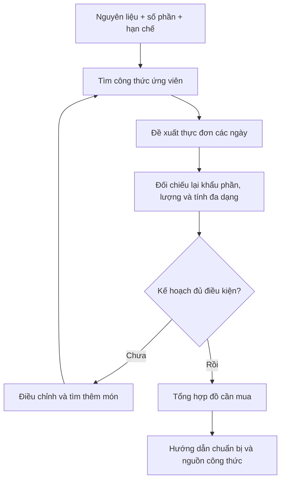

# Bài 07 — Lập kế hoạch bữa ăn cho cả tuần

## 1. Tóm tắt

Lập thực đơn tuần kết hợp nhiều bước: nhận nguyên liệu và giới hạn, tìm món, ghép bữa phù hợp, tính phần ăn, xác định đồ phải mua và đưa ra hướng dẫn chuẩn bị. Đây là bài toán **lập kế hoạch trên nhiều công thức**, không phải tìm một món đơn lẻ.

## 2. Mục tiêu học tập

Người học có thể:

1. Định nghĩa đầu vào tối thiểu của một yêu cầu thực đơn tuần.
2. Mô tả cơ chế agent truy xuất lặp để hoàn thiện kế hoạch.
3. Thiết kế đầu ra có thực đơn, danh sách mua sắm và hướng dẫn chuẩn bị.
4. Kiểm tra sự nhất quán giữa lượng nguyên liệu, khẩu phần và từng món.

## 3. Đầu vào của kế hoạch

Ví dụ: người dùng đang có **bắp cải, đùi gà và đậu gà**, muốn dùng các nguyên liệu ấy trong tuần. Ngoài danh sách đồ sẵn có, kế hoạch cần biết số người, số bữa, giới hạn ăn uống và mức linh hoạt đối với việc mua thêm.

| Nhóm thông tin | Câu hỏi hệ thống phải giải quyết |
| --- | --- |
| Nguyên liệu | Có gì và cần ưu tiên dùng hết thứ gì? |
| Khẩu phần | Một món cần chuẩn bị bao nhiêu phần ăn? |
| Khoảng thời gian | Lập cho mấy ngày, mấy bữa? |
| Hạn chế | Thành phần hay phương pháp nào không phù hợp? |
| Mua sắm | Có thể mua thêm bao nhiêu và mua những gì? |
| Chuẩn bị | Món nào nên làm trước, nguyên liệu nào cần bảo quản? |

Nếu không biết số lượng hoặc số phần, hệ thống phải hỏi hoặc nêu rõ giả định để người dùng phê duyệt, thay vì tính toán chính xác giả.

## 4. Vì sao cần tìm kiếm nhiều bước?

Một lần tìm có thể cho danh sách món dùng đùi gà, nhưng chưa chắc có đủ lựa chọn cho cả tuần. Agent có thể cần tra lần lượt từng nhóm món, đối chiếu món đã chọn, tìm phương án thay thế, sau đó tổng hợp danh sách mua sắm.



Việc thực hiện **truy xuất lặp**, nhìn lại kết quả trước và tổ chức các bước gọi công cụ là ví dụ về khả năng agentic search được khai thác trong bài toán này. Không nên hiểu rằng mọi kế hoạch đều tối ưu hoặc rằng Nexus bảo đảm một thuật toán tìm kiếm cụ thể cho mọi trường hợp.

## 5. Ba phần bắt buộc của đầu ra

### 5.1. Bảng thực đơn

Một thực đơn tuần nên thể hiện ngày, bữa, tên công thức, số phần, nguyên liệu chính và đường dẫn công thức. Với hệ thống thử nghiệm, có thể dùng mẫu sau và điền bằng công thức **thật có trong kho**:

| Ngày | Món lấy từ kho | Số phần | Nguyên liệu cần dùng |
| --- | --- | --- | --- |
| Thứ Hai | [Công thức 1] | [Theo yêu cầu] | [Theo công thức] |
| Thứ Ba | [Công thức 2] | [Theo yêu cầu] | [Theo công thức] |
| Thứ Tư | [Công thức 3] | [Theo yêu cầu] | [Theo công thức] |
| Thứ Năm | [Công thức 4] | [Theo yêu cầu] | [Theo công thức] |
| Thứ Sáu | [Công thức 5] | [Theo yêu cầu] | [Theo công thức] |
| Thứ Bảy | [Công thức 6] | [Theo yêu cầu] | [Theo công thức] |
| Chủ Nhật | [Công thức 7] | [Theo yêu cầu] | [Theo công thức] |

Mẫu không tự mặc định một bữa mỗi ngày là đủ cho mọi người; ứng dụng cần căn cứ đúng số bữa người dùng yêu cầu.

### 5.2. Danh sách mua sắm

Danh sách mua sắm được tổng hợp từ **nguyên liệu thiếu của toàn bộ các món**, loại trừ những thứ đã có đủ lượng. Nếu nhiều món cần cùng nguyên liệu, phải gộp nhu cầu, không chỉ liệt kê nhiều dòng trùng tên. Khi thiếu đơn vị hoặc khối lượng, nên để trạng thái “cần xác minh” thay vì cộng số đo không tương thích.

### 5.3. Hướng dẫn chuẩn bị

Phần chuẩn bị trả lời: cần sơ chế nguyên liệu nào trước, món nào có thể làm gần nhau và có thể tận dụng khâu chuẩn bị ra sao. Với đồ tươi, thời hạn và điều kiện bảo quản cần dựa vào hướng dẫn an toàn đáng tin cậy; không tự đưa ra thời hạn lưu trữ thiếu căn cứ.

## 6. Thiết kế prompt để lập kế hoạch

```text
Bạn là trợ lý lập thực đơn, chỉ sử dụng các công thức đã truy xuất có nguồn.
Dữ liệu đầu vào: nguyên liệu hiện có, lượng (nếu biết), số phần,
số ngày/bữa, hạn chế ăn uống và mức cho phép mua thêm.

Hãy:
1. Tìm các công thức phù hợp trong kho.
2. Lập thực đơn cho đúng các ngày và bữa được yêu cầu.
3. Kiểm tra nguyên liệu có sẵn, tránh dùng vượt lượng đã biết.
4. Liệt kê nguyên liệu cần mua thêm, gộp trùng nếu lượng tương thích.
5. Đưa ra gợi ý chuẩn bị và liên kết nguồn từng món.
6. Nếu thiếu thông tin quan trọng, hỏi rõ hoặc ghi giả định công khai.
Không bịa công thức, khối lượng, thời hạn bảo quản hay giá tiền.
```

Đây là prompt minh họa phục vụ thiết kế ứng dụng, không phải template mặc định của Nexus.

## 7. Checklist kiểm thử

- [ ] Đúng số ngày và số bữa được yêu cầu.
- [ ] Mỗi món có thể tra ngược về công thức nguồn.
- [ ] Mọi hạn chế ăn uống đã được kiểm tra với dữ liệu thích hợp.
- [ ] Tính tổng nguyên liệu theo số phần, không cộng sai đơn vị.
- [ ] Có danh sách mua sắm, không lặp đồ một cách vô ích.
- [ ] Có hướng dẫn chuẩn bị, không tuyên bố bảo quản thiếu cơ sở.
- [ ] Khi thiếu dữ liệu, nêu rõ điều chưa chắc chắn.

## 8. Thực hành

Chuẩn bị kho tối thiểu 7 công thức và danh sách nguyên liệu gồm bắp cải, đùi gà, đậu gà cùng lượng tương ứng. Tạo bảng bảy ngày cho một bữa mỗi ngày và hai phần ăn mỗi bữa. Điền món từ kho, ghi lượng cần dùng, tính đồ phải mua. Sau đó thay điều kiện thành “không dùng sữa” và xác minh từng món còn phù hợp hay không.

Không có đủ bảy công thức hợp lệ thì sản phẩm phải báo thiếu lựa chọn, không nên tạo nguồn giả cho đủ bảng.

## 9. Câu hỏi ôn tập

**Câu 1.** Khác biệt trọng tâm giữa thực đơn tuần và gợi ý một món là gì?

A. Thực đơn tuần không cần công thức.  
B. Thực đơn tuần chỉ cần tên món.  
C. Thực đơn tuần không có người dùng.  
D. Thực đơn tuần phải phối hợp nhiều món, phần ăn và nguyên liệu.

**Đáp án:** D. **Giải thích:** Đây là nhiệm vụ lập kế hoạch nhiều bước và nhiều điều kiện.

**Câu 2.** Vì sao cần truy xuất lặp khi lập thực đơn?

A. Vì mỗi lần tìm đều phải xóa công thức cũ.  
B. Vì cần bổ sung và kiểm tra các lựa chọn cho nhiều bữa.  
C. Vì chỉ mục nguyên liệu không bao giờ có dữ liệu.  
D. Vì mọi món phải có sô-cô-la.

**Đáp án:** B. **Giải thích:** Các món phải phối hợp với nhau và thỏa điều kiện tổng thể.

**Câu 3.** Hai món cùng cần một loại nguyên liệu, danh sách mua sắm nên làm gì?

A. Gộp nhu cầu theo đơn vị phù hợp và trừ lượng sẵn có.  
B. Chỉ mua cho món đầu.  
C. Xóa nguyên liệu chung.  
D. Luôn giữ hai dòng mà không tính lượng.

**Đáp án:** A. **Giải thích:** Danh sách mua sắm phải phản ánh nhu cầu tổng chứ không chỉ từng món riêng.

**Câu 4.** Nếu không biết số phần ăn, hành động nào tốt hơn?

A. Tự tính đúng 10 phần.  
B. Bỏ số phần khỏi mọi tính toán nhưng tuyên bố chính xác.  
C. Hỏi hoặc ghi giả định cần xác nhận.  
D. Chọn ngẫu nhiên nguyên liệu.

**Đáp án:** C. **Giải thích:** Số phần ảnh hưởng trực tiếp đến lượng nguyên liệu.

**Câu 5.** Đầu ra nào là bổ trợ quan trọng của thực đơn tuần?

A. Chỉ một ảnh minh họa.  
B. Chỉ số lượt truy vấn.  
C. Một danh sách URL bất kỳ.  
D. Danh sách mua sắm và hướng dẫn chuẩn bị.

**Đáp án:** D. **Giải thích:** Đây là hai phần giúp người dùng thực hiện kế hoạch trong thực tế.

## 10. Tổng kết

Kế hoạch bữa ăn chất lượng phải **có thể thực hiện và kiểm chứng**. Tìm kiếm nhiều bước hỗ trợ tạo thực đơn, nhưng kết quả vẫn cần kiểm tra lượng nguyên liệu, điều kiện ăn uống và nguồn công thức.
