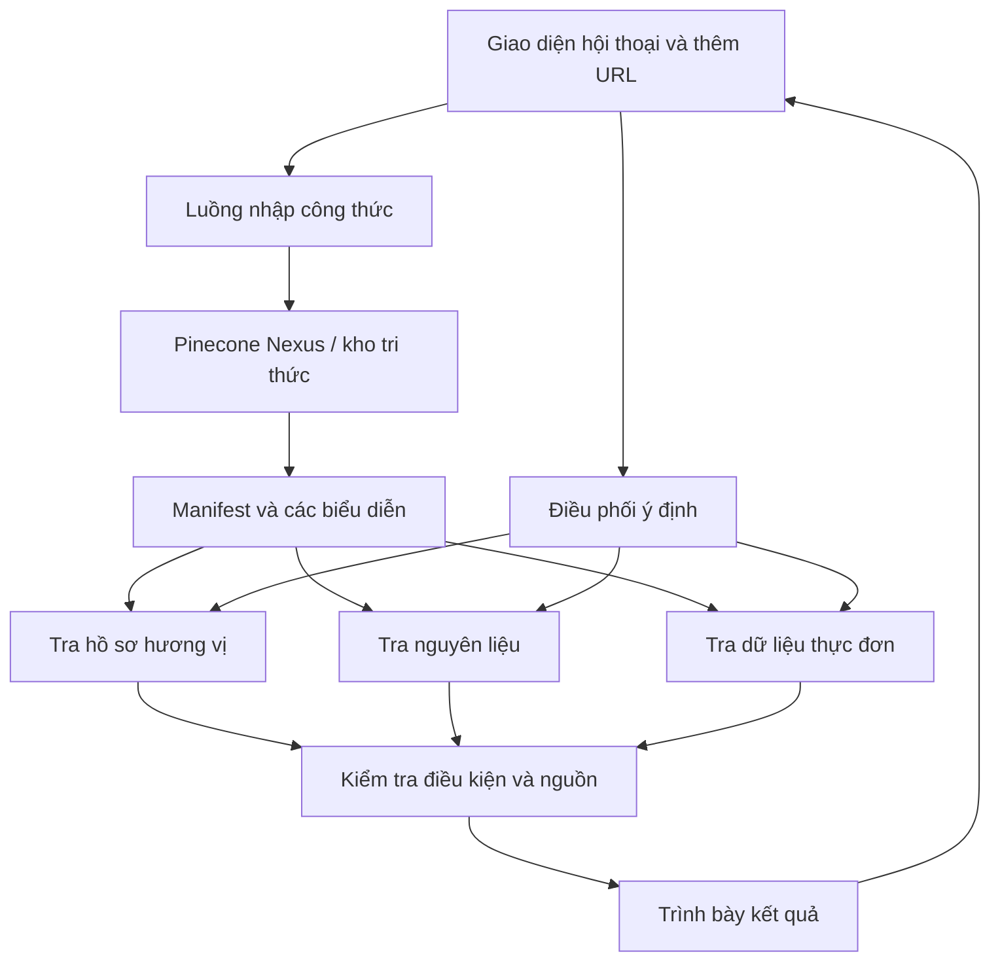

# Bài 08 — Đồ án cuối khóa: Thiết kế Conversational Food Recommendation Agent

## 1. Bài toán

Xây dựng bản thiết kế hoặc nguyên mẫu giao diện cho trợ lý nấu ăn với ba chức năng: **gợi ý theo mong muốn**, **tìm món theo nguyên liệu** và **lập thực đơn tuần**. Thư viện công thức hỗ trợ nhập URL, truy về nguồn và tổ chức các biểu diễn tri thức để sử dụng lại cho nhiều loại yêu cầu.

Đồ án tập trung vào **thiết kế luồng, dữ liệu và hành vi agent**. Nếu môi trường Pinecone Nexus của người học sẵn có, có thể tích hợp trực tiếp theo tài liệu sản phẩm hiện hành; bài này **không cung cấp SDK hay API giả định**.

## 2. Mục tiêu và sản phẩm cần nộp

1. Sơ đồ kiến trúc tổng thể và bảng mô tả ba kiểu truy vấn.
2. Bộ dữ liệu công thức mẫu có nguồn hoặc được ghi rõ là dữ liệu thử nghiệm.
3. Bản mô tả các biểu diễn dữ liệu phù hợp với từng truy vấn.
4. Prompt hoặc quy tắc điều phối và bộ ví dụ hội thoại.
5. Bản kiểm thử các trường hợp thường, dữ liệu thiếu và ràng buộc ăn uống.
6. Ảnh chụp màn hình / mô hình giao diện hoặc bản demo nếu có thực hiện ứng dụng.

## 3. Yêu cầu chức năng

| Mã | Chức năng | Điều kiện hoàn thành |
| --- | --- | --- |
| F01 | Nhập URL công thức | Có quy trình tiếp nhận và kiểm tra nội dung |
| F02 | Gợi ý theo hương vị | Trả ứng viên và giải thích mức phù hợp |
| F03 | Gợi ý theo nguyên liệu | Phân biệt có sẵn và cần mua thêm |
| F04 | Lập thực đơn | Có lịch bữa ăn, danh sách mua sắm, hướng dẫn chuẩn bị |
| F05 | Truy vết nguồn | Mỗi món trả về có nguồn công thức |
| F06 | Xử lý bất định | Không bịa món hoặc khẳng định sai hạn chế ăn uống |

## 4. Kiến trúc đề xuất



Sơ đồ là mô hình chức năng có thể triển khai bằng nhiều công nghệ. Các ô không đồng nghĩa các endpoint bắt buộc phải tồn tại trong Nexus.

## 5. Thiết kế dữ liệu mẫu

Khi chưa có môi trường Nexus, dùng cấu trúc JSON **tự thiết kế phục vụ bài tập**, tách rõ `ingredients` với `flavor_tags`:

```json
{
  "id": "recipe-demo-01",
  "name": "Bánh sô-cô-la thuần chay (mẫu)",
  "source_url": null,
  "verified": false,
  "ingredients": ["bột mì", "sô-cô-la", "chất béo thực vật"],
  "flavor_tags": ["ngọt", "đậm vị sô-cô-la"],
  "method": "nướng",
  "servings": null
}
```

**Lưu ý:** Đây chỉ là một bản ghi khởi tạo tối giản, không phải công thức hoàn chỉnh, không được dùng để khẳng định món này ăn được theo chế độ cụ thể. `null` chỉ thiếu dữ liệu. Khi dùng thật, phải bổ sung công thức nguồn, định lượng, hướng dẫn làm và xác minh các nhãn ăn uống.

## 6. Logic điều phối minh họa

```text
Nhận yêu cầu
  nếu yêu cầu là "theo mong muốn":
      tra biểu diễn hương vị / hồ sơ món
  nếu yêu cầu là "từ nguyên liệu":
      tra chỉ mục nguyên liệu
      đối chiếu có / thiếu cho từng công thức
  nếu yêu cầu là "kế hoạch tuần":
      truy xuất nhiều lần khi cần
      kết hợp món, kiểm tra khẩu phần và nguyên liệu
      tổng hợp mua sắm và chuẩn bị
  kiểm tra hạn chế ăn uống và nguồn dữ liệu
  trả kết quả có giải thích hoặc hỏi thêm điều cần thiết
```

Đây là **mã giả quy trình** để người học dễ chuyển thành chương trình, không phải lời gọi SDK hoặc mô tả bắt buộc về nội bộ Nexus.

## 7. Kế hoạch triển khai theo mốc

### 7.1. Mốc 1 — Bộ công thức đáng tin cậy

Thu thập tối thiểu 10 công thức có thể tra lại. Ghi tên, nguyên liệu, cách làm, URL và trạng thái xác minh. Với mỗi công thức, kiểm tra dữ liệu không bị cắt hoặc lẫn quảng cáo. Nếu chỉ dùng dữ liệu tự tạo, đánh dấu rõ “demo”.

### 7.2. Mốc 2 — Thiết kế tri thức

Tạo bảng ánh xạ từ công thức sang tóm tắt, danh sách nguyên liệu, hồ sơ hương vị, kỹ thuật chế biến và dữ liệu phục vụ lập thực đơn. Thiết kế ít nhất hai loại liên kết: `nguyên liệu → công thức`, `công thức → hương vị`.

### 7.3. Mốc 3 — Ba luồng hội thoại

Thử lần lượt ba câu:

- “Tôi muốn thứ gì đó sang trọng, đậm sô-cô-la.”
- “Tôi có bắp cải, đùi gà và đậu gà. Nấu được gì?”
- “Hãy lập kế hoạch ăn bảy ngày, hai phần mỗi bữa và cho biết còn thiếu gì.”

Kiểm tra ứng dụng có dùng **đúng kho tri thức**, không tạo kết quả vô căn cứ; có hỏi thêm nếu dữ liệu về phần ăn hoặc điều kiện quá thiếu.

### 7.4. Mốc 4 — Đánh giá, sửa lỗi và hoàn thiện

Đưa vào tình huống không có món phù hợp, URL không truy cập được, tên nguyên liệu khác cách viết, món có nguyên liệu gây dị ứng và công thức thiếu định lượng. Ghi kết quả theo bảng kiểm.

## 8. Ma trận kiểm thử

| Test | Đầu vào | Kết quả mong đợi |
| --- | --- | --- |
| T01 | Câu mô tả thèm sô-cô-la | Món từ kho, có lý do và nguồn |
| T02 | Danh sách nguyên liệu đầy đủ | Món không thiếu loại nguyên liệu, vẫn kiểm tra lượng |
| T03 | Thiếu một nguyên liệu | Nêu rõ tên nguyên liệu cần mua |
| T04 | Thực đơn 7 ngày | Đúng số ngày/bữa, có kế hoạch mua sắm |
| T05 | Yêu cầu không chứa sữa | Chỉ xác nhận món đã kiểm tra thành phần |
| T06 | URL không lấy được | Không giả vờ đã thêm công thức |
| T07 | Không có kết quả | Giải thích và đề nghị đổi tiêu chí hoặc bổ sung nguồn |
| T08 | Món thiếu số phần | Nêu thiếu dữ liệu, không tạo số phần giả |

## 9. Tiêu chí đánh giá (100 điểm)

| Tiêu chí | Điểm |
| --- | ---: |
| Mô tả đúng ba loại ý định và kiến trúc | 20 |
| Chất lượng dữ liệu và khả năng truy vết | 20 |
| Tổ chức nhiều biểu diễn và liên kết tri thức | 20 |
| Đầu ra hữu ích cho ba chức năng | 25 |
| Kiểm thử, xử lý dữ liệu thiếu và trình bày rõ | 15 |
| **Tổng** | **100** |

**Definition of Done:** có ít nhất một ví dụ chạy qua được từng luồng truy vấn; mỗi gợi ý có nguồn hoặc nhãn dữ liệu demo; các trường hợp không chắc chắn được nêu rõ; có kết quả kiểm thử và điều chỉnh thiết kế.

## 10. Câu hỏi ôn tập

**Câu 1.** Phần nào bắt buộc để phân biệt gợi ý có căn cứ và gợi ý bịa ra?

A. Màu giao diện.  
B. Số nút bấm.  
C. Truy vết món về công thức nguồn.  
D. Tên người lập trình.

**Đáp án:** C. **Giải thích:** Nguồn dữ liệu cho phép xác minh ứng viên thực sự tồn tại.

**Câu 2.** Nếu chưa có quyền truy cập Nexus, cách hoàn thành đồ án hợp lý là gì?

A. Tự đặt API rồi tuyên bố đã kết nối.  
B. Làm bản thiết kế, dữ liệu demo và kiểm thử các luồng ở mức mô hình.  
C. Không cần trình bày dữ liệu.  
D. Bỏ cả ba chức năng.

**Đáp án:** B. **Giải thích:** Thiết kế và mô phỏng có thể đánh giá mà không cần bịa tích hợp sản phẩm.

**Câu 3.** Trường `verified: false` nên được hiểu thế nào?

A. Dữ liệu chưa được xác minh, không được khẳng định an toàn theo hạn chế ăn uống.  
B. Món đã đạt chứng nhận y tế.  
C. Món chắc chắn không có sữa.  
D. URL đã hoạt động.

**Đáp án:** A. **Giải thích:** Cờ chưa xác minh biểu thị còn cần kiểm tra nguồn, không phải bằng chứng phù hợp.

**Câu 4.** Bài test nào trực tiếp kiểm tra xử lý nhập công thức lỗi?

A. T01.  
B. T03.  
C. T04.  
D. T06.

**Đáp án:** D. **Giải thích:** T06 kiểm tra khi URL không thu thập được.

**Câu 5.** Kết quả cuối khóa nên đáp ứng điều gì?

A. Chỉ cần nhiều dòng code.  
B. Chỉ cần gợi ý một món.  
C. Có ba luồng nghiệp vụ, tri thức truy vết được và kiểm thử rõ ràng.  
D. Chỉ cần giao diện đẹp.

**Đáp án:** C. **Giải thích:** Đồ án đánh giá tính đầy đủ từ nguồn dữ liệu đến câu trả lời và kiểm chứng.

## 11. Tổng kết

Thiết kế một trợ lý gợi ý món ăn đáng tin cậy đòi hỏi **dữ liệu có nguồn**, **biểu diễn phù hợp với mục tiêu**, **truy xuất đúng chiến lược** và **kiểm tra đầu ra**. Khi hoàn thành các mốc, người học đã có nền tảng để chuyển bản thiết kế thành ứng dụng khi có công cụ và quyền truy cập phù hợp.
