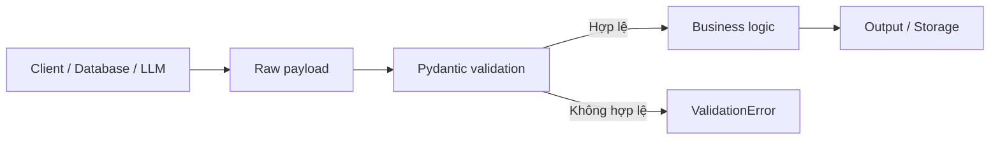

# Vì sao ứng dụng Python cần Pydantic?

> **Khóa học:** Pydantic Crash Course — tiếng Việt  
> **Học phần:** Module 01 — Nền tảng Pydantic và môi trường  
> **Loại nội dung:** Bài học / thực hành  
> **Mức độ:** Cơ bản → ứng dụng

## 1. Tóm tắt

Python có kiểu động, còn dữ liệu đi vào API, database và hệ thống AI thường không đáng tin cậy. Pydantic dùng type hints làm hợp đồng dữ liệu và xác thực khi chạy.

## 2. Mục tiêu học tập

Sau bài học này, bạn có thể:

- Giải thích được sự khác nhau giữa kiểu động, type hint và runtime validation.
- Chỉ ra lỗi xuất hiện muộn khi tin tưởng payload bên ngoài.
- Xác định vị trí đặt mô hình Pydantic ở ranh giới dữ liệu.

## 3. Bối cảnh và vấn đề

Một biến Python có thể đổi từ số sang chuỗi mà trình thông dịch không phản đối. Tính linh hoạt này rất tiện để thử nghiệm, nhưng trong ứng dụng có API, database, frontend và LLM, một giá trị sai kiểu có thể đi qua nhiều tầng rồi mới gây lỗi. Ví dụ `age` nhận chuỗi `"unknown"`, đến lúc cộng 1 mới gây `TypeError`. Lỗi xảy ra ở tầng tính toán, trong khi nguyên nhân là payload đến từ bên ngoài.

Pydantic giải quyết bằng **kiểm tra dữ liệu tại ranh giới**: dữ liệu bên ngoài → mô hình → đối tượng đã qua xác thực → logic nghiệp vụ. Nó không thay thế mọi kiểm thử, không loại bỏ logic nghiệp vụ và không tự xác minh sự thật của nội dung AI sinh ra.

## 4. Kiến thức cốt lõi

### 4.1. Ba tầng cần phân biệt

| Công cụ | Thời điểm kiểm tra | Tác dụng |
| --- | --- | --- |
| Python type hints (`age: int`) | Chủ yếu do IDE/type checker phân tích | Diễn đạt ý định, không tự bắt lỗi khi chạy |
| Pydantic `BaseModel` | Khi tạo/validate model | Kiểm tra cấu trúc, kiểu và ràng buộc |
| Business validation | Trong domain service | Kiểm tra điều kiện có ý nghĩa nghiệp vụ, quyền truy cập, trạng thái đơn hàng... |

### 4.2. Luồng dữ liệu an toàn



Cổng validation chặn payload sai trước khi đi sâu vào hệ thống. Với Pydantic, **type coercion** (ép kiểu có kiểm soát) cũng là hành vi mặc định cho một số kiểu; muốn cấm ép kiểu cần dùng strict mode.

## 5. Ví dụ và thực hành hướng dẫn

```python
from pydantic import BaseModel, Field, ValidationError

class User(BaseModel):
    id: int
    email: str
    age: int = Field(ge=0, le=120)

raw = {"id": 1, "email": "alice@example.com", "age": "unknown"}
try:
    user = User.model_validate(raw)
except ValidationError as exc:
    for issue in exc.errors():
        print(issue["loc"], issue["msg"])
```

Kết quả sẽ chỉ rõ đường dẫn trường `age` và nguyên nhân không chuyển được thành số nguyên. Lưu ý `str` chưa đồng nghĩa với email hợp lệ; có thể dùng `EmailStr` khi cài thêm phụ thuộc phù hợp.

## 6. Điểm dễ sai và cách khắc phục

- **Pydantic không thay thế bảo mật.** Xác thực dữ liệu không đồng nghĩa được phép truy cập tài nguyên.
- **Pydantic không xác thực độ đúng của tri thức do LLM sinh ra.** Schema đúng vẫn có thể chứa thông tin sai thực tế.
- **Validation phải thực hiện tại điểm nhận dữ liệu.** Truyền `dict` chưa kiểm tra vào core logic khiến lợi ích bị giảm.

## 7. Bài tập tự luyện

Thử thay `age` bằng `29`, `"29"`, `-1`, `None` và `"twenty-nine"`. Ghi lại trường hợp nào chạy được; giải thích sự khác nhau giữa ép kiểu, lỗi kiểu và lỗi ràng buộc. Tiêu chí: có bảng kết quả với nguyên nhân.

## 8. Câu hỏi ôn tập trắc nghiệm

**Câu 1. Dữ liệu API có `age="unknown"`. Nơi phù hợp nhất để phát hiện lỗi là đâu?**

A. Ngay khi payload đi vào backend  
B. Khi cộng thêm 1 vào `age`  
C. Sau khi đã ghi database  
D. Khi frontend hiển thị tuổi  

**Đáp án:** A.  
**Giải thích:** Validation sớm giúp trả lỗi đúng nguồn thay vì lỗi dây chuyền.

**Câu 2. Vì sao `age: int = "hello"` trong Python thông thường vẫn có thể chạy?**

A. Python tự chuyển mọi chuỗi thành số nguyên  
B. Type hints không tự cưỡng chế kiểu tại runtime  
C. Pydantic bị tắt mặc định  
D. Mọi biến Python đều là chuỗi  

**Đáp án:** B.  
**Giải thích:** Type hints hỗ trợ công cụ tĩnh; phép gán thông thường vẫn theo cơ chế kiểu động.

**Câu 3. Mô hình Pydantic kiểm tra schema thành công thì điều gì vẫn có thể sai?**

A. Dữ liệu không thể được serialize  
B. Không thể dùng trong FastAPI  
C. Sự thật hoặc ý nghĩa nghiệp vụ của dữ liệu  
D. Không thể truy cập thuộc tính  

**Đáp án:** C.  
**Giải thích:** Hợp lệ về cấu trúc chưa đồng nghĩa đúng sự thật hay đủ quyền.


## 9. Tổng kết

Pydantic biến hợp đồng kiểu dữ liệu thành kiểm tra ở runtime. Thiết kế tốt bắt đầu từ xác thực payload tại ranh giới và giữ kiểm tra nghiệp vụ tách biệt.
