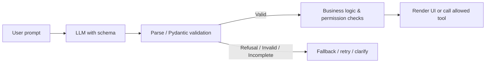

# Tại sao LLM cần Structured Output và schema?

> **Khóa học:** Pydantic Crash Course — tiếng Việt  
> **Học phần:** Module 07 — Structured output với LLM  
> **Loại nội dung:** Bài học / thực hành  
> **Mức độ:** Cơ bản → ứng dụng

## 1. Tóm tắt

Chuyển câu trả lời tự do của LLM thành hợp đồng dữ liệu rõ ràng để backend và frontend dùng được.

## 2. Mục tiêu học tập

Sau bài học này, bạn có thể:

- Giải thích sự khác nhau giữa văn bản, JSON mode, Structured Outputs và validation.
- Chọn schema cho tình huống trích xuất thông tin hoặc phản hồi giao diện.
- Nêu giới hạn: schema hợp lệ không đồng nghĩa nội dung đúng sự thật.

## 3. Bối cảnh và vấn đề

LLM thường sinh văn bản tự do. Khi muốn kết quả đưa vào UI, API, database hoặc tool, chỉ dựa vào lời nhắc “hãy trả về JSON” không đủ. Output có thể thiếu key, đổi tên key, thêm văn bản ngoài JSON hoặc chứa kiểu không đúng. Giải pháp là đặt một hợp đồng dữ liệu rõ ràng: schema định nghĩa loại kết quả và hệ thống kiểm tra dữ liệu trước khi sử dụng.

Structured Outputs của một nhà cung cấp, khi được hỗ trợ, hướng mô hình sinh nội dung bám sát JSON Schema tương thích. Pydantic tiếp tục là lớp runtime validation hữu ích. Tuy nhiên model có thể từ chối, hết token, bị gián đoạn hoặc sinh thông tin đúng schema nhưng sai thực tế.

## 4. Kiến thức cốt lõi

### 4.1. Ba cách tạo output

| Cách | Bảo đảm |
| --- | --- |
| Prompt: “trả về JSON” | Chỉ là hướng dẫn, có thể không tuân thủ |
| JSON mode | Mục tiêu là JSON hợp lệ về cú pháp; không cam kết đúng schema cụ thể |
| Structured Outputs | Khi được hỗ trợ, ràng buộc output theo subset JSON Schema đã cung cấp; vẫn cần xử lý refusal và incomplete |

### 4.2. Thiết kế schema từ nhu cầu downstream

```python
from typing import Literal
from pydantic import BaseModel, Field

class IntentResult(BaseModel):
    intent: Literal["answer", "search", "clarify"]
    query: str | None
    confidence_note: str
```

Schema cần diễn tả **thông tin phần mềm dùng** thay vì ép LLM luôn làm một workflow cứng. `intent` giúp backend chọn bước tiếp theo; nhưng backend phải tự kiểm tra xem có thực sự được phép search, truy vấn DB hoặc thực hiện action.

### 4.3. Luồng an toàn



Luồng này minh họa sự khác nhau giữa dữ liệu hợp lệ và quyết định nghiệp vụ hợp lệ.

## 5. Ví dụ và thực hành hướng dẫn

```python
from typing import Literal
from pydantic import BaseModel, ValidationError

class UiDecision(BaseModel):
    kind: Literal["text", "meal_card", "ask_follow_up"]
    message: str

samples = [
    {"kind": "text", "message": "Bạn muốn món nhiều đạm hay nhiều chất xơ?"},
    {"kind": "chart", "message": "..."},
]
for raw in samples:
    try:
        decision = UiDecision.model_validate(raw)
        print("Accepted:", decision.kind)
    except ValidationError as exc:
        print("Rejected:", exc.errors()[0]["msg"])
```

Ví dụ local chưa cần API key; nó kiểm tra ranh giới dữ liệu mà Structured Output phải đi qua.

## 6. Điểm dễ sai và cách khắc phục

- JSON hợp lệ chưa đồng nghĩa hợp đồng cấu trúc được đáp ứng.
- Một schema đúng cũng có thể chứa `calories=700` trong khi dinh dưỡng thực tế khác; phải xác minh nguồn dữ liệu.
- Không chạy tool có tác dụng phụ chỉ vì LLM trả về tên tool và arguments hợp lệ.
- Một số constraints trong JSON Schema Pydantic không được subset Structured Outputs của provider hỗ trợ; cần kiểm tra schema cụ thể và validate ở backend.

## 7. Bài tập tự luyện

Thiết kế `UiDecision` có `kind: Literal["text", "list", "follow_up"]` và các trường cần thiết cho từng loại. Tự tạo 5 kết quả giả và chạy Pydantic validation; phân loại lỗi cú pháp, lỗi schema, lỗi nghiệp vụ.

## 8. Câu hỏi ôn tập trắc nghiệm

**Câu 1. JSON mode khác Structured Outputs như thế nào?**

A. JSON mode không tự đảm bảo khớp schema cụ thể  
B. JSON mode luôn chính xác hơn schema  
C. Structured Outputs không tạo JSON  
D. Hai phương pháp giống hệt mọi tình huống  

**Đáp án:** A.  
**Giải thích:** Structured Outputs ràng buộc schema; JSON mode chỉ hướng tới JSON hợp lệ.

**Câu 2. Schema hợp lệ thì điều gì vẫn cần xác minh?**

A. Không cần làm gì thêm  
B. Tính đúng đắn và quyền thực hiện hành động  
C. Chỉ màu của UI  
D. Chỉ tên Python class  

**Đáp án:** B.  
**Giải thích:** Validation cấu trúc không thay thế business checks và factual checks.

**Câu 3. LLM trả tool call hợp lệ có đủ để thực hiện xóa dữ liệu không?**

A. Có, vì JSON đúng schema  
B. Có, nếu dùng Literal  
C. Không, backend cần authorization và policy kiểm tra riêng  
D. Có, nếu có type hints  

**Đáp án:** C.  
**Giải thích:** Quyền thực thi phải được kiểm soát ở hệ thống, không giao cho output LLM.


## 9. Tổng kết

Structured Output biến câu trả lời AI thành dữ liệu có hình dạng rõ ràng; lớp schema và business authorization là hai hàng rào khác nhau.
