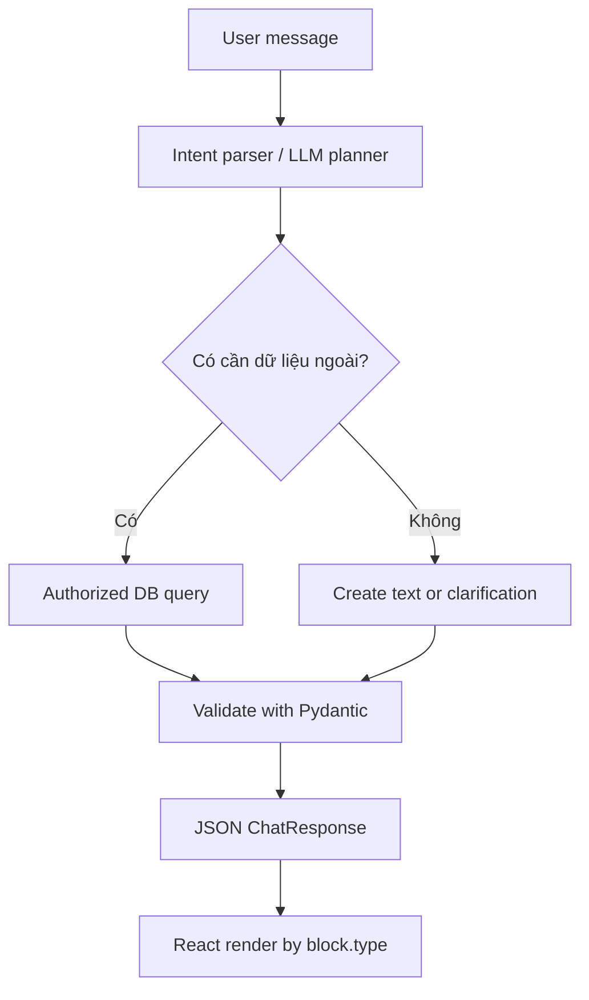

# Mini Project: Backend trả lời AI có cấu trúc để frontend render

> **Khóa học:** Pydantic Crash Course — tiếng Việt  
> **Học phần:** Module 08 — Thực hành tích hợp và tổng kết  
> **Loại nội dung:** Bài học / thực hành  
> **Mức độ:** Cơ bản → ứng dụng

## 1. Tóm tắt

Dùng Pydantic thiết kế hợp đồng giữa AI Planner, database và frontend chat có nhiều loại UI.

## 2. Mục tiêu học tập

Sau bài học này, bạn có thể:

- Thiết kế model cho chat text, thẻ món ăn và câu hỏi bổ sung.
- Tạo luồng validate JSON, tra cứu dữ liệu và dựng response.
- Xác định các tình huống lỗi và Definition of Done.

## 3. Bối cảnh và vấn đề

Mục tiêu là một backend có thể trả về những dạng dữ liệu khác nhau tùy yêu cầu, thay vì cố định bước “luôn tìm món ăn”. Project tách hợp đồng kết quả và quyết định từ LLM khỏi dữ liệu thực có trong database. Phiên bản đầu tiên dùng planner giả lập; người học có thể thay thế bằng LLM sau khi validation chạy ổn định.

## 4. Kiến thức cốt lõi

### 4.1. Kiến trúc gợi ý



DB query phải có kiểm tra quyền truy cập, không chạy SQL tùy ý chỉ vì LLM yêu cầu. Các block UI là **dữ liệu**, không phải HTML động chạy tùy ý.

### 4.2. Milestones

1. **Models:** `MessageInput`, `TextBlock`, `MealBlock`, `FollowUpBlock`, `ChatResponse`.
2. **Planner:** hàm thử nghiệm trả `intent` dựa vào test cases, không phụ thuộc hardcoded một loại output.
3. **Data layer:** dictionary `meals` giả lập database; tìm theo ID và kiểm tra giá trị.
4. **Renderer contract:** JSON response có `blocks`, mỗi block gắn type, và có lỗi validation rõ ràng.
5. **LLM integration (optional):** dùng `responses.parse` với schema planner, vẫn kiểm tra data layer.

Nội dung lab này không yêu cầu frontend thật; mã JSON có thể gửi cho React/Next.js sau khi có API.

## 5. Ví dụ và thực hành hướng dẫn

```python
from typing import Literal
from pydantic import BaseModel, Field

class MealRecord(BaseModel):
    id: str
    title: str
    kcal: int = Field(ge=0)

class TextBlock(BaseModel):
    type: Literal["text"] = "text"
    text: str

class MealBlock(BaseModel):
    type: Literal["meal"] = "meal"
    meal: MealRecord

class FollowUpBlock(BaseModel):
    type: Literal["follow_up"] = "follow_up"
    question: str

class ChatResponse(BaseModel):
    blocks: list[TextBlock | MealBlock | FollowUpBlock]

MEALS = {"1": {"id": "1", "title": "Cơm gà", "kcal": 630}}

def respond(kind: str) -> ChatResponse:
    if kind == "meal":
        meal = MealRecord.model_validate(MEALS["1"])
        return ChatResponse(blocks=[MealBlock(meal=meal)])
    if kind == "clarify":
        return ChatResponse(blocks=[FollowUpBlock(question="Bạn muốn tăng cơ hay giảm mỡ?")])
    return ChatResponse(blocks=[TextBlock(text="Mình có thể giúp giải thích hoặc gợi ý món ăn.")])

for kind in ("meal", "clarify", "text"):
    print(respond(kind).model_dump_json())
```

Mẫu thể hiện ba nhánh kết quả ở tầng response. Khi tích hợp thật, planner quyết định kind theo ý định và backend quyết định truy cập DB/tool có phù hợp hay không.

## 6. Điểm dễ sai và cách khắc phục

- Nếu dữ liệu DB không có meal ID, phải trả message/fallback có cấu trúc, không bịa ra meal.
- Không lưu plaintext API key vào message history hoặc JSON response.
- Không gửi output của planner thẳng vào client nếu chứa tham số tool, quyền, hoặc dữ liệu nội bộ.
- Project minh họa schema và pipeline, không phải AI Agent hoàn chỉnh hay dịch vụ production.

## 7. Bài tập tự luyện

**Yêu cầu đầu ra:** Repo mini có file `models.py`, `service.py`, `tests/test_service.py` (có thể gộp một file khi học). Viết ít nhất 6 test: text thường, hỏi tiếp, tìm meal thành công, ID không tồn tại, kcal âm, field lạ. **Definition of Done:** mọi nhánh trả JSON parse lại được thành `ChatResponse`, có error path rõ, không có secret hoặc SQL tùy ý.

## 8. Câu hỏi ôn tập trắc nghiệm

**Câu 1. Khi planner đề nghị meal ID không tồn tại, backend nên làm gì?**

A. Trả fallback hoặc lỗi có cấu trúc, không tự bịa record  
B. Tạo món ngẫu nhiên và ghi DB  
C. Bỏ kiểm tra schema  
D. Luôn trả status success  

**Đáp án:** A.  
**Giải thích:** Kết quả phải bám dữ liệu nguồn tin cậy.

**Câu 2. Frontend dựa vào đâu để chọn UI component?**

A. Cách viết hoa tên người dùng  
B. `block.type` trong hợp đồng response  
C. API key  
D. Chỉ màu nền  

**Đáp án:** B.  
**Giải thích:** Type tag là khóa phân biệt các block UI.

**Câu 3. Có cần kiểm tra quyền trước khi chạy DB/tool không?**

A. Không nếu Pydantic hợp lệ  
B. Không nếu prompt đủ dài  
C. Có, tại backend  
D. Chỉ cần khi frontend lỗi  

**Đáp án:** C.  
**Giải thích:** Model validation không kiểm tra authorization thay cho service.


## 9. Tổng kết

Project kết hợp Pydantic và cấu trúc phản hồi AI để hình thành nền tảng backend chat linh hoạt, có thể mở rộng sang database và frontend.
