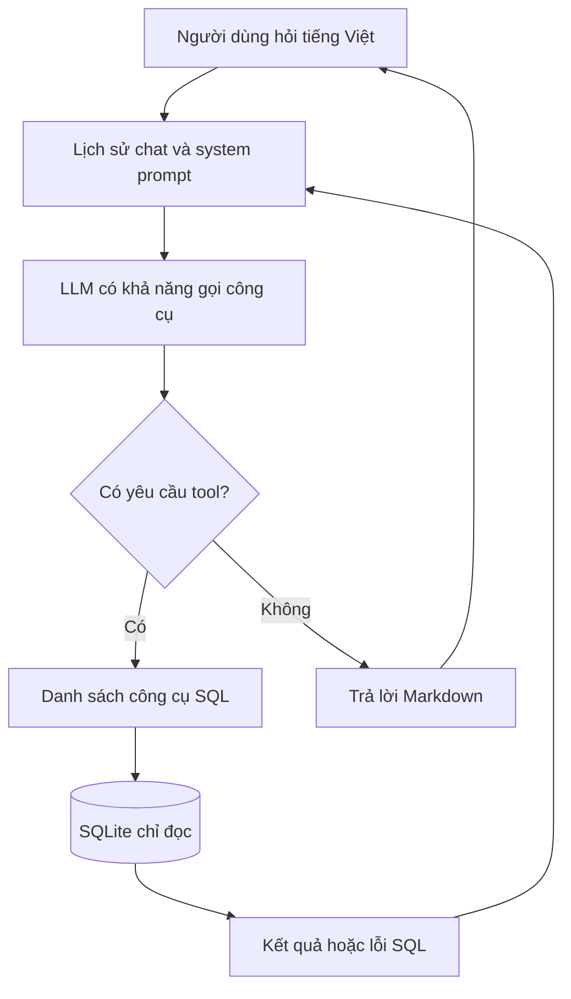

# Bài 01 — AI Agent giao tiếp với cơ sở dữ liệu SQL

> **Loại:** Lý thuyết · **Mục tiêu cuối bài:** Giải thích được cách một AI Agent chuyển câu hỏi tiếng Việt thành thao tác truy vấn SQL, phân biệt với chatbot thông thường và workflow cố định.

## 1. Tóm tắt

Một AI Agent dành cho cơ sở dữ liệu có thể nhận câu hỏi như “Khách hàng nào đặt nhiều đơn nhất?” và tự quyết định cần xem bảng nào, nhận diện khóa liên kết, viết SQL, gọi công cụ chạy SQL, sau đó diễn giải kết quả bằng ngôn ngữ tự nhiên. Mô hình ngôn ngữ không trực tiếp sở hữu dữ liệu; nó phải sử dụng công cụ được ứng dụng cấp quyền.

## 2. Mục tiêu học tập

- Giải thích được vai trò của **LLM**, **tools**, **chat history**, **database** và **agent loop**.
- Phân biệt cách làm việc của quy trình cố định và Agent tự lựa chọn bước tiếp theo.
- Phác thảo được luồng từ câu hỏi người dùng đến câu trả lời có căn cứ.
- Nhận diện được lý do cần giới hạn số vòng lặp và quyền truy cập SQL.

## 3. Vấn đề cần giải quyết

Trong ứng dụng thương mại điện tử, nhà phân tích thường phải nhớ tên bảng, cột, khóa ngoại và viết nhiều câu SQL. Người không biết SQL gặp khó khăn ngay cả với câu hỏi đơn giản. Giao diện hội thoại cho phép họ hỏi bằng tiếng Việt nhưng không được đánh đồng việc **LLM viết câu SQL nghe có vẻ hợp lý** với việc **SQL đã chạy và trả về dữ liệu đúng**.

Ví dụ, câu hỏi “Ai là khách hàng có nhiều đơn nhất?” có thể phải kết hợp bảng `customers` và `orders`. Một câu trả lời không đi qua công cụ truy vấn chỉ là phỏng đoán.

## 4. Kiến trúc cơ bản

**Diễn giải:** LLM được gọi cùng với lịch sử cuộc trò chuyện và mô tả công cụ. Khi cần dữ liệu, LLM trả một yêu cầu gọi tool (tên + đối số); chính **mã Python** mới thực thi công cụ đó. Kết quả được thêm vào lịch sử để LLM quyết định có cần thêm thao tác hay đã đủ dữ liệu trả lời.

### 4.1. Agent khác workflow như thế nào?

| Đặc điểm | Workflow quy định sẵn | AI Agent dùng tool |
| --- | --- | --- |
| Thứ tự thao tác | Đã định nghĩa trước | Có thể thay đổi theo câu hỏi |
| Ví dụ | Luôn `list → describe → SELECT` | Có thể bỏ bước đã biết schema |
| Kiểm soát | Dễ dự đoán, dễ kiểm thử | Linh hoạt hơn nhưng khó kiểm soát hơn |
| Rủi ro | Ít nhánh bất ngờ | Có thể gọi tool sai hoặc lặp |

Agent không mặc nhiên tốt hơn workflow. Với các nghiệp vụ ít biến thể, luồng cố định có thể an toàn, rẻ và ổn định hơn.

### 4.2. Vòng lặp hành động và phản hồi

Có thể hình dung tư duy thiết kế theo chuỗi **quan sát nhu cầu → chọn tool → nhận kết quả → quyết định tiếp**. Đây là cơ chế điều phối, không phải yêu cầu ứng dụng công khai suy luận nội bộ của mô hình.

## 5. Bộ công nghệ

- **Python** điều phối logic ứng dụng và truy cập SQLite.
- **SQLite** chứa dữ liệu quan hệ dạng file `.db`.
- **LangChain** biểu diễn chat model, message và tool-calling.
- **Ollama** chạy mô hình ngôn ngữ cục bộ; một cấu hình mẫu là `qwen2.5:7b` có hỗ trợ gọi công cụ.
- **Groq** là lựa chọn model qua API nếu không chạy cục bộ; dữ liệu gửi tới nhà cung cấp phải tuân theo chính sách bảo mật.
- **Streamlit** cung cấp giao diện chat và thanh bên thông tin cơ sở dữ liệu.
- **Rich** có thể hiển thị log tiến trình trong terminal để kiểm tra tác vụ.

## 6. Ví dụ một lượt hỏi đáp

Câu hỏi: “Cho biết tên khách hàng mua nhiều đơn nhất.”

1. `list_database_tables` xác định có bảng `customers`, `orders`.
2. `describe_database_table` phát hiện `orders.customer_id` liên kết tới `customers.id`.
3. `execute_sql_query` chạy một câu `JOIN` kèm `GROUP BY`, `ORDER BY`, `LIMIT`.
4. Agent đọc kết quả và trả lời tên cùng số lượng đơn hàng.

Một câu hỏi tiếp nối “Liệt kê các đơn của khách hàng đó” đòi hỏi Agent sử dụng được lịch sử chat để xác định đại từ “đó”, nhưng vẫn nên kiểm tra trên dữ liệu thực tế.

## 7. Điểm dễ sai và thực hành

**Điểm dễ sai:** Ngộ nhận rằng LLM có thể tự đọc file `.db`; bỏ kiểm tra đầu ra tool; mở quyền `INSERT/UPDATE/DELETE`; cho Agent chạy vô hạn; coi model temperature bằng `0` là bảo đảm kết quả hoàn toàn lặp lại. Temperature thấp có thể giảm biến động, không bảo đảm truy vấn luôn đúng.

**Thực hành ngắn:** Vẽ lại sơ đồ và ghi mỗi thành phần một trách nhiệm. Tự mô tả đường đi của câu hỏi “Những sản phẩm nào đã hết hàng?”; nêu các bước Agent có thể bỏ qua khi đã biết schema.

## 8. Tổng kết

Một SQL Agent là hệ thống gồm mô hình, công cụ, trạng thái hội thoại và tầng dữ liệu. Giá trị của nó đến từ khả năng **tạo truy vấn dựa trên cấu trúc dữ liệu có thật**; độ tin cậy phụ thuộc vào thiết kế công cụ, kiểm thử và quản lý quyền.

## 9. Câu hỏi ôn tập

### Câu 1

Điều kiện nào biến câu trả lời về doanh số thành kết quả có căn cứ?

A. LLM trả lời tự tin  

B. Model có temperature thấp  

C. SQL thực thi trên dữ liệu rồi trả kết quả  

D. Giao diện có biểu tượng chat  

**Đáp án:** C

**Giải thích:** Dữ liệu phải được lấy bằng công cụ từ database thật.

### Câu 2

Điểm nổi bật của Agent so với workflow cố định?

A. Chọn công cụ và thứ tự theo ngữ cảnh  

B. Luôn chạy ít công cụ hơn  

C. Luôn đúng hơn  

D. Không cần giới hạn quyền  

**Đáp án:** A

**Giải thích:** Agent linh hoạt quyết định thao tác cần thiết.

### Câu 3

Bộ phận nào thực thi SQL thực sự?

A. Lịch sử chat  

B. Mã ứng dụng/tool Python  

C. Avatar chat  

D. Temperature của model  

**Đáp án:** B

**Giải thích:** LLM chỉ yêu cầu gọi tool; Python chạy truy vấn.

### Câu 4

Vì sao đặt giới hạn số vòng Agent?

A. Giúp tăng số dòng dữ liệu  

B. Chặn Agent đọc schema  

C. Bắt buộc dùng Groq  

D. Tránh vòng lặp vô hạn và tốn tài nguyên  

**Đáp án:** D

**Giải thích:** Max steps là giới hạn vòng lặp để tránh bị kẹt.

### Câu 5

Câu hỏi “các đơn của khách hàng đó” cần gì?

A. Xóa lịch sử  

B. Tăng số bảng  

C. Ngữ cảnh hội thoại trước  

D. Bỏ liên kết khách hàng  

**Đáp án:** C

**Giải thích:** Đại từ đó phải được hiểu dựa trên lịch sử chat.
