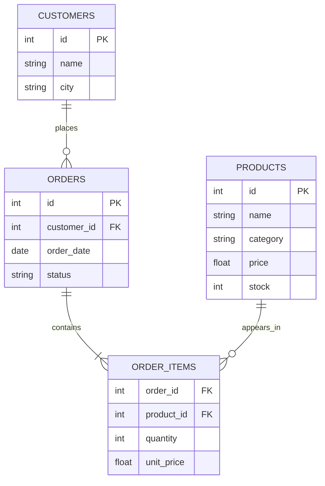

# Bài 02 — Thiết kế SQLite và mô hình dữ liệu thương mại điện tử

> **Loại:** Lý thuyết kết hợp thực hành · **Mục tiêu:** Tạo được database gồm `products`, `customers`, `orders`, `order_items` và truy vấn đúng quan hệ giữa chúng.

## 1. Tóm tắt

SQL Agent chỉ tạo truy vấn chính xác khi biết cấu trúc dữ liệu. Một database thương mại điện tử đơn giản vẫn có nhiều mối quan hệ: khách hàng đặt nhiều đơn, và mỗi đơn có thể chứa nhiều sản phẩm; sản phẩm cũng có thể xuất hiện trong nhiều đơn. Vì vậy cần bảng trung gian `order_items`.

## 2. Mục tiêu học tập

- Thiết kế và mô tả bốn bảng dữ liệu với khóa chính/khóa ngoại.
- Giải thích được quan hệ một–nhiều và nhiều–nhiều.
- Sử dụng `JOIN`, `GROUP BY` và `COUNT` để trả lời câu hỏi kinh doanh.
- Phân biệt dữ liệu được sinh để học với dữ liệu vận hành thực tế.

## 3. Các bảng cốt lõi

| Bảng | Trường tiêu biểu | Ý nghĩa |
| --- | --- | --- |
| `products` | `id`, `name`, `category`, `price`, `stock` | Danh mục sản phẩm, giá và tồn kho |
| `customers` | `id`, `name`, `city` | Khách hàng |
| `orders` | `id`, `customer_id`, `order_date`, `status` | Một giao dịch đặt hàng |
| `order_items` | `order_id`, `product_id`, `quantity`, `unit_price` | Sản phẩm và số lượng theo đơn |



Mỗi đơn thuộc về một khách hàng (`orders.customer_id`); một đơn có thể chứa nhiều dòng `order_items`. Dòng trung gian là nơi ghi giá tại thời điểm mua (`unit_price`), tránh sai lệch nếu giá hiện tại của sản phẩm thay đổi. Bài học dùng dữ liệu giả định, không tái tạo database thực của bất kỳ doanh nghiệp nào.

## 4. Tạo dữ liệu thực hành

Trong thư mục `ma-nguon/`, chạy:

```bash
python seed_data.py
```

Chương trình tạo file `ecommerce.db` và thêm dữ liệu minh họa. Một số mặt hàng như `Mỳ udon`, `Mỳ ramen` và `Trà xanh` cho phép kiểm tra tìm kiếm sản phẩm; có các đơn ở trạng thái `completed`, `pending`, `cancelled` để luyện câu hỏi có điều kiện.

Cách tạo bảng minh họa:

```sql
CREATE TABLE orders (
    id INTEGER PRIMARY KEY,
    customer_id INTEGER NOT NULL,
    order_date TEXT NOT NULL,
    status TEXT NOT NULL,
    FOREIGN KEY (customer_id) REFERENCES customers(id)
);
```

Đây là một phần của thiết kế. Script `seed_data.py` đã chứa đầy đủ cấu trúc và dữ liệu mẫu.

## 5. Truy vấn từ câu hỏi tự nhiên

### 5.1. Sản phẩm đang hết hàng

```sql
SELECT id, name, category, stock
FROM products
WHERE stock = 0;
```

### 5.2. Khách hàng có nhiều đơn hàng nhất

```sql
SELECT c.id, c.name, COUNT(o.id) AS so_don
FROM customers AS c
LEFT JOIN orders AS o ON o.customer_id = c.id
GROUP BY c.id, c.name
ORDER BY so_don DESC, c.id
LIMIT 1;
```

**Vì sao phải dùng `LEFT JOIN`?** Nó vẫn giữ khách hàng chưa có đơn trong danh sách gốc; truy vấn lấy người mua nhiều nhất vẫn hoạt động. `COUNT(o.id)` không đếm hàng `NULL` của đơn chưa tồn tại.

### 5.3. Tổng số tiền của những đơn hoàn tất

```sql
SELECT o.id, c.name,
       SUM(oi.quantity * oi.unit_price) AS tong_tien
FROM orders o
JOIN customers c ON c.id = o.customer_id
JOIN order_items oi ON oi.order_id = o.id
WHERE o.status = 'completed'
GROUP BY o.id, c.name
ORDER BY tong_tien DESC;
```

Điều kiện trạng thái được đặt trên `orders` để không tính nhầm đơn hủy. Nếu ứng dụng thật có giảm giá, hoàn tiền, phí vận chuyển, cần cập nhật công thức doanh thu theo nghiệp vụ.

## 6. Kiểm tra và lỗi thường gặp

- **Nhầm quan hệ:** Nối `orders.id = customers.id` thay cho `orders.customer_id = customers.id` sẽ cho kết quả sai.
- **Đếm trùng:** Nối thêm `order_items` rồi `COUNT(orders.id)` có thể đếm cùng một đơn nhiều lần; dùng `COUNT(DISTINCT orders.id)` khi phù hợp.
- **Sai doanh thu:** Dùng `products.price` thay vì `order_items.unit_price` có thể tính theo giá hiện tại.
- **Không kiểm tra trạng thái:** “Tổng doanh thu” cần định nghĩa có tính đơn hủy hay chưa thanh toán hay không.

**Thực hành:** Tìm các mặt hàng có chuỗi `Mỳ` trong tên bằng `WHERE name LIKE '%Mỳ%'`. Sau đó đếm số sản phẩm theo `category`. Đối chiếu kết quả trong SQLite trước khi nhờ Agent chạy.

## 7. Tổng kết

Schema là hợp đồng dữ liệu giữa công cụ SQL và mô hình. Các khóa ngoại và kiểu dữ liệu giúp Agent sinh truy vấn đúng; dữ liệu mẫu giúp kiểm tra kết quả thay vì tin vào câu trả lời trôi chảy.

## 8. Câu hỏi ôn tập

### Câu 1

Quan hệ nhiều–nhiều giữa đơn hàng và sản phẩm được thể hiện qua đâu?

A. customers  

B. order_items  

C. products.stock  

D. orders.status  

**Đáp án:** B

**Giải thích:** order_items chứa từng cặp order_id và product_id.

### Câu 2

Đếm số đơn sau khi JOIN thêm order_items dễ sai vì lý do gì?

A. Cột ngày rỗng  

B. SQLite không có JOIN  

C. Mỗi đơn có thể có nhiều dòng sản phẩm  

D. Khách hàng có tên trùng  

**Đáp án:** C

**Giải thích:** JOIN nhân một đơn thành nhiều dòng khi có nhiều item.

### Câu 3

Giá lịch sử của sản phẩm trong đơn nên lấy từ đâu?

A. order_items.unit_price  

B. products.stock  

C. customers.city  

D. orders.id  

**Đáp án:** A

**Giải thích:** unit_price lưu giá tại thời điểm giao dịch.

### Câu 4

Để tìm sản phẩm đã hết hàng dùng điều kiện nào?

A. price < 0  

B. stock > 0  

C. category IS NULL  

D. stock = 0  

**Đáp án:** D

**Giải thích:** Hàng tồn kho bằng 0 nghĩa là hiện hết hàng trong dữ liệu mẫu.

### Câu 5

Muốn nối orders tới customers, điều kiện đúng là?

A. orders.id = customers.id  

B. orders.customer_id = customers.id  

C. orders.id = products.id  

D. customers.city = orders.status  

**Đáp án:** B

**Giải thích:** customer_id là khóa ngoại tham chiếu customer.id.
