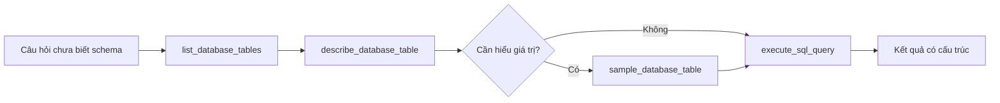

# Bài 04 — Xây dựng bộ công cụ SQL an toàn cho Agent

> **Loại:** Lý thuyết kết hợp lab · **Mục tiêu:** Thiết kế bốn tool LangChain để đọc schema, xem mẫu và thực thi truy vấn trong chế độ chỉ đọc.

## 1. Tóm tắt

LLM không nên nhận trực tiếp một kết nối cơ sở dữ liệu không giới hạn. Ứng dụng sẽ cung cấp một tập công cụ có hợp đồng đầu vào rõ ràng: liệt kê bảng, mô tả bảng, lấy dữ liệu mẫu và chạy truy vấn SELECT. Mọi thao tác thực thi đều do Python xử lý.

## 2. Mục tiêu học tập

- Giải thích và sử dụng được `@tool`, `tool.invoke` và `ToolMessage`.
- Phân biệt metadata của schema với dữ liệu nội dung.
- Tạo cơ chế truy cập SQLite ở chế độ `mode=ro` và `query_only`.
- Xác minh được câu lệnh ghi dữ liệu bị từ chối.

## 3. Bốn công cụ cần thiết

| Tool | Đầu vào | Kết quả |
| --- | --- | --- |
| `list_database_tables` | `purpose` | Tên các bảng của database |
| `describe_database_table` | `table`, `purpose` | Tên cột, kiểu dữ liệu, khóa ngoại |
| `sample_database_table` | `table`, `n_rows`, `purpose` | Tối đa 10 dòng đại diện |
| `execute_sql_query` | `sql`, `purpose` | Kết quả SELECT, giới hạn 50 dòng |

`purpose` là mô tả hành động ngắn gọn để người vận hành kiểm tra log, **không phải bản ghi suy luận nội bộ của mô hình**.

## 4. Luồng khám phá schema



**Diễn giải:** Khi biết bảng và cột, Agent có thể đi thẳng đến `execute_sql_query`. Khi không biết quy ước trạng thái, vài dòng mẫu giúp nhận ra các giá trị như `completed` hoặc `cancelled`. Mô hình chỉ xem dữ liệu thực sự cần thiết thay vì tự động lấy toàn bộ bảng.

## 5. Định nghĩa tool với LangChain

```python
from langchain_core.tools import tool

@tool
def list_database_tables(purpose: str) -> str:
    """Liệt kê các bảng hiện có trong database; purpose là mục đích thao tác."""
    return '["customers", "orders", "order_items", "products"]'
```

Đây là ví dụ tối giản minh họa `@tool`; ứng dụng hoàn chỉnh không dùng danh sách giả lập mà lấy bảng từ SQLite. File `tools_sql.py` đóng gói logic và trả danh sách tool qua `make_sql_tools(db_path)`.

Điều quan trọng là mô tả tool ngắn, chính xác và biểu diễn đối số ở dạng có kiểu dữ liệu rõ ràng. Tránh công cụ tên mơ hồ kiểu `run_anything`.

## 6. Cấp quyền SQLite chỉ đọc

Trong `db_access.py`, SQLite được mở với URI `?mode=ro`:

```python
from pathlib import Path
import sqlite3

path = Path("ecommerce.db").resolve()
con = sqlite3.connect(path.as_uri() + "?mode=ro", uri=True)
con.execute("PRAGMA query_only = ON")
```

Đồng thời, tool chỉ nhận câu bắt đầu bằng `SELECT` hoặc `WITH` và sử dụng `cursor.execute` cho một statement. Đây là kiểm tra đầu vào; **quyền SQLite chỉ đọc** mới là một lớp bảo vệ thực sự trước câu SQL tạo ra thao tác ghi. Mẫu còn giới hạn số hàng phản hồi và dùng SQLite progress handler để dừng truy vấn quá nặng. Các biện pháp này làm giảm rủi ro nhưng **không biến ứng dụng thành sandbox bảo mật tuyệt đối**.

### 6.1. Vì sao phải validate tên bảng?

Tên bảng không thể được truyền như giá trị `?` trong `FROM ?`; vì vậy công cụ phải kiểm tra tên bằng một quy tắc identifier và đối chiếu với `sqlite_master` trước khi nội suy vào SQL. Không nội suy tên bảng tùy ý do LLM trả về.

### 6.2. Vì sao chỉ lấy một phần kết quả?

Dữ liệu lớn có thể tràn context window hoặc làm lộ nhiều thông tin không cần thiết. `fetchmany(MAX_ROWS + 1)` cho phép hiển thị tối đa `MAX_ROWS` và đánh dấu `truncated=true` khi bị cắt. Agent nên diễn giải rõ khi kết quả chỉ là một phần.

## 7. Kiểm thử công cụ độc lập

Chạy trong thư mục `ma-nguon`:

```python
from db_access import list_tables, execute_select

print(list_tables("ecommerce.db"))
print(execute_select("ecommerce.db", "SELECT name FROM products LIMIT 3"))
```

Thử `execute_select("ecommerce.db", "DELETE FROM products")` phải báo lỗi. Thử tên bảng không tồn tại trong `describe_table()` phải báo lỗi, không chạy câu SQL lạ.

## 8. Debug và tổng kết

Nếu tool trả về dữ liệu bất thường, trước hết chạy SQL thủ công với cùng database. Kiểm tra lỗi khóa ngoại, tên cột, cú pháp SQLite và trạng thái đơn hàng; đừng chỉ điều chỉnh prompt để che lỗi dữ liệu. Công cụ là **ranh giới giữa quyết định của AI và hành động trên hệ thống**, cần thiết kế quyền từ đầu.

## 9. Câu hỏi ôn tập

### Câu 1

Công cụ nào mô tả cột và khóa ngoại?

A. execute_sql_query  

B. sample_database_table  

C. describe_database_table  

D. list_database_tables  

**Đáp án:** C

**Giải thích:** describe đọc metadata schema của bảng.

### Câu 2

Cách bảo vệ ghi dữ liệu vững hơn chỉ dùng regex?

A. Thêm emoji  

B. Mở SQLite mode=ro và query_only  

C. Chạy mọi SQL  

D. Ẩn nút submit  

**Đáp án:** B

**Giải thích:** Quyền chỉ đọc ở kết nối DB giúp chặn thao tác ghi.

### Câu 3

Vì sao cần validate tên bảng trước khi nội suy vào truy vấn?

A. Tên bảng không thể bind như value và có nguy cơ injection  

B. Để câu hỏi dài hơn  

C. Vì SQLite không hỗ trợ string  

D. Do Markdown cần escape  

**Đáp án:** A

**Giải thích:** Tên identifier phải kiểm tra cú pháp và sự tồn tại.

### Câu 4

Đánh dấu truncated=true có ý nghĩa gì?

A. Dữ liệu đã bị xóa  

B. Schema sai  

C. Model bị lỗi  

D. Kết quả chỉ hiển thị một phần  

**Đáp án:** D

**Giải thích:** Giới hạn hàng nhằm giảm tải và cần thông báo rõ.

### Câu 5

Mục đích của trường purpose trong ví dụ là?

A. Lưu mật khẩu  

B. Cho phép sửa dữ liệu  

C. Mô tả ngắn hành động cho log  

D. Yêu cầu lộ suy luận nội bộ  

**Đáp án:** C

**Giải thích:** Purpose là nhãn hành động kiểm tra được, không phải chain-of-thought.
