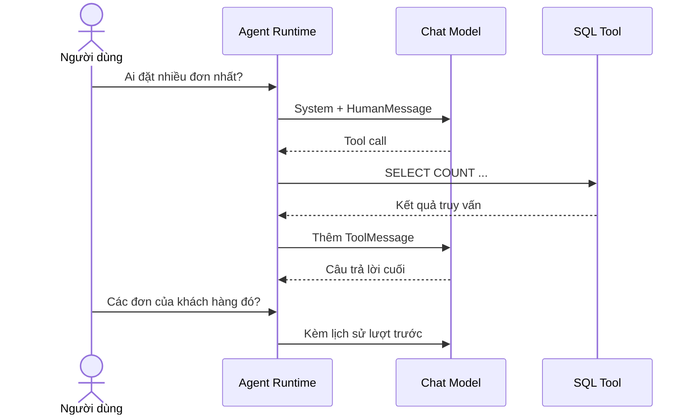

# Bài 05 — Thiết kế System Prompt và lịch sử hội thoại

> **Loại:** Lý thuyết ứng dụng · **Mục tiêu:** Viết được hướng dẫn cho SQL Agent, duy trì ngữ cảnh và xử lý câu hỏi tiếp nối.

## 1. Tóm tắt

Agent phải biết nhiệm vụ, giới hạn công cụ, cách xác minh kết quả, đối tượng đọc câu trả lời và định dạng đầu ra. Những quy tắc này được đưa vào **system prompt**. Lịch sử hội thoại giữ các lượt trước để câu hỏi “khách hàng đó” có thể liên kết tới khách hàng được nhắc đến gần nhất.

## 2. Mục tiêu học tập

- Viết prompt yêu cầu Agent truy vấn dữ liệu trước khi kết luận.
- Phân biệt `SystemMessage`, `HumanMessage`, `AIMessage`, `ToolMessage`.
- Giải thích cơ chế duy trì ngữ cảnh câu hỏi tiếp nối.
- Chỉ ra giới hạn của lịch sử lưu trong `st.session_state`.

## 3. Các quy tắc cần có trong System Prompt

Một prompt có thể chứa các nhóm chỉ dẫn sau:

| Nhóm | Quy tắc mẫu |
| --- | --- |
| Vai trò | Trợ lý phân tích dữ liệu thương mại điện tử |
| Căn cứ | Chỉ kết luận từ dữ liệu được tool trả về |
| Quy trình | Khi chưa biết schema, đọc metadata trước khi viết SQL |
| Bảo mật | Không thực thi thao tác ghi hoặc tiết lộ dư thừa dữ liệu nhạy cảm |
| Thời gian | Cung cấp ngày hiện tại để tính số ngày kể từ sự kiện |
| Đầu ra | Trả lời tiếng Việt, Markdown, dùng bảng khi dữ liệu có cấu trúc |
| Ngoại lệ | Nếu thiếu dữ liệu hoặc truy vấn lỗi, nói rõ và thử sửa hợp lý |

Một ví dụ ngắn:

```python
from datetime import date
from langchain_core.messages import SystemMessage

prompt = f"""Bạn là trợ lý phân tích dữ liệu.
Hôm nay là {date.today().isoformat()}.
Không suy đoán kết quả. Dùng tool SQL để lấy dữ liệu thật.
Chỉ SELECT; hỏi lại khi câu hỏi thiếu ngữ cảnh.
Trả lời bằng Markdown dễ hiểu cho người không biết SQL."""
messages = [SystemMessage(content=prompt)]
```

Câu lệnh `date.today()` lấy ngày của máy chủ. Trong ứng dụng nhiều múi giờ, cần quy định rõ múi giờ của người dùng và của dữ liệu.

## 4. Lịch sử chat hoạt động thế nào?



**Diễn giải:** Trong lịch sử, `AIMessage` chứa lời gọi tool phải đi kèm `ToolMessage` có đúng `tool_call_id`. Lịch sử này giúp LLM hiểu câu hỏi tiếp nối, nhưng không thay thế việc kiểm tra database: dữ liệu có thể thay đổi.

## 5. Lưu trạng thái trong Streamlit

`st.session_state` lưu trạng thái theo phiên tương tác của ứng dụng. Ta có thể dùng hai vùng riêng:

```python
if "chat_history" not in st.session_state:
    st.session_state.chat_history = []  # tin hiển thị
if "model_history" not in st.session_state:
    st.session_state.model_history = new_history()  # tin cho LLM
```

`chat_history` thường chỉ giữ cặp người dùng/trợ lý để hiển thị. `model_history` còn có thông điệp hệ thống và phản hồi tool, nên không cần công khai nội dung kỹ thuật trên giao diện mặc định.

**Giới hạn quan trọng:** Đây không phải cơ sở dữ liệu lưu bền. Khi phiên kết thúc, lịch sử có thể mất; để duy trì đa phiên cần một kho dữ liệu riêng, chính sách giữ/xóa dữ liệu, kiểm soát định danh người dùng và đồng bộ phù hợp.

## 6. Context window và chi phí

Một cuộc hội thoại dài mang theo nhiều thông điệp và kết quả tool có thể vượt giới hạn context của model, làm tăng latency và bộ nhớ. Trong ví dụ thực hành, số bước Agent và số hàng tool trả về được giới hạn. Khi triển khai lớn hơn có thể tóm tắt hội thoại cũ, giữ các quyết định quan trọng hoặc quản lý lịch sử theo phiên.

Không cần đưa toàn bộ 1000 hàng dữ liệu mẫu vào prompt nếu câu hỏi chỉ cần `COUNT(*)`. Hãy để SQL tổng hợp dữ liệu trước khi gửi kết quả vào LLM.

## 7. Lỗi thường gặp và thực hành

- **Không nối lịch sử:** Agent không hiểu “người đó” thuộc câu trước.
- **Nhân đôi tin nhắn:** Cùng một câu hỏi bị thêm hai lần vào history.
- **Bỏ `ToolMessage`:** Protocol tool-calling không hoàn chỉnh, model có thể báo lỗi.
- **Đẩy dữ liệu nhạy cảm lên API:** Không phải nhà cung cấp model nào cũng phù hợp dữ liệu nội bộ.
- **Prompt dài nhưng thiếu quy tắc:** Các hướng dẫn quan trọng bị lẫn vào filler, khó bảo trì.

**Thực hành:** Viết prompt hướng tới người dùng không rành SQL. Thêm quy tắc: Khi hỏi “doanh thu”, phải làm rõ có loại đơn hủy hay không nếu hệ thống chưa có định nghĩa. Thử cặp câu “Ai nhiều đơn nhất?” và “Liệt kê các đơn của người đó”.

## 8. Tổng kết

System prompt định hình cách Agent hành xử; lịch sử chat cung cấp ngữ cảnh. Cả hai phải được phối hợp với cơ chế thực thi tool và bảo mật tầng database, không thể chỉ dựa vào câu chữ trong prompt.

## 9. Câu hỏi ôn tập

### Câu 1

Loại message nào chứa nội dung kết quả sau khi tool chạy?

A. HumanMessage  

B. SystemMessage  

C. ToolMessage  

D. AIMessage  

**Đáp án:** C

**Giải thích:** ToolMessage mang kết quả gắn với tool_call_id.

### Câu 2

Vì sao cung cấp ngày hiện tại cho Agent?

A. Để đo RAM  

B. Để định dạng CSS  

C. Để bỏ SQL  

D. Để tính các câu hỏi ngày tháng tương đối  

**Đáp án:** D

**Giải thích:** Agent cần mốc ngày nếu hỏi khoảng cách thời gian.

### Câu 3

Lịch sử Streamlit trong lab có điểm hạn chế gì?

A. Không lưu bền qua mọi phiên  

B. Luôn được ghi vào Postgres  

C. Không thể chứa tin nhắn user  

D. Chỉ dùng trên Linux  

**Đáp án:** A

**Giải thích:** Session State gắn với phiên tương tác, không phải cơ sở dữ liệu lưu bền.

### Câu 4

Muốn giải quyết “các đơn của người đó”, model cần gì?

A. GPU riêng  

B. Ngữ cảnh lượt trước  

C. Tăng temperature  

D. Thay SQLite  

**Đáp án:** B

**Giải thích:** Ngữ cảnh giúp xác định tham chiếu người đó.

### Câu 5

Tại sao không gửi toàn bộ hàng dữ liệu vào prompt?

A. SQL sẽ bị xóa  

B. Không thể dùng Markdown  

C. Tốn context và có thể lộ dữ liệu  

D. Tool sẽ mất tên  

**Đáp án:** C

**Giải thích:** Nên tổng hợp tại DB rồi chỉ gửi phần cần thiết.
