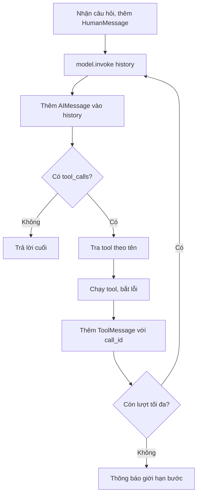

# Bài 06 — Tự xây dựng vòng lặp Agent với LangChain

> **Loại:** Lab kiến trúc · **Mục tiêu:** Đọc, sửa và kiểm thử vòng lặp `model → tool → model`, có giới hạn số bước và xử lý lỗi.

## 1. Tổng quan

LangChain cung cấp các kiểu `BaseMessage`, `HumanMessage`, `ToolMessage`, decorator `@tool` và phương thức `bind_tools`. Ta có thể dùng các thành phần này để viết vòng lặp Agent thủ công, không bắt buộc sử dụng framework đồ thị. Viết thủ công hữu ích cho việc học giao thức tool-calling và phát hiện lỗi.

## 2. Mục tiêu học tập

- Liên kết model với danh sách công cụ bằng `bind_tools`.
- Đọc `AIMessage.tool_calls` và dispatch theo tên công cụ.
- Trả kết quả tool về model bằng `ToolMessage(tool_call_id=...)`.
- Thêm điều kiện dừng và phản hồi hữu ích khi hết số bước.

## 3. Thuật toán chính



**Diễn giải:** Tool call là một **đề xuất hành động có cấu trúc** từ LLM. Agent tìm đúng hàm Python để chạy và ghi phản hồi tương ứng. Nếu model trả nhiều tool call trong một lượt, phải phản hồi mỗi call theo ID trước khi gọi model tiếp.

## 4. Code cốt lõi

```python
from langchain_core.messages import HumanMessage, ToolMessage


def run_turn(question, history, model, tools, max_steps=8):
    by_name = {item.name: item for item in tools}
    history.append(HumanMessage(content=question))
    for _ in range(max_steps):
        message = model.invoke(history)
        history.append(message)
        if not message.tool_calls:
            return message.content
        for call in message.tool_calls:
            item = by_name.get(call["name"])
            if item is None:
                result = "ERROR: unknown tool"
            else:
                try:
                    result = item.invoke(call["args"])
                except Exception as exc:
                    result = f"ERROR: {type(exc).__name__}: {exc}"
            history.append(ToolMessage(
                content=str(result), tool_call_id=call["id"]
            ))
    return "Không thể hoàn thành trong số bước cho phép."
```

File `agent.py` trong gói mã nguồn triển khai trực tiếp mô hình này. Mô hình đã bind tool sẽ nhận danh sách định nghĩa trong lệnh gọi `.invoke`. Không cần cho LLM quyền chạy tùy ý mã Python.

## 5. Kết nối và giới hạn vòng lặp

```python
from model_factory import create_model
from tools_sql import make_sql_tools
from agent import ask_agent, new_history

tools = make_sql_tools("ecommerce.db")
model = create_model().bind_tools(tools)
history = new_history()
answer = ask_agent("Ai có nhiều đơn nhất?", history, model, tools, max_steps=8)
print(answer)
```

Nếu mỗi bước Agent quyết định gọi lại đúng công cụ mà không tiến gần kết quả, giới hạn sẽ dừng phiên thay vì để ứng dụng vô hạn. Trong hệ thống thực tế cần thêm timeout cho model, giám sát latency, ngân sách token và log request theo quyền truy cập.

## 6. Xử lý lỗi có chủ đích

Lỗi truy vấn không nên làm crash toàn bộ trang. Agent có thể nhận:

```text
TOOL_ERROR: OperationalError: no such column: order_total
```

Thông báo này cho biết truy vấn tham chiếu một cột chưa có. Agent có thể gọi `describe_database_table("orders", ...)` để xem lại schema rồi chạy truy vấn khác, nhưng phải dừng sau số bước tối đa. Nếu query không hợp lệ hoặc thiếu quyền, Agent nên thông báo không thể thực hiện, không tự mở quyền thêm.

**Về log:** Hãy log tên công cụ, thời gian chạy, lỗi và một mô tả mục đích ngắn; không cần yêu cầu hay công bố chuỗi suy luận riêng tư của mô hình.

## 7. Kiểm thử các tình huống

| Tình huống | Kết quả mong đợi |
| --- | --- |
| Hỏi tên khách hàng đặt nhiều đơn nhất | Agent tìm schema, truy vấn và trả kết quả |
| Hỏi “liệt kê các đơn của người đó” | Agent tận dụng lịch sử hội thoại |
| Model gọi tool không tồn tại | Trả lỗi có kiểm soát trong `ToolMessage` |
| SQL tham chiếu cột không tồn tại | Cho phép model sửa hoặc báo lỗi |
| Model gọi lặp quá số bước | Dừng và trả thông báo giới hạn |

**Checkpoint:** Người học có thể chỉ rõ ba nơi trong `agent.py`: chỗ thêm `HumanMessage`, chỗ dispatch tool, chỗ nối `ToolMessage` bằng `call["id"]`.

## 8. Tổng kết

Vòng lặp đơn giản có thể tạo Agent đủ dùng cho bài toán SQL có cấu trúc nhỏ. Độ tin cậy phụ thuộc vào giao thức tool-message, quyền hạn chặt chẽ, giới hạn bước và các trường hợp lỗi được dự liệu từ đầu.

## 9. Câu hỏi ôn tập

### Câu 1

Trường nào gắn một ToolMessage với yêu cầu gọi tool?

A. tool_call_id  

B. temperature  

C. sql_cursor  

D. model_name  

**Đáp án:** A

**Giải thích:** ID kết nối chính xác lời gọi với kết quả.

### Câu 2

Sau khi AIMessage có tool_calls, Agent nên làm gì?

A. Trả câu trả lời phỏng đoán ngay  

B. Bỏ ToolMessage  

C. Xóa history  

D. Dispatch tool và gửi kết quả trở lại model  

**Đáp án:** D

**Giải thích:** Phải thực thi và phản hồi mỗi tool-call trước lượt model tiếp.

### Câu 3

Khi vượt số vòng tối đa, nên làm gì?

A. Lặp vô hạn  

B. Dừng và thông báo giới hạn  

C. Tăng quyền DB  

D. Xóa database  

**Đáp án:** B

**Giải thích:** Giới hạn là hàng rào chống kẹt loop.

### Câu 4

Nếu SQL báo không có cột, hướng xử lý nào phù hợp?

A. Đổi ngẫu nhiên tên bảng  

B. Bỏ kiểm tra SQL  

C. Đọc lại schema và sửa truy vấn  

D. Sửa dữ liệu để khớp model  

**Đáp án:** C

**Giải thích:** Metadata giúp tìm cột đúng.

### Câu 5

Một AIMessage có thể yêu cầu nhiều tool trong một lượt thì sao?

A. Phản hồi đủ từng tool_call_id  

B. Chỉ trả tool đầu  

C. Không cần dùng ID  

D. Phải restart app  

**Đáp án:** A

**Giải thích:** Mỗi lời gọi cần phản hồi tương ứng.
