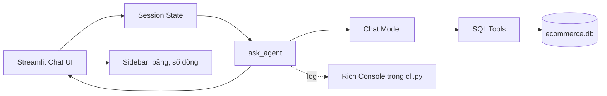

# Bài 07 — Xây dựng giao diện chat bằng Streamlit và giám sát bằng Rich

> **Loại:** Lab · **Mục tiêu:** Tạo giao diện hỏi đáp, xem metadata SQLite trong sidebar và hiển thị tiến độ gọi tool mà không làm lộ thông tin không cần thiết.

## 1. Tổng quan

Một Agent chỉ chạy trong terminal khó tiếp cận với người dùng không rành lập trình. Streamlit giúp tạo ứng dụng chat bằng Python; Rich giúp theo dõi chuỗi thao tác trong terminal khi phát triển. Cả hai dùng chung logic `ask_agent()` thay vì nhân đôi thuật toán.

## 2. Mục tiêu học tập

- Sử dụng được `st.chat_input`, `st.chat_message`, `st.session_state`.
- Trình bày tên bảng, số dòng và dung lượng database ở sidebar.
- Phân biệt log dành cho lập trình viên và câu trả lời cho người dùng.
- Khởi chạy, đặt câu hỏi và kiểm tra lịch sử phiên chat.

## 3. Sơ đồ kiến trúc ứng dụng



**Diễn giải:** `app.py` và `cli.py` là hai giao diện của cùng một Agent. Streamlit cho người dùng đặt câu hỏi; CLI cho lập trình viên quan sát tên tool được gọi. SQLite là nơi cung cấp dữ liệu chứ không phải nơi lưu chat lâu dài.

## 4. Giao diện chat cơ bản

```python
import streamlit as st

st.title("Hỏi đáp dữ liệu thương mại điện tử")
if "messages" not in st.session_state:
    st.session_state.messages = []

for msg in st.session_state.messages:
    with st.chat_message(msg["role"]):
        st.markdown(msg["content"])

question = st.chat_input("Nhập câu hỏi về database...")
if question:
    st.session_state.messages.append({"role": "user", "content": question})
    # Gọi SQL Agent tại đây, sau đó lưu câu trả lời thực tế.
```

Mẫu tối giản chưa có chức năng gọi model; file `app.py` đã tích hợp `model_factory.py`, `tools_sql.py` và `agent.py` để chạy luồng hoàn chỉnh.

## 5. Sidebar theo dõi cơ sở dữ liệu

Thông tin hữu ích cho người dùng gồm đường dẫn tới database, dung lượng, danh sách bảng và số hàng mỗi bảng. Ví dụ:

```python
from pathlib import Path
import streamlit as st

path = Path("ecommerce.db")
if path.exists():
    st.sidebar.metric("Dung lượng KB", round(path.stat().st_size / 1024, 1))
```

Đối với database thật, không tự động thống kê toàn bộ bảng lớn hoặc cấp quyền quản trị chỉ để hiển thị số hàng. Có thể lấy metadata đã được cho phép, caching và giới hạn tần suất.

## 6. Hiển thị quá trình thực thi

Trong `app.py`, `st.status()` hiển thị nhãn tool, ví dụ:

```python
with st.status("Đang truy vấn dữ liệu...") as status:
    status.write("list_database_tables · Tìm danh sách bảng")
    status.update(label="Hoàn tất", state="complete")
```

Trong CLI, Rich có thể hiển thị kết quả trong panel:

```python
from rich.console import Console
from rich.panel import Panel

console = Console()
console.print(Panel("Đã chạy câu truy vấn", title="SQL Agent"))
```

Không nên hiển thị toàn bộ dữ liệu khách hàng hoặc nội dung câu truy vấn nhạy cảm trên console công khai. Log `purpose` chỉ mang tính mô tả thao tác.

## 7. Các bước chạy và checkpoint

1. Mở terminal tại `ma-nguon/`.
2. Chuẩn bị `.env`, `python seed_data.py` và chạy Ollama.
3. Chạy `streamlit run app.py`.
4. Nhập “Có những sản phẩm nào hết hàng?” và xem tên sản phẩm trong phản hồi.
5. Nhập tiếp “Sản phẩm đó thuộc danh mục nào?”; đối chiếu cách xử lý ngữ cảnh.
6. Nhấn “Xóa lịch sử phiên” và kiểm tra câu hỏi không còn dùng ngữ cảnh cũ.

**Lưu ý:** Với nhiều dòng hết hàng, đại từ “sản phẩm đó” mơ hồ; Agent nên hỏi rõ đối tượng chứ không tự chọn tùy tiện.

## 8. Lỗi thường gặp và tổng kết

Nếu giao diện trống, kiểm tra log Streamlit. Nếu Ollama chưa chạy, thông báo thường xuất hiện khi ứng dụng bắt đầu gọi model chứ không nhất thiết ngay khi mở trang. Nếu phần hiển thị câu trả lời bị lặp, kiểm tra chỉ append một lần vào `chat_history` và tách riêng lịch sử dành cho model.

Streamlit giảm chi phí làm UI nhưng không thay thế xác thực, giám sát, lưu lịch sử bền vững hoặc tầng phân quyền khi triển khai cho nhiều người dùng.

## 9. Câu hỏi ôn tập

### Câu 1

Hàm Streamlit nào nhận câu chat mới?

A. st.dataframe  

B. st.metric  

C. st.sidebar  

D. st.chat_input  

**Đáp án:** D

**Giải thích:** chat_input tạo vùng nhập chat.

### Câu 2

Vì sao tách lịch sử UI và model?

A. Để đổi tên file  

B. UI không cần công khai system/tool messages  

C. Để tăng tốc SQL luôn luôn  

D. Vì model không có lịch sử  

**Đáp án:** B

**Giải thích:** Nội dung kỹ thuật có thể không phù hợp hiển thị trực tiếp.

### Câu 3

Nơi nào hiển thị metadata database cho người dùng?

A. Sidebar  

B. Python interpreter  

C. Hệ điều hành  

D. API key  

**Đáp án:** A

**Giải thích:** Sidebar chứa tên bảng, dung lượng và số dòng.

### Câu 4

Rich trong bài dùng chính để làm gì?

A. Tạo bảng SQLite  

B. Chạy mô hình GPU  

C. Hiển thị log terminal dễ theo dõi  

D. Lưu chat qua tháng  

**Đáp án:** C

**Giải thích:** Rich format nhật ký trên console.

### Câu 5

Xóa lịch sử phiên chat có tác dụng gì?

A. Xóa SQLite  

B. Cấp quyền mới  

C. Đổi Ollama model  

D. Xóa ngữ cảnh trong session  

**Đáp án:** D

**Giải thích:** Nó đặt lại lịch sử phiên chứ không xóa dữ liệu nghiệp vụ.
