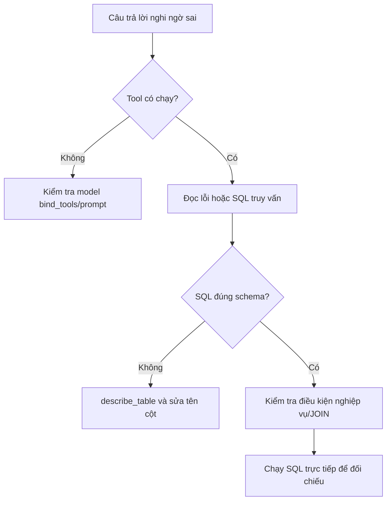

# Bài 08 — Lab kiểm thử SQL Agent: JOIN, lịch sử và sửa lỗi

> **Loại:** Lab · **Mục tiêu:** Đánh giá câu trả lời của Agent bằng cách so sánh với SQL trực tiếp và xử lý những tình huống thực tế.

## 1. Tổng quan

Một chatbot trả lời trôi chảy không có nghĩa là đã truy vấn đúng. Bài lab sử dụng dữ liệu `ecommerce.db` được tạo bởi `seed_data.py`, sau đó đối chiếu kết quả của AI Agent với SQL chạy trực tiếp.

## 2. Mục tiêu học tập

- Chạy được ít nhất năm tình huống hỏi đáp.
- Kiểm tra SQL được tạo có sử dụng khóa nối đúng.
- Kiểm chứng giá trị cuối với câu truy vấn đối chiếu.
- Phân loại được lỗi schema, logic nghiệp vụ, lịch sử và giới hạn bước.

## 3. Chuẩn bị

Cài dependency, tạo database, bật Ollama, sau đó:

```bash
cd ma-nguon
python seed_data.py
streamlit run app.py
```

Hoặc dùng console để quan sát tên tool:

```bash
python cli.py
```

Nếu chọn Groq, cần sửa `.env` và cấu hình API key trước. Mỗi bài kiểm thử nên tạo phiên sạch nếu không có ý định dùng lịch sử để tránh ngữ cảnh từ lượt trước làm nhiễu.

## 4. Các ca kiểm thử

### 4.1. Tình huống A — Sản phẩm hết hàng

**Câu hỏi:** “Sản phẩm nào đã hết hàng?”

Đối chiếu SQL:

```sql
SELECT name, stock FROM products WHERE stock = 0;
```

**Kiểm tra:** Tên sản phẩm và số tồn phải khớp; Agent không tự nói sản phẩm có thể đặt mua nếu không có dữ liệu về backorder.

### 4.2. Tình huống B — Khách hàng nhiều đơn nhất

**Câu hỏi:** “Ai có nhiều đơn hàng nhất?”

Đối chiếu SQL:

```sql
SELECT c.name, COUNT(o.id) AS so_don
FROM customers c
LEFT JOIN orders o ON o.customer_id = c.id
GROUP BY c.id, c.name
ORDER BY so_don DESC, c.id
LIMIT 1;
```

**Kiểm tra:** SQL có phép nối chính xác, đếm đơn chứ không đếm item. Trong dữ liệu mẫu đi kèm, truy vấn đối chiếu chọn khách hàng `Nguyễn An` với **5 đơn**. Kết quả từ model phải được so với database đang chạy, không chỉ nhớ câu trả lời ví dụ.

### 4.3. Tình huống C — Câu hỏi nối tiếp

**Lượt 1:** “Ai có nhiều đơn hàng nhất?”

**Lượt 2:** “Hãy liệt kê ngày và trạng thái các đơn của người đó.”

SQL kiểm tra cho lượt 2:

```sql
SELECT o.id, o.order_date, o.status
FROM orders o
JOIN customers c ON c.id = o.customer_id
WHERE c.name = 'Nguyễn An'
ORDER BY o.order_date DESC;
```

**Kiểm tra:** Mã khách hàng lấy từ lịch sử phải khớp. Trong ứng dụng thật nên sử dụng `customer_id` nếu có thay vì dựa vào tên không duy nhất.

### 4.4. Tình huống D — Doanh thu với quy tắc nghiệp vụ

**Câu hỏi:** “Tính tổng giá trị các đơn hoàn tất.”

Đối chiếu:

```sql
SELECT SUM(oi.quantity * oi.unit_price) AS tong
FROM orders o
JOIN order_items oi ON oi.order_id = o.id
WHERE o.status = 'completed';
```

**Kiểm tra:** Không trộn các đơn `pending` và `cancelled`. Đây là tổng giá trị dòng hàng trong mẫu, không phải định nghĩa kế toán đầy đủ về doanh thu.

### 4.5. Tình huống E — Câu hỏi thiếu dữ liệu

**Câu hỏi:** “Khách hàng này có hài lòng với sản phẩm không?”

Database không có bảng review hoặc khảo sát. Kết quả tốt là **nói rõ chưa có dữ liệu đánh giá**, không suy ra mức độ hài lòng từ số lần mua.

## 5. Quy trình debug



**Diễn giải:** Không nên chữa mọi lỗi bằng cách viết prompt dài hơn. Nếu kết quả sai do JOIN hoặc thiếu điều kiện `status`, cần sửa câu SQL, metadata và kiểm thử. Nếu model hoàn toàn không gọi tool, kiểm tra khả năng tool-calling trước.

## 6. Deliverable và checklist

Hoàn thành bảng kết quả kiểm thử: câu hỏi, tool đã dùng, SQL, kết quả SQL đối chiếu, Agent đúng/sai và nguyên nhân. Ghi ít nhất một lỗi từng xuất hiện và cách sửa. Mỗi lượt kiểm thử phải có kết quả thực tế; **không đánh dấu thành công khi chưa chạy app với model trên máy**.

- [ ] Cơ sở dữ liệu có đủ 4 bảng.
- [ ] Tool chỉ đọc, `DELETE` bị từ chối.
- [ ] Tình huống A–D có SQL đối chiếu.
- [ ] Tình huống C sử dụng ngữ cảnh lượt trước.
- [ ] Tình huống E không bịa dữ liệu.

## 7. Tổng kết

Chỉ tiêu quan trọng là **đúng dữ liệu và đúng logic truy vấn**, không phải câu trả lời dài hay đẹp. Đối chiếu SQL, phân loại lỗi và kiểm thử câu hỏi tiếp nối là nền tảng để mở rộng Agent lên database thật.

## 8. Câu hỏi ôn tập

### Câu 1

Khi kiểm thử Agent, tiêu chí quan trọng nhất?

A. Câu trả lời dài  

B. Khớp SQL đối chiếu và quy tắc nghiệp vụ  

C. Có nhiều emoji  

D. Gọi nhiều tool  

**Đáp án:** B

**Giải thích:** Kết quả phải đúng dữ liệu và logic.

### Câu 2

Câu hỏi về mức độ hài lòng khi không có bảng review, Agent nên?

A. Suy từ số lần mua  

B. Trả 5 sao mặc định  

C. Hỏi ngày sinh  

D. Nêu rõ không có dữ liệu phù hợp  

**Đáp án:** D

**Giải thích:** Không suy diễn thông tin không hiện diện.

### Câu 3

Tại sao phải kiểm tra order.status trong doanh thu mẫu?

A. Để loại đơn chưa hoàn tất theo quy ước  

B. Vì tất cả đơn giống nhau  

C. Vì stock âm  

D. Vì bảng products thiếu id  

**Đáp án:** A

**Giải thích:** Trạng thái đơn ảnh hưởng tổng cần tính.

### Câu 4

Nếu tool không bao giờ được gọi, kiểm tra điều nào trước?

A. Đổi ngôn ngữ UI  

B. Thêm data mẫu nhiều hơn  

C. Model có bind_tools và hỗ trợ tool-calling  

D. Xóa bảng customers  

**Đáp án:** C

**Giải thích:** Khả năng và cấu hình tool-calling quyết định lời gọi.

### Câu 5

Vì sao nối từ orders tới order_items có thể ảnh hưởng COUNT?

A. Ngày sai  

B. Một đơn có nhiều dòng item  

C. SQLite không có GROUP BY  

D. Tên khách hàng rỗng  

**Đáp án:** B

**Giải thích:** Nối bảng item làm lặp đơn theo dòng sản phẩm.
