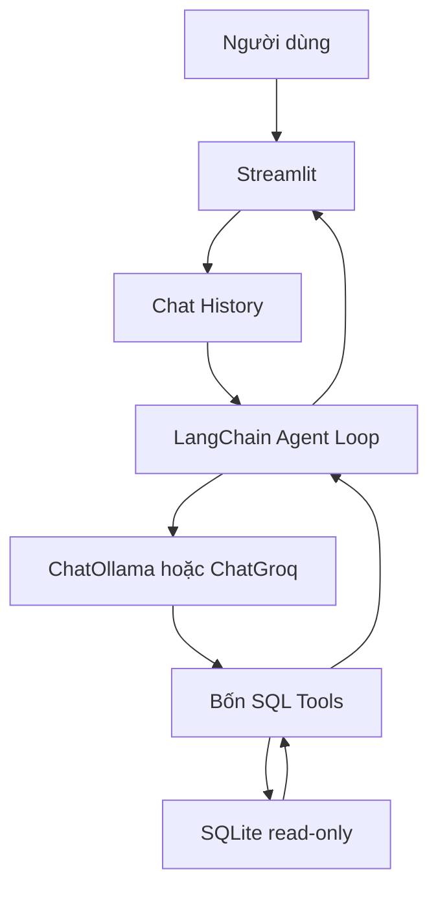

# Bài 09 — Đồ án cuối khóa: SQL Agent dùng được và dễ kiểm thử

> **Loại:** Project · **Mục tiêu:** Ghép thành một ứng dụng SQL Agent đầy đủ có giao diện hội thoại, công cụ chỉ đọc, lịch sử, nhật ký thao tác và bài kiểm thử.

## 1. Bài toán

Nhóm phân tích thương mại điện tử cần hỏi bằng tiếng Việt về sản phẩm, khách hàng và đơn hàng mà không trực tiếp viết SQL. Xây dựng một ứng dụng trả lời bằng Markdown, dựa trên cơ sở dữ liệu `products`, `customers`, `orders`, `order_items`.

Sản phẩm cuối phải hỗ trợ SQLite, Ollama chạy cục bộ và có thể đổi sang Groq qua cấu hình. Tất cả câu truy vấn phải đi qua bộ công cụ được kiểm soát.

## 2. Yêu cầu và tiêu chí thành công

| Yêu cầu | Cách kiểm chứng |
| --- | --- |
| Kết nối dữ liệu quan hệ | Đọc đúng schema 4 bảng |
| Tự chọn tool khi cần | Nhìn thấy ít nhất một chuỗi tool-calling hoàn chỉnh |
| Trả lời theo dữ liệu | Khớp truy vấn SQL đối chiếu |
| Đọc lịch sử chat | Giải quyết đúng câu “các đơn của người đó” |
| Chỉ đọc | `DELETE` hoặc `UPDATE` không thực thi được |
| Có giới hạn Agent | Dừng ở `MAX_AGENT_STEPS` |
| UI dễ sử dụng | Có chat, thanh bên và hướng dẫn khi lỗi |
| Dễ vận hành | Có `.env.example`, hướng dẫn chạy và checklist |

## 3. Kiến trúc bàn giao

**Diễn giải:** UI không được gọi SQL trực tiếp theo câu chữ người dùng. Agent gọi tool trong giới hạn được đặt; model provider là thành phần có thể thay thế, còn tầng SQLite chỉ đọc dùng chung.

## 4. Các cột mốc triển khai

### 4.1. Milestone 1 — Dữ liệu và cấu hình

Tạo file SQLite bằng `seed_data.py`, chạy truy vấn trực tiếp bằng Python, chuẩn bị `.env` và cài mô hình hỗ trợ tool-calling. Tài liệu thiết lập phải đủ để một người khác chạy lại mà không yêu cầu API key của tác giả.

### 4.2. Milestone 2 — Công cụ và Agent

Xác thực bốn tool (`list`, `describe`, `sample`, `execute`), thiết lập `bind_tools`, xử lý `ToolMessage` theo ID, giới hạn vòng lặp và bắt lỗi SQL. Test thử truy vấn xóa phải bị chặn.

### 4.3. Milestone 3 — UI và đánh giá

Kết nối Streamlit với Agent, hiển thị câu trả lời Markdown, giữ lịch sử trong phiên, thêm sidebar và checklist kiểm thử. Chụp lại màn hình kết quả hoặc ghi log test để phục vụ đánh giá.

## 5. Đánh giá theo thang 100 điểm

| Tiêu chí | Điểm |
| --- | ---: |
| Schema và dữ liệu mẫu đúng | 15 |
| Bốn tool hoạt động, kết nối chỉ đọc | 25 |
| Agent loop đúng protocol và giới hạn bước | 20 |
| Câu hỏi đơn + JOIN + câu hỏi tiếp nối | 20 |
| Streamlit, lịch sử, log hữu ích | 10 |
| README, hướng dẫn chạy và kết quả kiểm thử | 10 |
| **Tổng** | **100** |

Không chấm độ chính xác bằng một câu hỏi thành công; cần tập tình huống cả đúng, sai, mơ hồ và thiếu dữ liệu. Nếu model không phản hồi, phải ghi nhận là chưa kiểm thử end-to-end, không suy ra là thành công từ các bài test SQLite.

## 6. Rủi ro và hướng phát triển

**Bảo mật:** Read-only ở mức file là phù hợp lab, nhưng môi trường production còn cần phân quyền theo người dùng, hạn chế dữ liệu cá nhân, timeout, audit log, chống lộ thông tin qua câu hỏi hợp lệ và chính sách lưu dữ liệu. Một query `SELECT` vẫn có thể gây lộ dữ liệu hoặc tốn tài nguyên.

**Chất lượng:** Model có thể chọn JOIN sai, nhầm trạng thái đơn hàng hoặc bỏ qua điều kiện lọc. Phải có tập câu hỏi chuẩn để kiểm tra truy vấn và câu trả lời sau mỗi thay đổi model/prompt.

**Mở rộng phù hợp mục đích sản phẩm:** Có thể thay bốn bảng thương mại điện tử bằng bảng `recipes`, `ingredients`, `recipe_ingredients` trong ứng dụng trợ lý món ăn. Khi người dùng gõ “mỳ”, công cụ SQL có thể tìm theo tên món/nguyên liệu; nếu không tìm được thì Agent nên hỏi thêm khẩu vị hoặc nguyên liệu hiện có. Đó là hướng mở rộng, không nằm trong logic chạy thử của bộ code đính kèm.

## 7. Definition of Done

- [ ] Đã kiểm tra schema và các quan hệ.
- [ ] `python seed_data.py` chạy thành công.
- [ ] Cài model hỗ trợ tool-calling, kết nối được.
- [ ] Agent trả được kết quả ít nhất 4 tình huống có SQL đối chiếu.
- [ ] Câu hỏi không có dữ liệu được trả lời trung thực.
- [ ] Không có câu lệnh ghi SQL được thực thi.
- [ ] Model dừng khi vượt giới hạn bước.
- [ ] `.env` không chứa khóa bị đưa vào bản bàn giao.
- [ ] Có ảnh chụp hoặc log xác nhận kiểm thử trên máy chạy thật.

## 8. Tổng kết

Đồ án thành công khi có thể **lặp lại, kiểm chứng và vận hành** chứ không chỉ khi chatbot xuất hiện trên màn hình. Học viên nên bắt đầu với database nhỏ, kiểm soát tốt vòng lặp, sau đó mới mở rộng đến dữ liệu phức tạp và quyền truy cập nhiều người dùng.

## 9. Câu hỏi ôn tập

### Câu 1

Điều kiện đủ để nói dự án đã kiểm thử end-to-end?

A. Có README  

B. Compile Python không lỗi  

C. Có Streamlit screenshot nhưng chưa gọi model  

D. Có chạy thật model + tool + database và SQL đối chiếu  

**Đáp án:** D

**Giải thích:** End-to-end cần kiểm chứng toàn bộ chuỗi thực thi.

### Câu 2

Vì sao chỉ mở database read-only vẫn chưa đủ bảo mật?

A. SELECT vẫn có thể lộ thông tin  

B. Sẽ mất index  

C. Không có JOIN  

D. Không được dùng Streamlit  

**Đáp án:** A

**Giải thích:** Phải thêm kiểm soát truy cập dữ liệu và giám sát.

### Câu 3

Thay database sản phẩm bằng món ăn trước tiên cần gì?

A. Đổi tên model thôi  

B. Sửa schema và định nghĩa công cụ phù hợp  

C. Xóa phần Agent  

D. Tắt validation  

**Đáp án:** B

**Giải thích:** Schema recipes/ingredients khác schema thương mại điện tử.

### Câu 4

Nếu user hỏi mơ hồ “món nào hợp?” khi thiếu dữ kiện, nên?

A. Tự bịa khẩu vị  

B. Trả lời ngẫu nhiên  

C. Hỏi thêm tiêu chí phù hợp  

D. Luôn chọn món đắt  

**Đáp án:** C

**Giải thích:** Hỏi lại giúp xác định nhu cầu hợp lý.

### Câu 5

Khi bàn giao, nên xử lý API key thế nào?

A. Đưa thẳng vào README  

B. Commit lên Git  

C. Dán trong SQL  

D. Chỉ đưa .env.example, không chứa key thật  

**Đáp án:** D

**Giải thích:** Tách bí mật khỏi repo/bản bàn giao.
