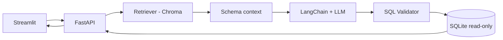

# Khóa học: Xây dựng chatbot Text-to-SQL với RAG

> **Ngôn ngữ:** Tiếng Việt · **Trình độ:** Python/SQL cơ bản đến dự án thử nghiệm · **Lĩnh vực ứng dụng:** truy vấn dữ liệu món ăn bằng hội thoại.

## 1. Giới thiệu

Khóa học hướng dẫn biến câu hỏi ngôn ngữ tự nhiên thành SQL có căn cứ bằng **Retrieval-Augmented Generation (RAG)**. Hệ thống dùng SQLite lưu dữ liệu, embeddings và Chroma truy xuất schema, LangChain gọi mô hình, FastAPI phục vụ API, Streamlit tạo giao diện chat.

Người học sẽ hiểu vì sao chỉ dùng LLM để viết SQL dễ sai tên bảng/cột và vì sao RAG cần đi kèm xác thực SQL, phân quyền và kiểm thử.

## 2. Lộ trình học

| Bài | Nội dung | Sản phẩm sau bài |
| --- | --- | --- |
| [01](01-tong-quan-text-to-sql.md) | Bài toán Text-to-SQL | Sơ đồ pipeline |
| [02](02-sqlite-schema-va-quan-he.md) | SQLite, schema và JOIN | SQL lọc món và nguyên liệu |
| [03](03-rag-cho-text-to-sql.md) | RAG lấy ngữ cảnh schema | Document metadata |
| [04](04-embedding-va-chroma.md) | Embeddings và Chroma | Thử similarity search |
| [05](05-langchain-orchestration.md) | LangChain và prompt | Phác thảo chuỗi sinh SQL |
| [06](06-an-toan-sql.md) | An toàn thực thi SQL | Checklist bảo vệ |
| [07](07-fastapi-backend.md) | FastAPI | Thiết kế `/ask` |
| [08](08-streamlit-chat-ui.md) | Streamlit | Giao diện chat |
| [09](09-schema-sync-va-toi-uu.md) | Đồng bộ và đánh giá | Bộ tiêu chí đo |
| [10](10-lab-xay-dung-chatbot.md) | Lab đầu cuối | Chatbot demo |

## 3. Bức tranh tổng thể

`Chroma` lưu vector của **schema**, `SQLite` lưu **dữ liệu nghiệp vụ**. Mỗi câu hỏi được gắn ngữ cảnh trước khi sinh SQL; SQL được kiểm tra trước khi chạy.

## 4. Hướng dẫn sử dụng

Học theo thứ tự 01–10. Mỗi bài độc lập gồm mục tiêu, lý thuyết, thực hành ngắn, tổng kết và **5 câu trắc nghiệm có đáp án giải thích**. Sơ đồ dùng cú pháp Mermaid, có thể xem trong GitHub/VS Code với tiện ích phù hợp.

Thư mục `demo/` đi kèm một **prototype học tập**. Bắt đầu từ hướng dẫn ở Bài 10; chỉ chạy bằng dữ liệu giả lập tại máy cá nhân. Trong môi trường thực cần bổ sung xác thực, phân quyền theo user, giới hạn truy vấn, secret management, theo dõi lỗi, kiểm thử và bảo mật dữ liệu.

## 5. Các thuật ngữ quan trọng

- **Schema:** định nghĩa bảng/cột/kiểu và quan hệ trong CSDL.
- **Text-to-SQL:** chuyển yêu cầu tự nhiên thành câu truy vấn SQL.
- **RAG:** truy xuất ngữ cảnh trước khi tạo đầu ra bằng mô hình.
- **Embedding:** vector số biểu diễn ý nghĩa văn bản.
- **Vector store:** nơi lưu và truy xuất vector, ví dụ Chroma.
- **Retriever:** thành phần lấy các mô tả schema phù hợp.
- **SQL validation:** kiểm tra câu truy vấn trước khi thực thi; không thay thế phân quyền.
- **Grounded answer:** câu trả lời dựa vào hàng dữ liệu thực.

## 6. Ghi chú về phạm vi

Kiến trúc và công nghệ bám sát nội dung giảng dạy về Text-to-SQL với RAG. Các ví dụ món ăn, bài tập, đoạn mã và prototype là phần diễn giải/ứng dụng bổ sung để thực hành, **không phải source code trích nguyên từ bài giảng**. Không khẳng định pipeline này đã đạt điều kiện triển khai sản xuất.

## 7. Tham khảo tài liệu kỹ thuật

- Chroma tích hợp LangChain: https://reference.langchain.com/python/langchain-chroma/vectorstores/Chroma
- Structured output của LangChain OpenAI: https://reference.langchain.com/python/langchain-openai/chat_models/base/ChatOpenAI/with_structured_output
- FastAPI request body: https://fastapi.tiangolo.com/tutorial/body/
- Streamlit chat widgets: https://docs.streamlit.io/develop/api-reference/chat
- SQLGlot: https://sqlglot.com/sqlglot.html

Các API/thư viện phát triển liên tục; khi triển khai cần đối chiếu tài liệu phiên bản đã cài.
