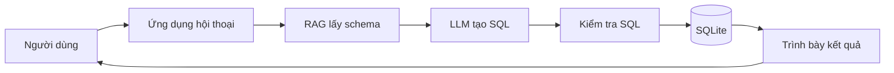

# Bài 01 — Từ câu hỏi tự nhiên đến dữ liệu có cấu trúc

> **Tóm tắt:** Biến câu hỏi tiếng Việt thành truy vấn SQL có thể thực thi trên cơ sở dữ liệu hiện có.

## 1. Mục tiêu học tập

- Mô tả được bài toán Text-to-SQL và các nhóm người sử dụng.
- Phân biệt khả năng tạo SQL của LLM và độ đúng thực tế trên một cơ sở dữ liệu cụ thể.
- Vẽ được các bước từ câu hỏi đến kết quả có kiểm chứng.

## 2. Kiến thức và nguyên lý

### 2.1. Vì sao cần Text-to-SQL?

SQL là ngôn ngữ truy vấn dữ liệu quan hệ. Để trả lời câu hỏi “Món nào có mì và không chứa hải sản?”, cách truyền thống là hiểu tên bảng, viết điều kiện lọc và ghép dữ liệu. Người sử dụng ứng dụng nấu ăn có thể không biết SQL, nhưng vẫn cần câu trả lời từ dữ liệu thực tế.

**Text-to-SQL** nhận câu hỏi tự nhiên, tạo câu SQL tương ứng, kiểm tra, chạy trên cơ sở dữ liệu rồi trình bày kết quả. Đây là **truy vấn dữ liệu đang lưu**; không đồng nghĩa với sáng tạo một công thức nấu ăn mới.

### 2.2. Ví dụ điển hình

Giả sử bảng `dishes(id, name, cooking_minutes)` lưu món ăn. Yêu cầu “Liệt kê món nấu không quá 20 phút” có thể được ánh xạ thành:

```sql
SELECT name, cooking_minutes
FROM dishes
WHERE cooking_minutes <= 20
ORDER BY cooking_minutes ASC;
```

Câu SQL đúng về cú pháp chưa đủ. Nếu cơ sở dữ liệu thực tế đặt cột là `prep_time` thì truy vấn thất bại. Mô hình ngôn ngữ lớn (LLM) không tự biết bảng/cột của ứng dụng khi chưa được cung cấp.

### 2.3. Kiến trúc ở mức tổng quan



Luồng truy vấn đi qua các bước: đọc câu hỏi, lấy ngữ cảnh từ **schema**, sinh SQL, kiểm tra, thực thi, rồi trả lời dựa trên hàng dữ liệu nhận được. Không nên bỏ qua khâu kiểm tra chỉ vì SQL do AI tạo ra.

### 2.4. Thế nào là câu trả lời có cơ sở?

- Truy vấn chỉ tham chiếu bảng và cột tồn tại.
- Quan hệ `JOIN` khớp khóa ngoại hoặc quy ước dữ liệu.
- Không lấy hàng dữ liệu vượt quyền của người hỏi.
- Không khẳng định có món ăn nếu kết quả là mảng rỗng.
- Nêu rõ khi câu hỏi còn thiếu điều kiện hoặc chưa đủ dữ liệu.

**Phạm vi:** Text-to-SQL thích hợp với dữ liệu quan hệ. Khi cần giải thích quy tắc nấu ăn, tìm kiếm ngữ nghĩa trong ghi chú, hoặc tạo món hoàn toàn mới, cần bổ sung công cụ/luồng khác.

## 3. Thực hành ngắn

Viết 3 câu hỏi tiếng Việt tương ứng với: lọc thời gian, sắp xếp kết quả và đếm tổng số món. Với mỗi câu, ghi rõ bảng/cột tối thiểu cần có.

## 4. Tổng kết

Text-to-SQL mở quyền tiếp cận dữ liệu cho người không viết SQL. LLM là công cụ sinh truy vấn, còn độ tin cậy đến từ schema thật, kiểm tra truy vấn và kết quả trên cơ sở dữ liệu.

## 5. Câu hỏi ôn tập

### Câu 1

Vì sao mô hình có thể tạo SQL đúng cú pháp nhưng không chạy được?

A. SQLite không hỗ trợ SELECT  
B. Mô hình có thể đoán sai tên cột/bảng  
C. Câu hỏi luôn thiếu dấu chấm  
D. SQL không hỗ trợ tiếng Việt  

**Đáp án:** B. **Giải thích:** LLM không mặc nhiên biết cấu trúc CSDL của bạn.

### Câu 2

Bước nào thực sự lấy dữ liệu từ hệ thống?

A. Sinh embedding  
B. Vẽ sơ đồ  
C. Thực thi SQL trên CSDL  
D. Tạo prompt  

**Đáp án:** C. **Giải thích:** Chỉ thực thi câu truy vấn đã kiểm tra mới lấy các hàng dữ liệu.

### Câu 3

Người dùng hỏi món không quá 20 phút. Điều kiện phù hợp nhất là gì?

A. cooking_minutes <= 20  
B. cooking_minutes = 0  
C. ORDER BY name  
D. DROP TABLE dishes  

**Đáp án:** A. **Giải thích:** Điều kiện lọc giữ lại các món có thời gian không vượt giới hạn.

### Câu 4

Khi truy vấn trả về 0 hàng, hệ thống nên làm gì?

A. Tự tạo một tên món có vẻ hợp lý  
B. Xóa điều kiện lọc lặng lẽ  
C. Thực thi lại liên tục  
D. Trình bày không tìm thấy kết quả và gợi ý làm rõ  

**Đáp án:** D. **Giải thích:** Kết quả phải trung thực với dữ liệu đã truy vấn.

### Câu 5

Cấu phần nào phải nằm giữa sinh SQL và chạy SQL?

A. Bộ kiểm tra và giới hạn truy vấn  
B. Trình duyệt web  
C. Công cụ chỉnh ảnh  
D. Bộ thu âm  

**Đáp án:** A. **Giải thích:** Việc kiểm tra giảm rủi ro sai lệnh và vượt quyền.
