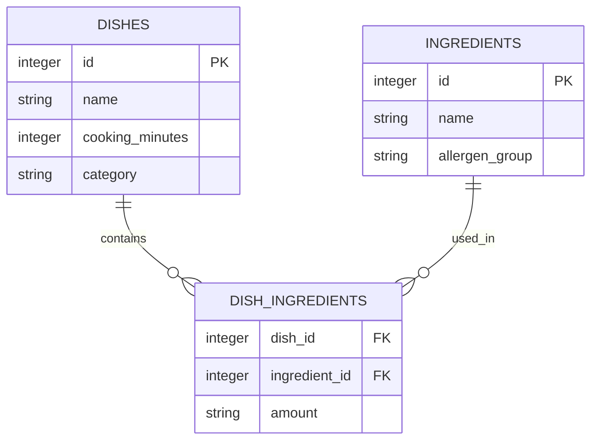

# Bài 02 — Đọc schema SQLite và hiểu quan hệ dữ liệu

> **Tóm tắt:** Muốn hỏi dữ liệu chính xác, trước tiên phải hiểu bảng, cột, kiểu dữ liệu và khóa ngoại.

## 1. Mục tiêu học tập

- Giải thích được table, column, primary key và foreign key.
- Đọc được schema SQLite để xác định quan hệ giữa món ăn và nguyên liệu.
- Viết được SELECT, WHERE và JOIN cơ bản cho dữ liệu ví dụ.

## 2. Kiến thức và nguyên lý

### 2.1. Thiết kế dữ liệu cho ứng dụng món ăn

Một mô hình quan hệ đơn giản gồm:

| Bảng | Chức năng | Các cột tiêu biểu |
| --- | --- | --- |
| `dishes` | Thông tin món | `id`, `name`, `cooking_minutes`, `category` |
| `ingredients` | Danh mục nguyên liệu | `id`, `name`, `allergen_group` |
| `dish_ingredients` | Liên kết nhiều–nhiều | `dish_id`, `ingredient_id`, `amount` |



Một món có nhiều nguyên liệu, một nguyên liệu xuất hiện trong nhiều món, vì vậy cần bảng trung gian. Sơ đồ chỉ là cấu trúc minh họa; ứng dụng thật có thể có bảng khác.

### 2.2. Truy vấn mẫu

```sql
SELECT d.name, d.cooking_minutes
FROM dishes AS d
JOIN dish_ingredients AS di ON di.dish_id = d.id
JOIN ingredients AS i ON i.id = di.ingredient_id
WHERE i.name = 'mì'
ORDER BY d.cooking_minutes ASC;
```

`JOIN` nối các dòng qua khóa ngoại. `WHERE` lọc nguyên liệu theo tên. Nếu người dùng hỏi **không có hải sản**, không nên dùng điều kiện `i.allergen_group <> 'seafood'` ngay trên hàng JOIN: món chứa nhiều nguyên liệu có thể vẫn lọt qua bởi một nguyên liệu không phải hải sản. Hãy dùng `NOT EXISTS`:

```sql
SELECT d.name
FROM dishes AS d
WHERE NOT EXISTS (
  SELECT 1
  FROM dish_ingredients AS di
  JOIN ingredients AS i ON i.id = di.ingredient_id
  WHERE di.dish_id = d.id AND i.allergen_group = 'seafood'
);
```

### 2.3. Trích xuất metadata của SQLite

Truy vấn danh sách bảng (loại bảng hệ thống):

```sql
SELECT name FROM sqlite_master
WHERE type = 'table' AND name NOT LIKE 'sqlite_%';
```

Với từng bảng đáng tin cậy, lập trình viên có thể dùng `PRAGMA table_info(table_name)` để đọc cột và `PRAGMA foreign_key_list(table_name)` để đọc khóa ngoại. **Tên bảng phải đến từ metadata được xác minh**, không lấy trực tiếp từ chuỗi người dùng rồi nối vào SQL.

### 2.4. Dữ liệu mẫu và metadata khác nhau thế nào?

Schema cho biết `category` là cột text, nhưng không cho biết các giá trị phổ biến như `món nước` hoặc `món khô`. Một ít giá trị mẫu đã được phép công bố có thể giúp mô hình hiểu quy ước. Không nên đưa dữ liệu cá nhân, hồ sơ người dùng hoặc bí mật vào tài liệu embedding.

## 3. Thực hành ngắn

Tự vẽ quan hệ ba bảng. Viết hai truy vấn: (1) món nấu trong 20 phút; (2) món có mì nhưng không có nguyên liệu thuộc nhóm `seafood`.

## 4. Tổng kết

Schema và khóa ngoại là nền tảng để AI tạo phép lọc và JOIN chính xác. Thông tin cấu trúc có thể đọc từ metadata SQLite, nhưng phải kiểm soát những gì được đem đi lập chỉ mục.

## 5. Câu hỏi ôn tập

### Câu 1

Bảng nào mô tả mối quan hệ nhiều–nhiều giữa món và nguyên liệu?

A. dishes  
B. dish_ingredients  
C. sqlite_master  
D. ingredients  

**Đáp án:** B. **Giải thích:** Bảng trung gian lưu cặp khóa ngoại của hai phía.

### Câu 2

Tại sao lọc `allergen_group <> seafood` trên JOIN có thể sai?

A. Vì không có JOIN trong SQLite  
B. Vì chỉ dùng cho số  
C. Một món còn có thể chứa hải sản ở hàng nguyên liệu khác  
D. Vì nhóm dị ứng không thể lưu text  

**Đáp án:** C. **Giải thích:** Điều kiện trên từng dòng không phủ định toàn bộ nhóm nguyên liệu của món.

### Câu 3

Muốn xem tên bảng trong SQLite nên bắt đầu từ đâu?

A. sqlite_master  
B. Streamlit  
C. Pydantic  
D. Pinecone  

**Đáp án:** A. **Giải thích:** SQLite lưu thông tin cấu trúc trong sqlite_master.

### Câu 4

Foreign key có tác dụng chính gì?

A. Chỉ định màu giao diện  
B. Mã hóa dữ liệu  
C. Sinh token cho AI  
D. Chỉ ra mối liên hệ giữa các bản ghi  

**Đáp án:** D. **Giải thích:** Khóa ngoại nối bản ghi của bảng con tới bảng được tham chiếu.

### Câu 5

Điều kiện nào phù hợp để chọn món nấu nhanh?

A. ORDER BY name  
B. WHERE cooking_minutes <= 20  
C. DROP TABLE dishes  
D. HAVING name  

**Đáp án:** B. **Giải thích:** WHERE lọc hàng theo điều kiện thời gian nấu.
