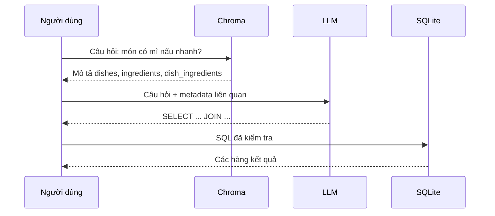

# Bài 03 — RAG: nối câu hỏi với schema có liên quan

> **Tóm tắt:** RAG không thay SQL; RAG cung cấp đúng ngữ cảnh để LLM sinh SQL đáng tin cậy hơn.

## 1. Mục tiêu học tập

- Mô tả được hai giai đoạn Retrieval và Generation.
- Phân biệt schema retrieval với truy vấn dữ liệu thực.
- Thiết kế nội dung mô tả bảng phù hợp cho việc truy xuất ngữ nghĩa.

## 2. Kiến thức và nguyên lý

### 2.1. Vấn đề của prompt chứa toàn bộ cơ sở dữ liệu

Ứng dụng có hàng trăm bảng thì việc đưa toàn bộ `CREATE TABLE` vào mọi prompt vừa tốn token, vừa khiến mô hình nhiễu bởi các bảng không liên quan. Đưa một vài tên bảng do người viết prompt đoán cũng không giải quyết được vấn đề.

**Retrieval-Augmented Generation (RAG)** gồm: (1) truy xuất thông tin phù hợp; (2) dùng thông tin đó để tạo đầu ra. Trong Text-to-SQL, thông tin được truy xuất là **schema và mô tả quan hệ**, còn đầu ra là câu SQL.

### 2.2. Một vòng RAG



Trong triển khai thực tế, các mũi tên do backend điều phối; người dùng không trực tiếp truy vấn Chroma hoặc thực thi SQL. Sơ đồ nhấn mạnh khác biệt giữa **retrieval schema** và **execution SQL**.

### 2.3. Tài liệu schema cho RAG

Một bản mô tả gọn nên có:

```text
Bảng: dish_ingredients
Vai trò: nối món ăn với nguyên liệu
Cột: dish_id INTEGER, ingredient_id INTEGER, amount TEXT
Quan hệ: dish_id -> dishes.id; ingredient_id -> ingredients.id
Câu hỏi thường gặp: món chứa nguyên liệu X, món tránh nguyên liệu Y
```

Nên dùng một document trên bảng hoặc nhóm bảng quan hệ chặt chẽ. Nếu mỗi cột là một document riêng biệt, truy xuất có thể bỏ mất quan hệ JOIN; vì thế cần giữ thông tin khóa ngoại trong context.

### 2.4. Lỗi có thể xảy ra

RAG giúp giảm ảo giác schema, **không đảm bảo SQL chính xác**. Retriever có thể bỏ sót bảng trung gian; metadata có thể cũ; mô hình có thể suy diễn sai ý định “không có hải sản”. Hãy ghi lại bảng nào được truy xuất và kiểm tra SQL trên database thật.

RAG dùng cho schema không có nghĩa là dữ liệu nghiệp vụ được nhân bản vào vector store. SQLite vẫn là nguồn sự thật khi trả lời các câu hỏi về món ăn.

## 3. Thực hành ngắn

Viết ba document schema cho `dishes`, `ingredients` và `dish_ingredients`. Mỗi document có vai trò, cột, khóa và ví dụ ý định truy vấn.

## 4. Tổng kết

RAG cung cấp bối cảnh có liên quan cho mô hình tạo SQL. Nó làm hệ thống nhận biết schema tốt hơn, nhưng kết quả cuối vẫn phải dựa trên cơ sở dữ liệu thật và bộ kiểm tra truy vấn.

## 5. Câu hỏi ôn tập

### Câu 1

Trong Text-to-SQL, retriever nên lấy thông tin gì?

A. Giọng nói người dùng  
B. Schema và quan hệ liên quan  
C. Mật khẩu database  
D. Ảnh trang trí  

**Đáp án:** B. **Giải thích:** Ngữ cảnh bảng/cột giúp tạo SQL có căn cứ.

### Câu 2

Đâu là vai trò của SQLite trong vòng RAG này?

A. Tạo embedding  
B. Hiển thị chat  
C. Chạy truy vấn để lấy dữ liệu thật  
D. Tự sinh câu hỏi  

**Đáp án:** C. **Giải thích:** SQLite giữ dữ liệu quan hệ và thực thi SQL.

### Câu 3

Vì sao document cho bảng trung gian cần khóa ngoại?

A. Để mô hình suy ra JOIN đúng  
B. Để cải thiện màu UI  
C. Để thay thế mã API  
D. Để nén database  

**Đáp án:** A. **Giải thích:** JOIN phụ thuộc đường nối giữa khóa ngoại và khóa chính.

### Câu 4

RAG có bảo đảm mọi SQL luôn đúng không?

A. Có, tuyệt đối  
B. Chỉ khi dùng Chroma  
C. Chỉ khi dùng SQLite  
D. Không, vẫn phải xác thực và kiểm thử  

**Đáp án:** D. **Giải thích:** Truy xuất ngữ cảnh có thể thiếu hoặc lỗi thời.

### Câu 5

Câu nào mô tả đúng vai trò vector store?

A. Thay SQLite lưu tất cả giao dịch  
B. Tìm metadata gần nghĩa với câu hỏi  
C. Tự phê duyệt mọi câu SQL  
D. Đổi SQL thành hình ảnh  

**Đáp án:** B. **Giải thích:** Kho vector hỗ trợ truy xuất ngữ nghĩa, không thay database giao dịch.
