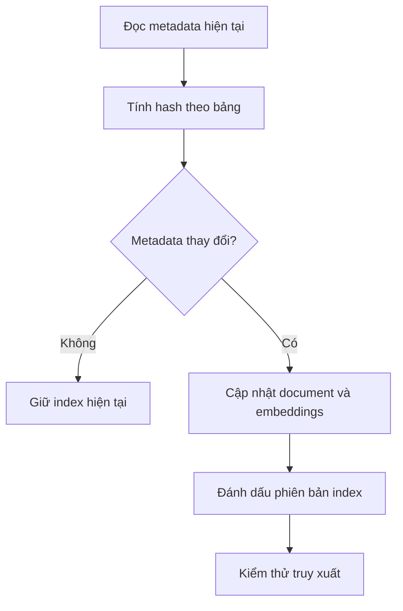

# Bài 09 — Đồng bộ schema, cache, đánh giá và mở rộng

> **Tóm tắt:** Theo dõi thay đổi cơ sở dữ liệu và đo chất lượng hệ thống thay vì chỉ dựa vào câu trả lời nhìn có vẻ đúng.

## 1. Mục tiêu học tập

- Phân biệt dữ liệu hàng thay đổi với schema thay đổi.
- Đề xuất được chiến lược cập nhật chỉ mục có kiểm soát.
- Lập được tiêu chí đánh giá retrieval, SQL và latency.

## 2. Kiến thức và nguyên lý

### 2.1. Khi nào cần cập nhật vector?

Bản ghi món ăn được thêm vào `dishes` thường **không cần** cập nhật embedding nếu Chroma chỉ lưu schema. SQL truy vấn trực tiếp SQLite sẽ thấy dữ liệu mới. Nhưng khi thêm cột `is_vegan`, đổi tên bảng hoặc sửa mô tả quan hệ, tài liệu schema trong Chroma phải được đồng bộ.

Nếu vector store còn chứa tên món, mô tả món hoặc ví dụ giá trị dữ liệu thì cần cập nhật phần nội dung liên quan; không nên đánh đồng hai trường hợp.

### 2.2. Đồng bộ tăng dần

Hướng nâng cấp: dùng ID ổn định `schema_<table>`, hash của mô tả đã chuẩn hóa và upsert các document đổi, xóa document tương ứng bảng đã xóa. Có thể chạy job nền theo lịch để không chặn đường đi của yêu cầu chat. Job nền cần có retry, log và cách rollback khi index lỗi.

### 2.3. Cache có điều kiện

Cache kết quả retrieval dựa trên câu hỏi/schema version; cache SQL theo câu hỏi, phiên bản schema và phạm vi quyền; cache hàng dữ liệu thêm phiên bản dữ liệu hoặc TTL hợp lý. Không dùng chung cache câu trả lời của hai người dùng có quyền xem dữ liệu khác nhau.

### 2.4. Đánh giá chất lượng

| Tầng | Câu hỏi đánh giá | Cách đo |
| --- | --- | --- |
| Retrieval | Lấy đủ bảng và khóa cần thiết chưa? | Recall@k theo bộ câu hỏi gán nhãn |
| SQL | Có chạy thành công và trả tập kết quả đúng? | Execution accuracy / kết quả so chuẩn |
| An toàn | Có chặn bảng cấm và lệnh viết? | Tập kiểm thử âm tính |
| Trải nghiệm | Trả lời có trung thực với rows? | Đánh giá chuyên gia và test có đáp án |
| Hiệu năng | Bước nào chậm? | Latency theo retrieval, model, SQLite |

`Execution accuracy` cần tập câu hỏi và truy vấn chuẩn; chỉ chạy thành công không đủ chứng tỏ đúng ý nghĩa.

### 2.5. Lộ trình mở rộng

Có thể thêm visualizations, feedback sửa SQL, indexing theo nhóm nghiệp vụ, monitoring, hoặc thay Chroma bằng Pinecone/Qdrant khi quy mô thật sự yêu cầu. Fine-tuning chỉ nên tính đến khi có dữ liệu gán nhãn đủ chất lượng, tránh coi đó là lựa chọn mặc định.

**Cảnh báo:** Prototype gồm FastAPI + Chroma + SQLite + Streamlit chưa mặc nhiên đạt mức production. Cần kiểm thử bảo mật, backup, phân quyền, vận hành và load test.

## 3. Thực hành ngắn

Đề xuất một kế hoạch thử nghiệm cho 20 câu hỏi về món ăn: ghi câu chuẩn, bảng kỳ vọng, SQL chuẩn, kết quả chuẩn và tiêu chí “không được tiết lộ dữ liệu”.

## 4. Tổng kết

Hệ thống bền vững cần đồng bộ metadata, đánh giá accuracy, kiểm soát cache và vận hành an toàn. Các tối ưu phải dựa trên dữ liệu đo thực tế.

## 5. Câu hỏi ôn tập

### Câu 1

Khi thêm một món mới vào SQLite nhưng schema không đổi, index chỉ chứa schema cần làm gì?

A. Bắt buộc tạo lại toàn bộ  
B. Thông thường không cần cập nhật schema embedding  
C. Xóa mọi vector  
D. Khởi động lại LLM  

**Đáp án:** B. **Giải thích:** Dữ liệu truy vấn đọc trực tiếp DB, không cần index lại schema nếu schema không đổi.

### Câu 2

Nếu đổi tên cột mà không đồng bộ vector, rủi ro gì?

A. Streamlit biến mất  
B. Thêm nhiều token tốt hơn  
C. Model sinh SQL dựa trên cột đã cũ  
D. SQLite không mở được file  

**Đáp án:** C. **Giải thích:** Ngữ cảnh sai thời điểm dẫn đến SQL không chạy được.

### Câu 3

Chỉ số nào đánh giá retrieval có lấy đủ bảng cần thiết?

A. Recall@k  
B. FPS  
C. Dung lượng ảnh  
D. Số nút trên UI  

**Đáp án:** A. **Giải thích:** Recall@k đo mức bao phủ mục tiêu trong top-k.

### Câu 4

Cache theo câu hỏi mà bỏ qua quyền người dùng có vấn đề gì?

A. Chỉ tốn RAM  
B. Không thể thêm prompt  
C. Luôn an toàn  
D. Có thể lộ kết quả từ phạm vi quyền khác  

**Đáp án:** D. **Giải thích:** Cache phải được phân vùng theo identity và quyền.

### Câu 5

Một SQL chạy thành công có chắc trả lời đúng ý định?

A. Có  
B. Không, cần đối chiếu kết quả kỳ vọng  
C. Chỉ khi có Chroma  
D. Chỉ khi UI đẹp  

**Đáp án:** B. **Giải thích:** Execution success và semantic correctness khác nhau.
