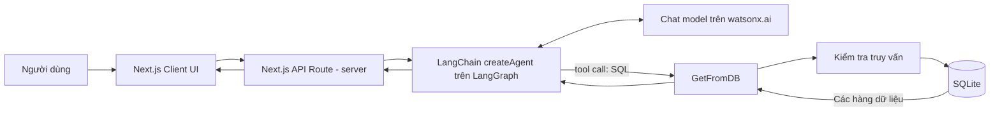
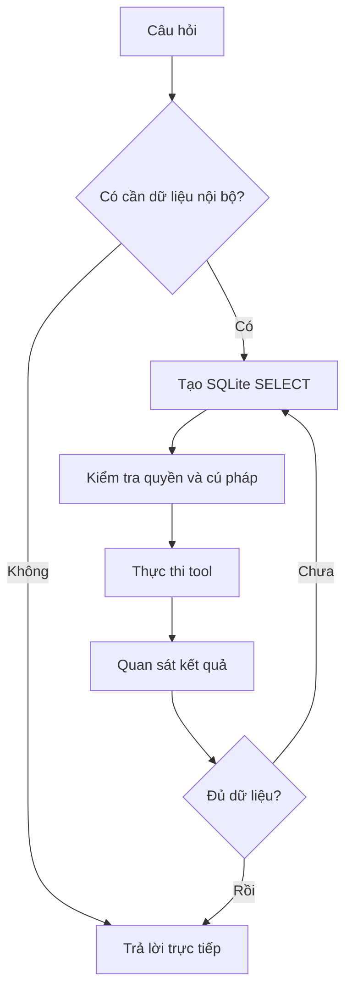

# Bài 01 — Bài toán Text-to-SQL và kiến trúc hệ thống

> **Tóm tắt:** Biến một câu hỏi tự nhiên thành truy vấn cơ sở dữ liệu có thể kiểm chứng, thay vì để LLM đoán đáp án.

## 1. Mục tiêu học tập

- Giải thích quy trình Text-to-SQL và phân biệt với chat LLM thông thường.
- Vẽ được kiến trúc Next.js → Agent → Tool → SQLite.
- Phân biệt ReAct (tư duy–hành động) với React (thư viện giao diện).

## 2. Vấn đề và cách tiếp cận

Người dùng hỏi: **“Tôi có bao nhiêu khách hàng?”**. LLM không thể biết số khách hàng trong hệ thống chỉ từ dữ liệu huấn luyện. Để có câu trả lời đáng tin, trợ lý phải truy vấn bảng `customers` và diễn giải kết quả.

**Text-to-SQL** là quá trình chuyển yêu cầu ngôn ngữ tự nhiên thành câu lệnh SQL phù hợp với lược đồ và mục tiêu. Agent có thêm khả năng **lựa chọn công cụ, gọi công cụ, xem kết quả và quyết định bước kế tiếp**. Trong khóa học, LLM không được trực tiếp truy cập database bằng mật khẩu; nó chỉ có công cụ `GetFromDB` do backend kiểm soát.

## 3. Kiến trúc tổng thể

Các mũi tên thể hiện luồng giao tiếp: frontend chỉ gửi câu hỏi và lịch sử trò chuyện; backend giữ API key; agent quyết định khi nào gọi tool; tool truy cập database đã được giới hạn quyền; LLM tóm tắt kết quả cho người dùng.

## 4. Quy trình ra quyết định ReAct

**ReAct** là mô hình lặp giữa *Reasoning* và *Acting*. Khi nhận câu hỏi, agent xác định liệu có cần dữ liệu, chọn công cụ thích hợp, quan sát kết quả và phản hồi. Không phải câu nào cũng gọi SQL. Ví dụ câu “Kể một câu chuyện cười về SQL” có thể trả lời trực tiếp, trong khi “Ai đặt nhiều đơn nhất?” cần đếm và nối bảng.

Một vòng lặp quá nhiều lần có thể tốn chi phí và tăng độ trễ; ứng dụng thực tế cần giới hạn số lần gọi tool và thời gian xử lý.

## 5. Phân công công nghệ

| Công nghệ | Nhiệm vụ |
|---|---|
| Next.js + React | Giao diện chat và HTTP API phía server |
| TypeScript | Kiểu hóa dữ liệu đầu vào/đầu ra |
| Tailwind CSS | Định dạng giao diện bằng utility class |
| LangChain / LangGraph | Khai báo agent, message, tool và vòng lặp thực thi |
| watsonx.ai | Cung cấp chat model tương thích với tool calling |
| SQLite | Cơ sở dữ liệu quan hệ nhỏ dùng để thử nghiệm |

**Điểm dễ nhầm:** thư viện giao diện **React** không phải phương pháp agent **ReAct**. LangGraph cung cấp nền tảng đồ thị; `createAgent` hiện đại của LangChain triển khai agent trên nền LangGraph.

## 6. Bài thực hành ngắn

Viết hai câu hỏi không cần SQL và ba câu hỏi bắt buộc truy vấn dữ liệu. Với mỗi câu hỏi có SQL, hãy xác định bảng, cột và phép toán cần dùng. Ví dụ “Khách hàng nào có nhiều đơn hàng nhất?” yêu cầu JOIN, GROUP BY và COUNT.

## 7. Tổng kết

Agent Text-to-SQL không thay thế hệ quản trị cơ sở dữ liệu. Nó là lớp phiên dịch yêu cầu, trong khi **quyền thực thi, phạm vi dữ liệu và xác thực** vẫn thuộc backend và database.

## 8. Câu hỏi ôn tập

### Câu 1

Khi nào agent phải gọi database?

A. Khi người dùng hỏi một câu đố chung  
B. Khi câu hỏi cần số liệu chỉ có trong cơ sở dữ liệu  
C. Mọi lượt chat đều bắt buộc gọi SQL  
D. Chỉ khi có lỗi mạng  

**Đáp án:** B  
**Giải thích:** Thông tin giao dịch riêng không nằm trong tri thức huấn luyện của model.

### Câu 2

Thành phần nào nên nắm API key watsonx.ai?

A. Frontend chạy trên browser  
B. Trình duyệt của người dùng  
C. Tailwind class  
D. Backend phía server  

**Đáp án:** D  
**Giải thích:** API key không được nhúng vào bundle client.

### Câu 3

Vai trò của GetFromDB là gì?

A. Cầu nối có kiểm soát giữa agent và DB  
B. Thay thế thuật toán SQL  
C. Lưu mật khẩu trong browser  
D. Tạo bảng tùy ý không cần quyền  

**Đáp án:** A  
**Giải thích:** Tool là giao diện thực thi do ứng dụng định nghĩa.

### Câu 4

Câu nào KHÔNG nhất thiết phải chạy SQL?

A. Có bao nhiêu đơn hàng?  
B. Tổng giá trị đơn hàng là bao nhiêu?  
C. Kể một câu đùa về SQL  
D. Khách nào nhiều đơn nhất?  

**Đáp án:** C  
**Giải thích:** Câu đùa không phụ thuộc dữ liệu nội bộ.

### Câu 5

ReAct trong agent là gì?

A. Bộ CSS framework  
B. Vòng lặp quyết định hành động và quan sát kết quả  
C. Cách tạo component giao diện  
D. Tên database  

**Đáp án:** B  
**Giải thích:** ReAct nói về mô hình hành động của agent, khác React frontend.
