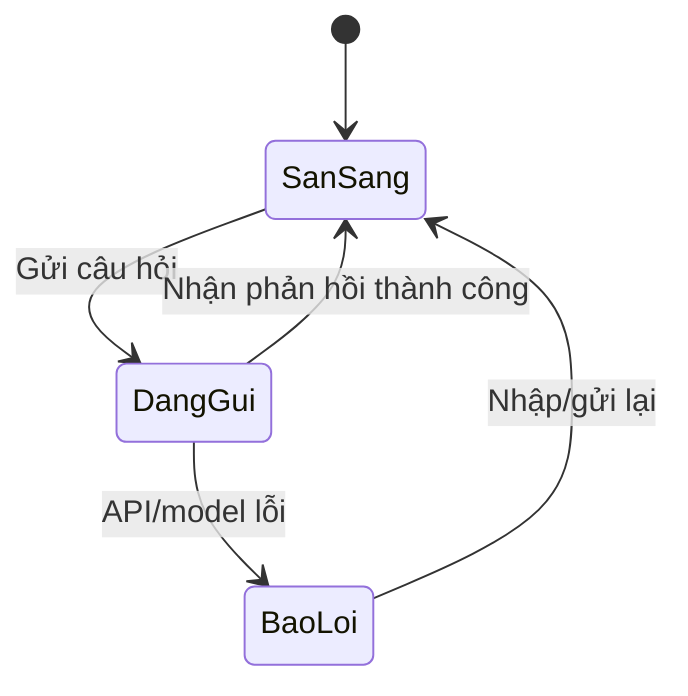

# Bài 03 — Giao diện chat, useState và lịch sử hội thoại

> **Tóm tắt:** Xây giao diện có hộp nhập, nút gửi, trạng thái loading và danh sách tin nhắn động.

## 1. Mục tiêu học tập

- Tạo component client và kiểm soát input bằng useState.
- Quản lý mảng tin nhắn role user/assistant và trạng thái loading/error.
- Gửi HTTP POST và xử lý hiển thị phản hồi từ backend.

## 2. Kiểu dữ liệu và Client Component

Trong Next.js App Router, `page.tsx` là Server Component mặc định. Giao diện có `useState`, callback gửi và sự kiện nhập liệu phải là Client Component, vì vậy dòng đầu file phải là:

```tsx
"use client";
import { useState, type FormEvent } from "react";

type ChatTurn = { role: "user" | "assistant"; content: string };
```

Biến `messages` chỉ chứa tin nhắn người dùng và agent; **system prompt không gửi xuống trình duyệt**. Dùng kiểu dữ liệu đơn giản để truyền JSON thay vì cố tuần tự hóa toàn bộ đối tượng class `BaseMessage`.

## 3. Ba trạng thái thiết yếu

```tsx
const [inputMessage, setInputMessage] = useState("");
const [messages, setMessages] = useState<ChatTurn[]>([]);
const [isLoading, setIsLoading] = useState(false);
```

`inputMessage` là giá trị hiện tại của ô nhập, `messages` giữ lịch sử, và `isLoading` cấm gửi trùng trong khi yêu cầu đang chạy. Nên có thêm `error` để hiện lỗi kết nối/model, và đưa `isLoading` về `false` trong `finally`.

## 4. Controlled input và nút gửi

```tsx
<form onSubmit={sendMessage}>
  <input value={inputMessage} disabled={isLoading}
    onChange={(e) => setInputMessage(e.target.value)} />
  <button type="submit" disabled={isLoading || !inputMessage.trim()}>
    {isLoading ? "Đang tải…" : "Gửi"}
  </button>
</form>
```

`onChange` đồng bộ màn hình và state. `disabled` vừa hỗ trợ trải nghiệm vừa tránh nhấn liên tục; **không phải** là biện pháp chống spam API phía server.

## 5. Gửi tin nhắn đến backend

```tsx
async function sendMessage(event: FormEvent<HTMLFormElement>) {
  event.preventDefault();
  const content = inputMessage.trim();
  if (!content || isLoading) return;
  const nextMessages: ChatTurn[] = [...messages, { role: "user", content }];
  setMessages(nextMessages);
  setInputMessage("");
  setIsLoading(true);
  try {
    const response = await fetch("/api/chat", {
      method: "POST",
      headers: { "Content-Type": "application/json" },
      body: JSON.stringify({ messages: nextMessages }),
    });
    if (!response.ok) throw new Error("Yêu cầu thất bại");
    const data: { answer: string } = await response.json();
    setMessages((old) => [...old, { role: "assistant", content: data.answer }]);
  } finally {
    setIsLoading(false);
  }
}
```

Đoạn code tập trung vào luồng chính. `ma-mau/src/app/page.tsx` có thêm `try/catch`, hiển thị lỗi, `aria-live`, và bố cục Tailwind.

## 6. Hiển thị đúng role

```tsx
{messages.map((message, index) => (
  <div key={`${message.role}-${index}`}>
    <strong>{message.role === "user" ? "Bạn" : "Agent"}</strong>
    <p>{message.content}</p>
  </div>
))}
```

React cần `key` ổn định để theo dõi danh sách. Index phù hợp demo chỉ thêm cuối; với hội thoại hỗ trợ sửa/xóa/sắp xếp tin nhắn nên dùng ID thật. Không nên render thẳng `SystemMessage` hoặc nội dung tool nội bộ thành bong bóng hội thoại.

## 7. Sơ đồ trạng thái



Trong trạng thái `DangGui`, nút không nhận click và có nhãn “Đang tải”. Khi lỗi, hiển thị thông điệp cho người dùng thay vì để loading treo vô hạn.

## 8. Checkpoint

Mở ứng dụng, nhập câu hỏi và nhấn Enter. Bạn phải thấy câu hỏi được thêm vào hội thoại, loading xuất hiện trong lúc gọi API, và phản hồi được thêm vào lịch sử. Nếu backend chưa được cài, giao diện phải hiển thị lỗi hợp lý.

## 9. Câu hỏi ôn tập

### Câu 1

Dòng nào biến page thành Client Component?

A. "use server";  
B. "use client";  
C. "use sql";  
D. "use react";  

**Đáp án:** B  
**Giải thích:** `use client` cho phép hook và sự kiện phía trình duyệt.

### Câu 2

Controlled input sử dụng cặp nào?

A. value và onChange  
B. className và id  
C. role và key  
D. src và alt  

**Đáp án:** A  
**Giải thích:** `value` đọc state; `onChange` cập nhật state.

### Câu 3

Tại sao cần finally?

A. Lưu API key  
B. Biến SQL thành JSON  
C. Luôn reset loading dù thành công hay lỗi  
D. Xóa database  

**Đáp án:** C  
**Giải thích:** `finally` chạy sau xử lý lỗi hoặc thành công.

### Câu 4

System prompt nên được đặt ở đâu?

A. State của client  
B. Trong input placeholder  
C. Trong localStorage  
D. Backend tạo agent  

**Đáp án:** D  
**Giải thích:** Prompt hệ thống thuộc luồng xử lý server; không coi client là nơi đáng tin.

### Câu 5

Với lịch sử chỉ thêm cuối trong demo, key có thể dùng gì?

A. Mã SQL  
B. Vai trò cộng index  
C. Giá trị API key  
D. Đối tượng database  

**Đáp án:** B  
**Giải thích:** Role+index đủ cho ví dụ không sắp xếp lại, nhưng chưa phù hợp dữ liệu động phức tạp.
