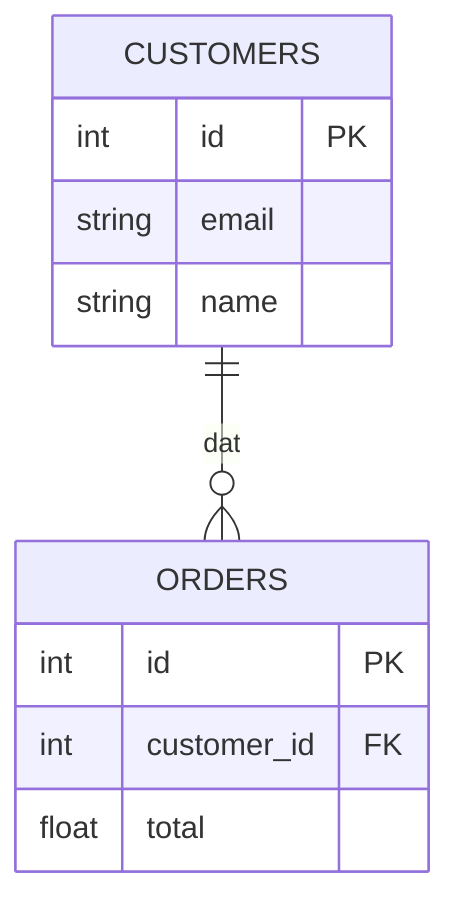
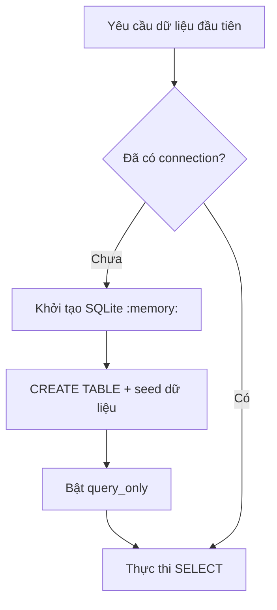

# Bài 05 — Thiết kế SQLite, khóa ngoại và dữ liệu mẫu

> **Tóm tắt:** Tạo database `:memory:` với bảng khách hàng và đơn hàng, có khóa ngoại và dữ liệu seed.

## 1. Mục tiêu học tập

- Tạo lược đồ customers/orders đúng quan hệ 1–n.
- Dùng SQLite và seed dữ liệu an toàn bằng tham số SQL.
- Giải thích khác biệt database trong bộ nhớ với database tệp.

## 2. Thiết kế quan hệ dữ liệu

Cần hai bảng: khách hàng có `id`, `email`, `name`; đơn hàng có `id`, `customer_id`, `total`. Một khách hàng có thể đặt nhiều đơn, nhưng mỗi đơn thuộc về một khách hàng.



Khóa chính `customers.id` là định danh khách hàng. `orders.customer_id` tham chiếu khóa này. Từ đó agent có thể JOIN hai bảng để trả lời câu hỏi tổng hợp.

## 3. Lệnh CREATE TABLE

```sql
CREATE TABLE "customers" (
  "id" INTEGER PRIMARY KEY,
  "email" TEXT NOT NULL UNIQUE,
  "name" TEXT NOT NULL
);

CREATE TABLE "orders" (
  "id" INTEGER PRIMARY KEY,
  "customer_id" INTEGER NOT NULL,
  "total" REAL NOT NULL,
  FOREIGN KEY ("customer_id") REFERENCES "customers" ("id")
);
```

Bật `PRAGMA foreign_keys = ON` cho kết nối SQLite trước khi nạp dữ liệu để thực sự kiểm tra ràng buộc khóa ngoại. Bài thực hành sử dụng `sqlite3` của npm với callback hoặc Promise wrapper.

## 4. Kết nối và seed dữ liệu

```ts
import sqlite3 from "sqlite3";
const db = new sqlite3.Database(":memory:");

// Hàm run() là Promise wrapper cho db.run().
await run(db, "PRAGMA foreign_keys = ON");
await run(db, `INSERT INTO "customers" ("id", "email", "name")
               VALUES (?, ?, ?)`, [1, "lucas@example.com", "Lucas Bill"]);
```

Dấu `?` là placeholder; giá trị từ dữ liệu đầu vào được truyền tách khỏi cú pháp SQL, tránh việc ghép chuỗi nguy hiểm. File hoàn chỉnh `ma-mau/src/lib/database.ts` khởi tạo **10 khách hàng** và **14 đơn hàng giả lập**, đủ thử COUNT và JOIN. Trong bộ dữ liệu mẫu tự xây dựng này, Lucas Bill có 4 đơn và nhiều hơn mỗi người còn lại.

## 5. Database bộ nhớ và vòng đời ứng dụng

Khi dùng `:memory:`, nội dung database gắn với **một kết nối**, không tự tồn tại qua restart. Trong Next.js, module có thể tải lại khi phát triển; nếu seed dữ liệu vô điều kiện trong `useEffect` của client, dễ nạp trùng hoặc gọi server function sai lớp. Cách thích hợp hơn là **lazy initialization phía server**: `getDatabase()` chỉ khởi tạo Promise kết nối một lần trong tiến trình.



`query_only` được bật sau khi seed để ngăn SQL do agent tạo sửa dữ liệu. Demo này không áp dụng nguyên xi cho serverless hoặc hệ thống đa tiến trình: các instance có bộ nhớ riêng. Dùng SQLite file hoặc hệ DB cloud khi cần dữ liệu ổn định.

## 6. Kiểm tra dữ liệu mẫu

```sql
SELECT COUNT(*) AS "customer_count" FROM "customers";
SELECT COUNT(*) AS "order_count" FROM "orders";
```

Với dữ liệu seed trong `ma-mau`, số bản ghi mong đợi lần lượt là **10** và **14**. Đây là dữ liệu do bài thực hành tạo, không phải thống kê doanh nghiệp thực tế.

## 7. Checkpoint và lỗi dễ gặp

Sau khi khởi tạo, `SELECT` phải trả về hàng dữ liệu. Thử chèn `customer_id` không tồn tại **trước khi bật read-only** để xác minh foreign key. Lỗi `no such table` thường do query chạy trước bước seed, còn `SQLITE_READONLY` xuất hiện khi cố ghi sau `PRAGMA query_only = ON`.

## 8. Câu hỏi ôn tập

### Câu 1

Quan hệ customers → orders trong lược đồ là gì?

A. 1–1  
B. 1–n  
C. n–n không cần bảng trung gian  
D. Không có quan hệ  

**Đáp án:** B  
**Giải thích:** Mỗi khách hàng có thể có nhiều đơn.

### Câu 2

Thuộc tính nào liên kết đơn hàng đến khách hàng?

A. orders.total  
B. customers.email  
C. orders.customer_id  
D. customers.name  

**Đáp án:** C  
**Giải thích:** Foreign key nằm ở `orders.customer_id`.

### Câu 3

Ý nghĩa của :memory:?

A. DB nằm trong RAM của kết nối SQLite  
B. DB tự sao lưu lên cloud  
C. DB tồn tại vĩnh viễn  
D. DB là NoSQL  

**Đáp án:** A  
**Giải thích:** Dữ liệu mất khi kết nối/tài nguyên bị đóng.

### Câu 4

Vì sao nên dùng placeholder ?

A. Để thêm màu cho bảng  
B. Để sửa kiểu dữ liệu  
C. Để mở API key  
D. Để truyền giá trị tách khỏi cú pháp SQL  

**Đáp án:** D  
**Giải thích:** Tham số giúp tránh ghép chuỗi dữ liệu vào câu lệnh.

### Câu 5

Dữ liệu seed đi kèm ví dụ có bao nhiêu khách hàng?

A. 5  
B. 14  
C. 10  
D. 100  

**Đáp án:** C  
**Giải thích:** File mẫu nạp đúng 10 khách hàng giả lập.
