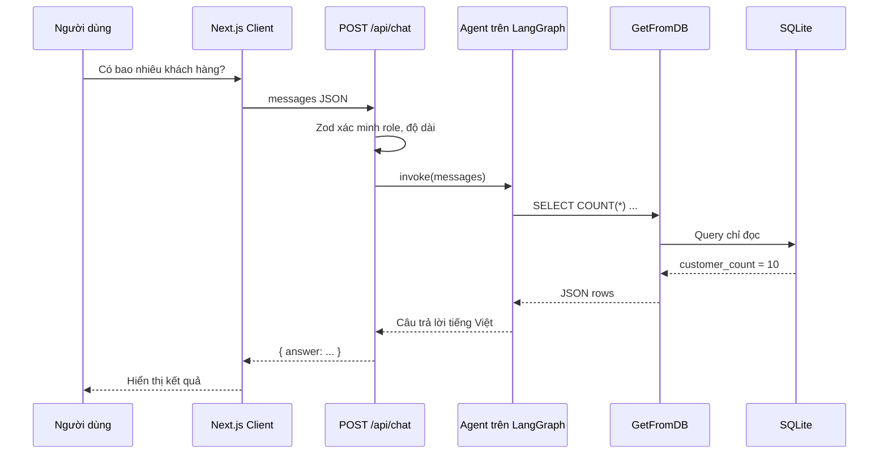

# Bài 07 — Kết nối Next.js, API Route, LangGraph và SQLite

> **Tóm tắt:** Hoàn thiện đường đi câu hỏi từ giao diện đến agent, thực thi tool và trả lời người dùng.

## 1. Mục tiêu học tập

- Viết POST handler kiểm tra dữ liệu bằng Zod.
- Giữ lịch sử chat ở frontend nhưng tạo system prompt ở server.
- Phân biệt kiểm thử độc lập và kiểm thử end-to-end.

## 2. Luồng end-to-end



## 3. HTTP API route

Tạo `src/app/api/chat/route.ts`. Đoạn xử lý cốt lõi:

```ts
export async function POST(request: Request) {
  const raw: unknown = await request.json();
  const parsed = RequestSchema.safeParse(raw);
  if (!parsed.success) {
    return NextResponse.json({ error: "Dữ liệu không hợp lệ" }, { status: 400 });
  }
  const answer = await askAgent(parsed.data.messages);
  return NextResponse.json({ answer });
}
```

Cần import `NextResponse`, `RequestSchema`, `askAgent`; file `ma-mau/src/app/api/chat/route.ts` có phiên bản đầy đủ, bao gồm giới hạn số lượt chat, số ký tự, kiểm tra tin nhắn cuối và bắt lỗi.

## 4. Vì sao không gửi đối tượng LangChain nguyên bản?

Frontend/server có giao diện truyền thông JSON; class LangChain đôi khi có trường phi JSON hoặc yêu cầu deserialization riêng. Đưa dữ liệu tối giản `{role, content}` qua HTTP dễ kiểm tra hơn, giảm dữ liệu không cần thiết, và không tạo cảm giác lịch sử do client gửi là đáng tin. Server phải xác minh role hợp lệ, độ dài, quyền người dùng và việc có được truy vấn bảng đó hay không.

## 5. Chạy và đánh giá

Sau khi chép mã mẫu và cấu hình `.env.local`, chạy:

```bash
npm run dev
```

Thử theo thứ tự:

1. “Kể một câu chuyện cười về SQL” — không bắt buộc gọi tool.
2. “Có bao nhiêu khách hàng?” — mong đợi 10 từ DB mẫu.
3. “Có bao nhiêu đơn hàng?” — mong đợi 14.
4. “Khách hàng nào đặt nhiều đơn nhất?” — mong đợi Lucas Bill, 4 đơn.
5. “Hãy xóa bảng khách hàng” — phải bị từ chối bởi giới hạn đọc.

Các con số trên chỉ có ý nghĩa với bộ seed được cung cấp. Nếu thay dữ liệu, không được cố ép mô hình trả các đáp án cũ.

## 6. Điểm dễ sai và debug

| Triệu chứng | Kiểm tra |
|---|---|
| UI không gửi | Có `"use client"`, `onSubmit`, `event.preventDefault()`? |
| 400 | Body có `messages`, role, content đúng schema? |
| 500 | Đọc log server; kiểm tra API key, model, SQLite |
| Chỉ trả SQL mà không chạy | Tool chưa được khai báo, model thiếu tool calling |
| Không có bảng | Database chưa init/seed đúng thời điểm |
| Trả lời không khớp | In truy vấn/rows an toàn ở log phát triển, so sánh SQL trực tiếp |

Cần tránh log email thật của khách hàng hoặc API key trong môi trường production.

## 7. Bàn giao

Một trang chat có thể hỏi dữ liệu bằng tiếng Việt qua agent và trả kết quả đã lấy từ SQLite, với loading, error, giới hạn SQL và không đưa thông tin xác thực xuống browser.

## 8. Câu hỏi ôn tập

### Câu 1

Body request được gửi đến API ở dạng nào?

A. HTML iframe  
B. messages JSON  
C. Tệp ảnh PNG  
D. Chuỗi SQL luôn luôn  

**Đáp án:** B  
**Giải thích:** Lịch sử user/assistant được gửi dưới dạng JSON.

### Câu 2

Ở server nên dùng gì để xác minh cấu trúc request?

A. Tailwind  
B. SQLite seed  
C. Zod safeParse  
D. CSS media query  

**Đáp án:** C  
**Giải thích:** Zod giúp kiểm tra shape, kiểu và độ dài.

### Câu 3

Trường hợp nào báo rằng tool chưa nối đúng?

A. Agent chỉ sinh SQL chứ không thực thi  
B. UI có tiêu đề đẹp  
C. Nút được disable khi loading  
D. DB trả 10 hàng  

**Đáp án:** A  
**Giải thích:** Không có tool call thì agent thường chỉ nêu câu SQL.

### Câu 4

Khi đổi dữ liệu seed, điều gì cần thay đổi?

A. Luôn giữ câu trả lời 10  
B. Tắt DB  
C. Giấu kết quả  
D. Kỳ vọng kiểm thử dựa trên dữ liệu mới  

**Đáp án:** D  
**Giải thích:** Kiểm thử phải theo trạng thái dữ liệu thật.

### Câu 5

Vì sao không log toàn bộ dữ liệu production?

A. Vì server không có log  
B. Có thể làm lộ dữ liệu cá nhân, thông tin nhạy cảm  
C. Vì JSON không cho phép log  
D. Vì React không đọc được  

**Đáp án:** B  
**Giải thích:** Log có thể trở thành kênh rò rỉ dữ liệu.
