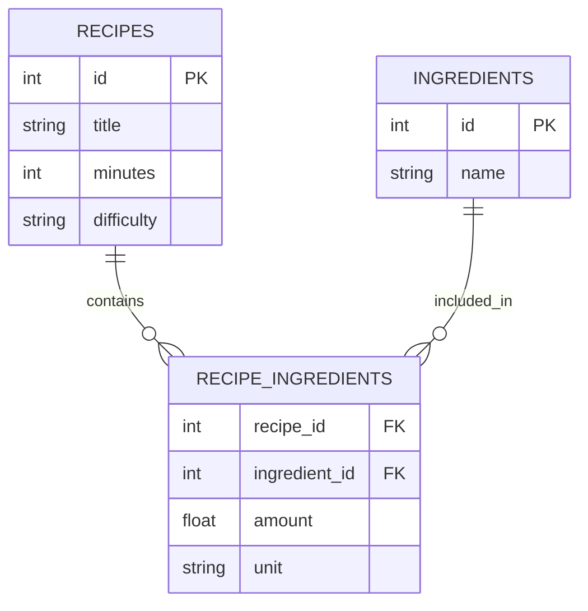
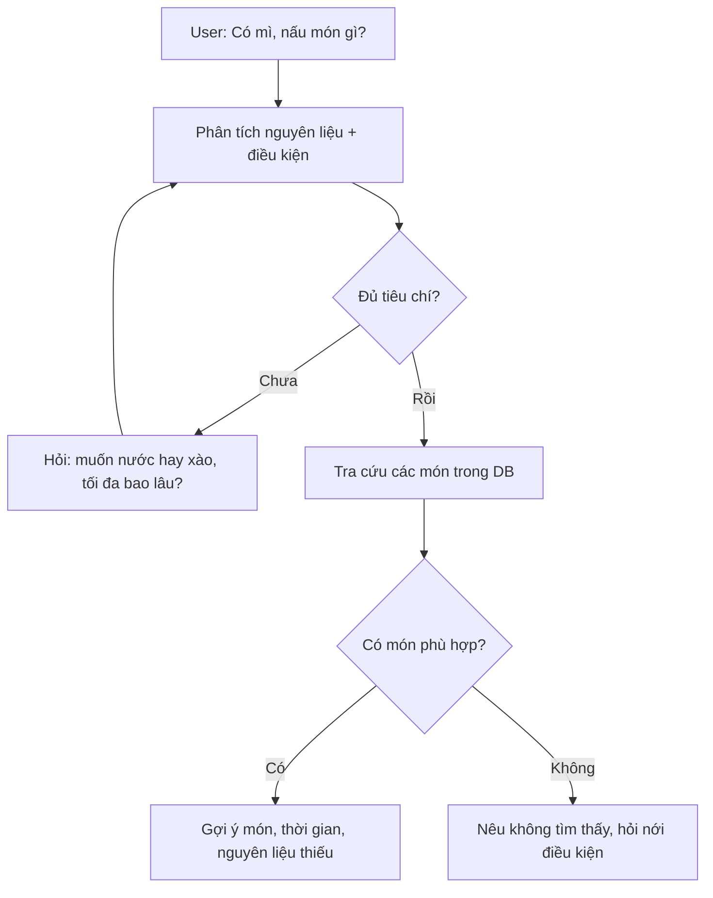

# Bài 09 — Dự án mở rộng: AI tư vấn món ăn từ database

> **Tóm tắt:** Áp dụng Text-to-SQL để tìm món theo nguyên liệu, khẩu vị và điều kiện của người dùng; hỏi lại khi thông tin chưa đủ.

## 1. Mục tiêu học tập

- Phác thảo schema món ăn/nguyên liệu và mô hình dữ liệu nhiều–nhiều.
- Viết SQL tìm món theo thành phần và độ khó.
- Đề xuất luồng hội thoại hỏi làm rõ thay vì bịa món trong database.

## 2. Bài toán sản phẩm

Người dùng nhập “Tôi có mì, trứng và cà chua, nấu gì nhanh?”. Ứng dụng phải nhận diện nguyên liệu và ràng buộc, tìm món trong database rồi giải thích vì sao phù hợp. Nếu người dùng chỉ nhập “mì”, nên **hỏi thêm** về khẩu vị, thời gian, nguyên liệu hiện có hoặc chấp nhận tìm kiếm rộng.

Phần này là **bài tập mở rộng từ bài toán khách hàng/đơn hàng**, không phải một tính năng đã có sẵn trong dự án demo.

## 3. Lược đồ đề xuất



Bảng nối `recipe_ingredients` giải quyết quan hệ nhiều–nhiều: một món có nhiều nguyên liệu và một nguyên liệu có trong nhiều món. Nếu có dị ứng, chế độ ăn hoặc dữ liệu dinh dưỡng, cần schema bổ sung đáng tin cậy; không nên đoán từ tên món.

## 4. Ví dụ SQL tìm món có mì

```sql
SELECT DISTINCT "r"."id", "r"."title", "r"."minutes"
FROM "recipes" AS "r"
JOIN "recipe_ingredients" AS "ri" ON "r"."id" = "ri"."recipe_id"
JOIN "ingredients" AS "i" ON "i"."id" = "ri"."ingredient_id"
WHERE LOWER("i"."name") LIKE '%mì%'
ORDER BY "r"."minutes" ASC
LIMIT 10
```

Ví dụ này dùng bảng mở rộng; cần tạo và seed bảng trước khi chạy. Với dữ liệu quy mô lớn, cân nhắc full-text search, bộ lọc có chỉ mục, chuẩn hóa tên nguyên liệu và truy xuất vector khi người dùng diễn đạt nhiều cách như “mì gói”/“mì ăn liền”.

## 5. Luồng hỏi làm rõ



Nếu muốn **tự sinh công thức mới** khi database không có món, phải tách chế độ rõ ràng với việc tìm món sẵn; dán nhãn “công thức AI đề xuất, chưa xác thực” và không lưu vào DB như món đã được kiểm duyệt nếu chưa có bước đánh giá.

## 6. Milestone và Definition of Done

1. **Dữ liệu:** ít nhất ba bảng, có dữ liệu món thật hoặc giả lập được ghi rõ.
2. **Truy vấn:** agent tìm được món chứa mì và lọc được thời gian nấu.
3. **Hội thoại:** yêu cầu mơ hồ dẫn đến câu hỏi làm rõ hợp lý.
4. **An toàn:** không thực thi SQL ghi; không bịa giá trị dinh dưỡng/dị ứng.
5. **Kiểm thử:** ít nhất 5 tình huống có kết quả SQL đối chiếu được.

**Deliverable:** README, schema SQL, 5 kịch bản chat, ảnh màn hình và bảng test pass/fail. Người học tự mở rộng `ma-mau` thành schema món ăn.

## 7. Câu hỏi ôn tập

### Câu 1

Quan hệ recipes–ingredients thường là?

A. Nhiều–nhiều qua bảng nối  
B. Một–một cố định  
C. Không thể mô hình hóa bằng SQL  
D. Chỉ chứa văn bản tự do  

**Đáp án:** A  
**Giải thích:** Món và nguyên liệu liên kết qua recipe_ingredients.

### Câu 2

Nếu user chỉ nhập “mì”, phản hồi nào tốt?

A. Bịa ngay một món không có trong DB  
B. Luôn báo lỗi 500  
C. Tìm rộng hoặc hỏi thêm điều kiện cần thiết  
D. Tự thêm món vào DB  

**Đáp án:** C  
**Giải thích:** Agent nên hỏi làm rõ hoặc tìm với điều kiện hiện có.

### Câu 3

Khi DB không tìm thấy món nào, agent nên làm gì?

A. Khẳng định có 10 món  
B. Nêu không tìm thấy và hỏi có nới điều kiện không  
C. Sửa DB không báo  
D. Dựa vào ký ức để bịa ID món  

**Đáp án:** B  
**Giải thích:** Không được mô tả món ngoài DB như bản ghi có thật.

### Câu 4

Truy vấn món có nguyên liệu thường JOIN qua bảng nào?

A. customers  
B. orders  
C. logs  
D. recipe_ingredients  

**Đáp án:** D  
**Giải thích:** Bảng nối biểu diễn món–nguyên liệu.

### Câu 5

Công thức AI tạo mới nên được xử lý thế nào?

A. Gắn nhãn chưa xác thực, phân biệt với món trong DB  
B. Tự coi là dữ liệu đã kiểm duyệt  
C. Bỏ qua vấn đề dị ứng  
D. Gán ID có sẵn bừa bãi  

**Đáp án:** A  
**Giải thích:** Phân biệt kết quả truy xuất và nội dung tổng hợp là quan trọng.
