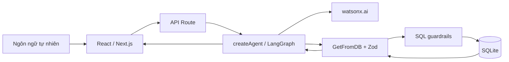

# Bài 10 — Ôn tập, bài kiểm tra cuối khóa và checklist dự án

> **Tóm tắt:** Hệ thống kiến thức đã học và xây bộ tiêu chí tự nghiệm thu Text-to-SQL Agent.

## 1. Mục tiêu học tập

- Tổng hợp được các thành phần của hệ thống.
- Tự kiểm thử một yêu cầu JOIN xuyên nhiều bảng.
- Đề xuất tối thiểu ba kiểm soát bảo mật ngoài prompt.

## 2. Bản đồ kiến thức

Bất kỳ trục trặc nào trên đường đi đều có thể khiến người dùng không nhận được câu trả lời, vì vậy cần debug theo tầng: request, model, tool, SQL, kết quả, cách diễn đạt.

## 3. Bảng phân biệt thuật ngữ

| Khái niệm | Ý nghĩa | Sai lầm thường gặp |
|---|---|---|
| Text-to-SQL | Tạo truy vấn từ câu hỏi | Tưởng mọi câu đều cần truy vấn |
| ReAct | Agent quyết định–hành động–quan sát | Nhầm với React UI |
| React `useState` | Quản lý trạng thái UI | Đặt logic DB phía client |
| LangGraph | Runtime agent dạng graph | Cho rằng tự có quyền DB |
| Tool calling | Model yêu cầu gọi hàm | Cấp quyền SQL toàn phần |
| SQLite `:memory:` | CSDL trên RAM theo kết nối | Tưởng có dữ liệu vĩnh viễn |
| Zod | Kiểm tra cấu trúc đầu vào | Tưởng đảm bảo ngữ nghĩa SQL |

## 4. Bài thực hành cuối khóa

**Đề bài:** Xây ứng dụng chat cho dữ liệu khách hàng–đơn hàng. Người dùng hỏi “Liệt kê ba khách hàng có nhiều đơn hàng nhất; nếu bằng số đơn thì xếp theo tên.”

**Yêu cầu:** chọn JOIN phù hợp, tổng hợp COUNT, sắp giảm dần số đơn và tăng dần tên, giới hạn ba hàng; xử lý cả khách không có đơn nếu yêu cầu bao gồm toàn bộ khách. Ghi lại SQL agent tạo, so sánh kết quả thực tế, thử prompt yêu cầu xóa bảng và chứng minh bị chặn.

**Tiêu chí chấm gợi ý (100 điểm):** kiến trúc và môi trường 20; SQL đúng 25; UI và API 20; kiểm thử 20; an toàn và giải thích 15. Không tính điểm nếu đáp án số liệu chỉ được model đoán mà không truy vấn DB.

## 5. Checklist nghiệm thu

- [ ] `npm run dev` mở được trang chat.
- [ ] API key chỉ tồn tại server-side.
- [ ] Model đã được kiểm tra hỗ trợ tool calling.
- [ ] `COUNT(customers)` khớp dữ liệu thực tế.
- [ ] JOIN và GROUP BY cho kết quả đúng.
- [ ] Hệ thống biết không gọi tool khi câu hỏi không cần dữ liệu.
- [ ] Truy vấn ghi bị từ chối tại DB.
- [ ] Lỗi được xử lý và loading kết thúc.
- [ ] Không bịa cột hoặc số liệu không có trong DB.
- [ ] Chưa triển khai công khai nếu chưa có auth, phân quyền dữ liệu, quota và timeout.

## 6. Tổng kết

Điểm cốt lõi của hệ thống không chỉ là sinh SQL hợp lệ mà là **sinh truy vấn đúng với quyền dữ liệu**, thực thi an toàn rồi diễn giải kết quả chính xác. Khi chuyển sang bài toán tìm kiếm món ăn, thay thế schema và dữ liệu, nhưng vẫn giữ các nguyên tắc kiểm chứng này.

## 7. Câu hỏi ôn tập

### Câu 1

SQL Agent đáng tin cần gì hơn SQL chạy được?

A. Màu giao diện đẹp  
B. Dữ liệu đúng, quyền hợp lệ và kết quả được kiểm chứng  
C. Chỉ model lớn nhất  
D. Không cần kiểm thử  

**Đáp án:** B  
**Giải thích:** Query hợp lệ không đủ nếu vi phạm quyền hoặc sai ý người dùng.

### Câu 2

LangGraph có vai trò gần nhất là gì?

A. Nơi lưu password người dùng  
B. Hệ quản trị database  
C. Nền tảng thực thi agent graph  
D. Công cụ styling  

**Đáp án:** C  
**Giải thích:** LangGraph tổ chức và vận hành luồng agent.

### Câu 3

Khi nào data source ở :memory: bị mất?

A. Khi kết nối/tiến trình bị kết thúc  
B. Khi thêm nút Gửi  
C. Khi Tailwind cập nhật  
D. Khi React render lại một phần tử  

**Đáp án:** A  
**Giải thích:** SQLite in-memory không lưu bền vững qua restart.

### Câu 4

Bảo vệ dữ liệu thực cần gì?

A. Chỉ system prompt  
B. Chỉ Zod  
C. Chỉ nút disabled  
D. Auth, phân quyền DB, hạn mức và kiểm soát truy vấn  

**Đáp án:** D  
**Giải thích:** Cần nhiều lớp cưỡng chế và giới hạn.

### Câu 5

Vì sao phải kiểm thử câu trả lời cuối so với rows từ tool?

A. Để tăng tốc CSS  
B. LLM có thể diễn giải sai dù SQL và rows đúng  
C. SQL tự hiển thị đẹp  
D. Vì mỗi tool call ghi vào DB  

**Đáp án:** B  
**Giải thích:** Kiểm chứng end-to-end bắt lỗi ở bước diễn giải.
