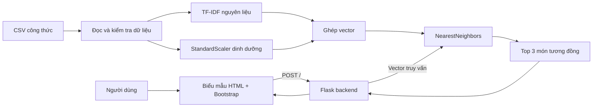

# Bài 01 — Bài toán và kiến trúc hệ thống gợi ý công thức

> **Loại:** Bài học và thực hành · **Chủ đề:** Recipe Recommendation System · **Công cụ:** Python, scikit-learn, Flask

## 1. Tóm tắt

Một hệ thống gợi ý công thức nhận danh sách nguyên liệu và các chỉ tiêu dinh dưỡng do người dùng nhập, rồi trả về những công thức có sẵn gần với yêu cầu nhất. Đây là **hệ thống truy hồi theo mức độ tương đồng** dựa trên Machine Learning, không phải chatbot tự sáng tác món ăn.

## 2. Mục tiêu học tập

- Mô tả được đầu vào, đầu ra và giới hạn của hệ thống.
- Vẽ được luồng xử lý từ form HTML đến dữ liệu công thức.
- Phân biệt gợi ý dựa trên nội dung với việc sinh công thức mới.

## 3. Xác định yêu cầu sản phẩm

Người dùng có thể nhập `chicken, rice, carrot` và tùy chọn các giá trị dinh dưỡng. Hệ thống xếp hạng **ba công thức có sẵn** theo độ gần của vector đặc trưng. Thông tin hiển thị gồm tên món, danh sách nguyên liệu và một số thuộc tính dinh dưỡng.

Đặc trưng văn bản là **nguyên liệu**; đặc trưng dạng số gồm `calories`, `fat_g`, `carbohydrates_g`, `protein_g`, `cholesterol_mg`, `sodium_mg`, `fiber_g`. `recipe_id`, số đánh giá và URL hình ảnh là thuộc tính hiển thị/quản lý, không mặc nhiên là đầu vào khoảng cách.

## 4. Kiến trúc tổng thể

Hai đường dữ liệu có nhiệm vụ khác nhau: dữ liệu CSV dùng để xây chỉ mục truy hồi; form cung cấp *một truy vấn mới*. Cả hai phải dùng **cùng bộ biến đổi đã được fit**. Nếu huấn luyện lại vectorizer trên từng truy vấn, ý nghĩa các cột trong vector sẽ thay đổi.

## 5. Truy hồi so với sáng tạo món ăn

- **Truy hồi:** chỉ chọn công thức đã có, thích hợp khi cần đảm bảo dữ liệu gốc.
- **Sinh mới:** cần thêm cơ chế tạo nội dung, kiểm tra định lượng và độ an toàn của công thức; không nằm trong mô hình KNN của khóa này.
- **Mức tương đồng:** không phải xác suất món ngon, không bảo đảm mọi nguyên liệu đều có sẵn hoặc đạt chính xác mục tiêu dinh dưỡng.

## 6. Tiêu chí hoàn thành

Sản phẩm tối thiểu có giao diện nhập nguyên liệu, xử lý giá trị số tùy chọn, trả về ba kết quả hoặc thông báo lỗi dễ hiểu và chạy được ở máy cá nhân.

## 7. Thực hành tự kiểm tra

Vẽ lại luồng: người dùng gửi `tofu, broccoli` → Flask → biến đổi thành đặc trưng → truy hồi ba hàng gần nhất. Chỉ ra đâu là bước **fit** và đâu là bước **transform**.

## 8. Câu hỏi ôn tập

**Câu 1.** Hệ thống đang triển khai thuộc nhóm nào?

A. Nhận dạng khuôn mặt  
B. Sinh công thức hoàn toàn mới  
C. Gợi ý theo độ tương đồng với dữ liệu có sẵn  
D. Dịch máy  

**Đáp án: C.** Mô hình trả các hàng có sẵn trong CSV.

**Câu 2.** Đâu là dữ liệu phù hợp làm đầu vào văn bản?

A. Danh sách nguyên liệu  
B. ID công thức  
C. Lượt xem website  
D. URL ảnh  

**Đáp án: A.** Danh sách nguyên liệu mô tả trực tiếp nội dung món.

**Câu 3.** Vì sao không nên fit lại TF-IDF trên mỗi truy vấn?

A. Làm HTML chậm  
B. Thay đổi không gian đặc trưng và làm sai phép so sánh  
C. Tăng số ảnh  
D. Không thể dùng Flask  

**Đáp án: B.** Vector truy vấn phải dùng từ vựng đã học từ công thức.

**Câu 4.** Kết quả có similarity 0,9 có nghĩa gì?

A. 90% người sẽ thích  
B. Món đủ dinh dưỡng 90%  
C. Công thức do AI tạo ra  
D. Mức gần theo thước đo vector đang dùng  

**Đáp án: D.** Đó chỉ là chỉ số gần, không phải sự bảo đảm.

**Câu 5.** Thành phần nào nhận HTTP POST từ form?

A. Pandas  
B. Jupyter  
C. Flask  
D. TF-IDF  

**Đáp án: C.** Flask là lớp web backend tiếp nhận yêu cầu.

## 9. Tổng kết

Bài này hoàn thiện một mắt xích của hệ thống gợi ý công thức. Khi thực hành, hãy đối chiếu kết quả với tệp `thuc-hanh/` và tự giải thích lý do của từng phép biến đổi.
