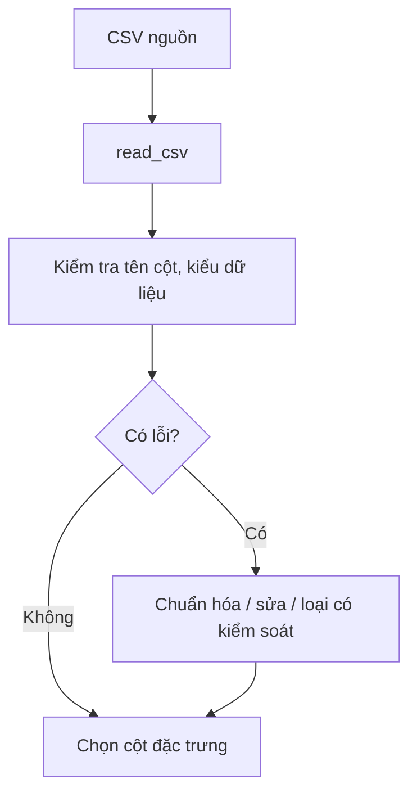

# Bài 02 — Khám phá dữ liệu CSV và đặc trưng công thức

> **Loại:** Bài học và thực hành · **Chủ đề:** Recipe Recommendation System · **Công cụ:** Python, scikit-learn, Flask

## 1. Tóm tắt

Trước khi xây mô hình, cần đọc cấu trúc CSV, xác định ý nghĩa cột, đơn vị đo và chất lượng dữ liệu. Bước khám phá giúp tránh lỗi đặc trưng sai kiểu hoặc đánh đồng gram với milligram.

## 2. Mục tiêu học tập

- Đọc và kiểm tra bảng dữ liệu bằng pandas.
- Phân biệt cột dùng cho truy hồi và cột chỉ dùng để hiển thị.
- Phát hiện dữ liệu khuyết, trùng và đơn vị không nhất quán.

## 3. Cấu trúc dữ liệu

| Cột minh họa | Ý nghĩa | Vai trò |
| --- | --- | --- |
| `recipe_id`, `name` | Định danh, tên món | Hiển thị/quản lý |
| `average_rating`, `review_count` | Đánh giá và số lượt đánh giá | Có thể hiển thị; chưa dùng trong vector |
| `image_url` | Đường dẫn ảnh nếu nguồn có cung cấp | Trình bày, không phải đặc trưng khoảng cách |
| `calories` | Năng lượng, kcal | Biến số |
| `fat_g`, `carbohydrates_g`, `protein_g`, `fiber_g` | Các chất dinh dưỡng, gram | Biến số |
| `cholesterol_mg`, `sodium_mg` | Cholesterol và natri, milligram | Biến số |
| `ingredients` | Các nguyên liệu, ngăn cách bởi dấu phẩy | Biến văn bản |

Tệp minh họa trong `thuc-hanh/data/recipes_demo.csv` không chứa ảnh, chỉ chứa các cột đủ để chạy demo. Các số liệu được soạn để thực hành thuật toán, **không đại diện cho giá trị dinh dưỡng đã kiểm chứng**.

## 4. Đọc CSV bằng pandas

```python
import pandas as pd

df = pd.read_csv("data/recipes_demo.csv", encoding="utf-8-sig")
print(df.head(3))
print(df.info())
print(df.isna().sum())
print("Số dòng trùng ID:", df.duplicated(subset=["recipe_id"]).sum())
```

`head(3)` xem nhanh ba dòng; `info()` giúp nhận diện cột số bị đọc thành chuỗi; `isna().sum()` thống kê giá trị trống. Việc không thấy null trong một file **không bảo đảm** mọi bộ dữ liệu thực tế đều sạch.

## 5. Kiểm tra dữ liệu quan trọng

Nếu một công thức có `fat_g = "unknown"`, ta phải chuyển nó thành giá trị thiếu rồi xử lý; tuyệt đối không ép kiểu số bằng cách bỏ qua lỗi mà không kiểm tra. Nếu dữ liệu đến từ nguồn ngoài, kiểm tra bản quyền ảnh, quyền sử dụng công thức và độ tin cậy thông tin dinh dưỡng.

Dữ liệu có thể lưu nguyên liệu ở dạng chuỗi, ví dụ `tomato, basil, garlic`. Chọn **một quy ước phân cách** duy nhất; nếu dữ liệu gốc chứa JSON list, hãy phân tích JSON thay vì tách chuỗi một cách mù quáng.

## 6. Dòng dữ liệu



Dữ liệu sau kiểm tra là đầu vào cho bước biến đổi thành vector, không trực tiếp đưa chuỗi văn bản vào `NearestNeighbors`.

## 7. Thực hành tự kiểm tra

Chạy đoạn code trên bằng cách đứng trong thư mục `thuc-hanh/`. Thêm một dòng lỗi vào **bản sao** CSV, quan sát `info()` và `isna()`, sau đó hoàn tác thay đổi.

## 8. Câu hỏi ôn tập

**Câu 1.** Lệnh nào phát hiện số giá trị thiếu theo cột?

A. df.head()  
B. df.isna().sum()  
C. df.plot()  
D. df.copy()  

**Đáp án: B.** isna tạo mặt nạ thiếu; sum cộng theo cột.

**Câu 2.** Vì sao phải giữ đơn vị của sodium nhất quán?

A. Để tô màu form  
B. Để tăng số dòng  
C. Để thay tên món  
D. Để khoảng cách số không bị méo do đơn vị  

**Đáp án: D.** Đổi đơn vị không thống nhất gây sai lệch mô hình.

**Câu 3.** Trường nào thường không cần cho mô hình tương đồng nguyên liệu-dinh dưỡng?

A. recipe_id  
B. ingredients  
C. fat_g  
D. protein_g  

**Đáp án: A.** ID chỉ để định danh, không phải ý nghĩa món.

**Câu 4.** CSV ví dụ có thể dùng làm bảng dinh dưỡng chuẩn chưa?

A. Có, đã kiểm nghiệm  
B. Có, thay lời khuyên y tế  
C. Không, chỉ là dữ liệu thuật toán minh họa  
D. Có nếu có rating  

**Đáp án: C.** Các con số demo chưa được xác thực.

**Câu 5.** Mục đích đầu tiên của df.info() là gì?

A. Fit KNN  
B. Xem kiểu dữ liệu, số dòng và cột  
C. Triển khai Flask  
D. Tạo HTML  

**Đáp án: B.** Kiểm tra schema và kiểu dữ liệu trước khi xử lý.

## 9. Tổng kết

Bài này hoàn thiện một mắt xích của hệ thống gợi ý công thức. Khi thực hành, hãy đối chiếu kết quả với tệp `thuc-hanh/` và tự giải thích lý do của từng phép biến đổi.
