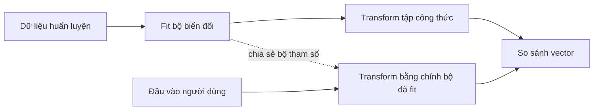

# Bài 03 — Tiền xử lý nguyên liệu và giá trị dinh dưỡng

> **Loại:** Bài học và thực hành · **Chủ đề:** Recipe Recommendation System · **Công cụ:** Python, scikit-learn, Flask

## 1. Tóm tắt

Dữ liệu chuỗi và dữ liệu số cần được xử lý khác nhau trước khi ghép thành cùng một vector. Mục tiêu là loại bỏ lỗi định dạng nhưng không làm mất ý nghĩa của nguyên liệu.

## 2. Mục tiêu học tập

- Chuẩn hóa chuỗi nguyên liệu mà không tự ý đổi tên món.
- Xử lý giá trị số trống bằng chiến lược có thể giải thích.
- Nêu được quy tắc tiền xử lý thống nhất khi đưa vào mô hình.

## 3. Chuẩn hóa văn bản nguyên liệu

`"  Chicken , Rice, rice "` và `"chicken, rice"` nên cho ra các token giống nhau. Trong mã demo, hàm `ingredients_analyzer()` phân tách bằng dấu phẩy, chuyển chữ về dạng thường và loại phần tử trùng. Mỗi nguyên liệu nhiều từ như `soy sauce` được giữ nguyên như một token.

```python
from recommender import ingredients_analyzer
print(ingredients_analyzer(" Chicken , Rice, rice, soy sauce "))
# ['chicken', 'rice', 'soy sauce']
```

Một lỗi thường gặp là dùng trình tách từ mặc định rồi vô tình coi `soy` và `sauce` như hai thành phần không liên quan. Bên cạnh đó, `bell pepper` và `capsicum` là từ đồng nghĩa **nhưng không tự trở thành một token** trong bản mẫu: bài toán chuẩn hóa từ đồng nghĩa cần bảng ánh xạ bổ sung.

## 4. Xử lý dữ liệu số

Các cột dinh dưỡng phải chuyển thành số để tính khoảng cách:

```python
NUMERIC = ["calories", "fat_g", "carbohydrates_g", "protein_g",
           "cholesterol_mg", "sodium_mg", "fiber_g"]
df[NUMERIC] = df[NUMERIC].apply(pd.to_numeric, errors="coerce")
medians = df[NUMERIC].median().fillna(0.0)
filled = df[NUMERIC].fillna(medians)
```

Điền trung vị (`median`) là **lựa chọn triển khai minh họa**, không phải bằng chứng mọi giá trị trống đều bằng trung vị. Khi triển khai thật, cần ghi tỷ lệ khuyết, kiểm tra nguồn số liệu và cân nhắc loại bỏ dòng không đáng tin.

## 5. Không làm sai phép biến đổi ở thời điểm truy vấn



Trung vị, giá trị trung bình/độ lệch chuẩn và từ vựng TF-IDF phải đến từ tập công thức, không tính lại từ một dòng truy vấn. Đây là nguyên tắc quan trọng để mô hình có thể chạy ổn định.

## 6. Phân biệt thiếu dữ liệu và không có nguyên liệu

Người dùng bỏ trống `protein_g` nghĩa là **không đặt mục tiêu cụ thể**; dữ liệu thực hành lấp bằng trung vị để đủ vector. Đó không phải việc người dùng yêu cầu lượng protein bằng trung vị. Có thể nâng cấp bằng mặt nạ chỉ tiêu được chọn để giảm ảnh hưởng từ các ô bỏ trống.

## 7. Thực hành tự kiểm tra

Nhập `Egg, egg,  Mushroom` và đối chiếu token đầu ra. Sau đó giả lập một ô `sodium_mg` trống trong DataFrame tạm thời; kiểm tra trung vị dùng để điền.

## 8. Câu hỏi ôn tập

**Câu 1.** Chuỗi "soy sauce" nên được xử lý thế nào khi nó là một nguyên liệu?

A. Bỏ cả chuỗi  
B. Đổi thành 0  
C. Giữ thành một token nguyên liệu  
D. Dùng làm ID  

**Đáp án: C.** Đơn vị tách là dấu phẩy giữa các nguyên liệu.

**Câu 2.** Nếu có ô sodium_mg = "abc" khi ép số với errors="coerce" sẽ xảy ra gì?

A. Trở thành NaN  
B. Trở thành 1  
C. Tự đổi thành mg  
D. Giữ nguyên và fit được  

**Đáp án: A.** Giá trị không hợp lệ được chuyển thành NaN.

**Câu 3.** fit scaler trên một truy vấn mới là đúng hay sai?

A. Đúng vì nhanh hơn  
B. Đúng nếu có một dòng  
C. Đúng khi query rỗng  
D. Sai vì mất hệ quy chiếu chung  

**Đáp án: D.** Phải dùng scaler đã fit ở tập gốc.

**Câu 4.** Điền trung vị phù hợp nhất khi nào?

A. Khi muốn đảm bảo số liệu thật  
B. Khi cần chiến lược baseline có giải thích  
C. Khi thay đơn vị mg bằng g  
D. Khi viết CSS  

**Đáp án: B.** Đây là một baseline và phải được đánh giá.

**Câu 5.** Mục tiêu chính của chuẩn hóa khoảng trắng và chữ hoa là gì?

A. Tăng rating  
B. Thêm công thức  
C. Hạn chế token trùng do cách viết  
D. Thay đổi hàm fit  

**Đáp án: C.** Các cách viết tương đương sẽ ánh xạ về cùng token.

## 9. Tổng kết

Bài này hoàn thiện một mắt xích của hệ thống gợi ý công thức. Khi thực hành, hãy đối chiếu kết quả với tệp `thuc-hanh/` và tự giải thích lý do của từng phép biến đổi.
