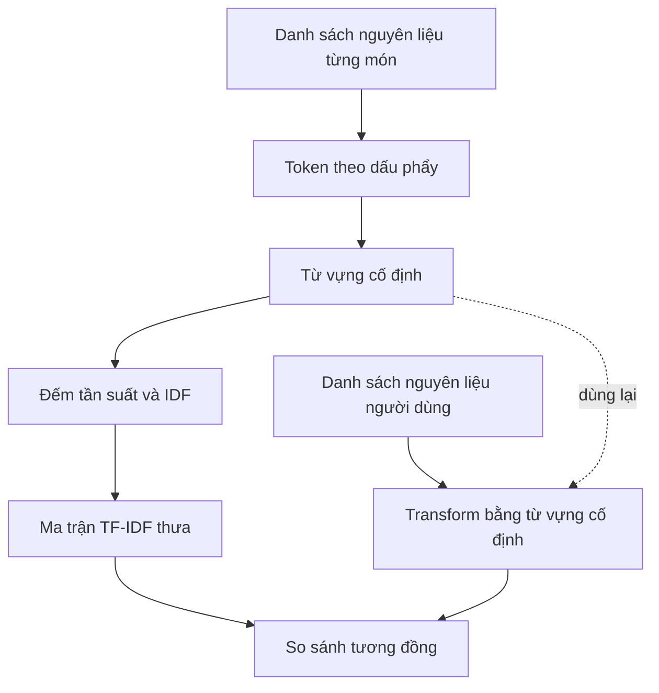

# Bài 04 — Biểu diễn nguyên liệu bằng TF-IDF

> **Loại:** Bài học và thực hành · **Chủ đề:** Recipe Recommendation System · **Công cụ:** Python, scikit-learn, Flask

## 1. Tóm tắt

Thuật toán tìm láng giềng gần nhất không tính khoảng cách trực tiếp giữa hai chuỗi nguyên liệu. TF-IDF chuyển danh sách nguyên liệu thành vector số, giúp mô hình so sánh các công thức theo thành phần.

## 2. Mục tiêu học tập

- Giải thích được TF và IDF ở mức trực giác và công thức.
- Áp dụng `TfidfVectorizer` lên chuỗi nguyên liệu phân cách dấu phẩy.
- Xử lý được token không xuất hiện trong từ vựng đã fit.

## 3. Từ văn bản sang vector

Một tập công thức có các token `rice`, `chicken`, `carrot` sẽ tạo các chiều tương ứng trong không gian đặc trưng. Một món có `chicken, rice` mang trọng số khác 0 ở hai chiều đầu và bằng 0 ở chiều `carrot`.

TF (term frequency) mô tả mức xuất hiện của token trong một tài liệu. IDF (inverse document frequency) giảm vai trò của token xuất hiện ở quá nhiều tài liệu. Một công thức IDF thông dụng trong tài liệu lý thuyết:

$$
\operatorname{IDF}(t)=\log\left(\frac{N}{\operatorname{df}(t)}\right)
$$

Trong đó $N$ là số công thức và $\operatorname{df}(t)$ là số công thức chứa token $t$. **scikit-learn mặc định dùng biến thể có làm trơn**: $\operatorname{IDF}(t)=\log((1+N)/(1+\operatorname{df}(t)))+1$, sau đó chuẩn hóa vector; vì vậy giá trị thực tế có thể khác phép tính tay theo công thức đơn giản.

## 4. Triển khai

```python
from sklearn.feature_extraction.text import TfidfVectorizer
from recommender import ingredients_analyzer

texts = ["chicken, rice", "tofu, rice", "tofu, broccoli"]
vectorizer = TfidfVectorizer(analyzer=ingredients_analyzer,
                             lowercase=False)
X = vectorizer.fit_transform(texts)
print(vectorizer.get_feature_names_out())
print(X.shape)  # (3, số token khác nhau)

query = vectorizer.transform(["rice, chicken"])
```

`fit_transform()` tạo từ vựng và tính ma trận cho tập công thức; `transform()` biến đổi truy vấn theo từ vựng cố định. Dữ liệu TF-IDF thường **thưa (sparse)**: không cần đổi tất cả sang ma trận đặc rồi mới ghép.

## 5. Tình huống ngoài từ vựng

Nếu trong toàn bộ CSV không có `dragon fruit`, thì từ này không có chiều tương ứng và bị bỏ qua khi `transform()`. Khi truy vấn toàn token lạ, vector nguyên liệu có thể bằng 0; kết quả khi đó bị quyết định bởi các tiêu chí còn lại, hoặc thiếu cơ sở hữu ích nếu không có tiêu chí nào. Mô hình production nên phát hiện để đề nghị người dùng đổi cách nhập.

## 6. Sơ đồ tạo từ vựng



## 7. Thực hành tự kiểm tra

Tạo bộ ba công thức nhỏ như ví dụ, in `get_feature_names_out()` và so sánh vector `"rice, chicken"` với `"rice, tofu"`. Kiểm tra truy vấn token chưa từng xuất hiện.

## 8. Câu hỏi ôn tập

**Câu 1.** Mục đích của TF-IDF?

A. Tạo UI  
B. Biến nguyên liệu thành vector số có trọng số  
C. Đổi kcal thành gram  
D. Đọc HTTP  

**Đáp án: B.** TF-IDF cung cấp biểu diễn cho phép so sánh khoảng cách.

**Câu 2.** Truy vấn mới cần gọi phương thức nào?

A. fit_transform  
B. fit  
C. score  
D. transform  

**Đáp án: D.** Không thay từ vựng đã fit trên dữ liệu công thức.

**Câu 3.** Token quá phổ biến thường có IDF như thế nào?

A. Thấp tương đối  
B. Vô hạn  
C. Bằng độ dài URL  
D. Luôn bằng 0  

**Đáp án: A.** IDF giảm trọng số token xuất hiện rộng khắp.

**Câu 4.** TF-IDF của scikit-learn mặc định có đúng chính xác log(N/df)?

A. Luôn đúng  
B. Chỉ đúng khi có ảnh  
C. Không, có làm trơn và chuẩn hóa mặc định  
D. Không thể tính được  

**Đáp án: C.** Công thức triển khai có cộng 1 và chuẩn hóa.

**Câu 5.** Vì sao giữ ma trận thưa có lợi?

A. Làm thay đổi ngữ nghĩa  
B. Tiết kiệm bộ nhớ khi nhiều phần tử bằng 0  
C. Tạo thêm món  
D. Thay ảnh món ăn  

**Đáp án: B.** TF-IDF có nhiều ô bằng 0.

## 9. Tổng kết

Bài này hoàn thiện một mắt xích của hệ thống gợi ý công thức. Khi thực hành, hãy đối chiếu kết quả với tệp `thuc-hanh/` và tự giải thích lý do của từng phép biến đổi.
