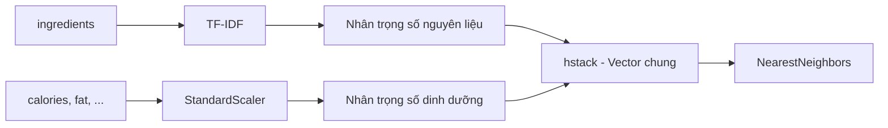

# Bài 05 — Chuẩn hóa dinh dưỡng và ghép đặc trưng

> **Loại:** Bài học và thực hành · **Chủ đề:** Recipe Recommendation System · **Công cụ:** Python, scikit-learn, Flask

## 1. Tóm tắt

Chỉ riêng TF-IDF chưa thể xử lý yêu cầu như “muốn khoảng 500 kcal và 30 g protein”. Cần chuẩn hóa các cột số rồi ghép với biểu diễn nguyên liệu sao cho từng nhóm đặc trưng không áp đảo nhau một cách vô ý.

## 2. Mục tiêu học tập

- Giải thích vì sao các đơn vị số khác nhau làm méo khoảng cách.
- Áp dụng `StandardScaler` trên dữ liệu công thức.
- Ghép TF-IDF và dinh dưỡng thành một ma trận đặc trưng.

## 3. Tại sao phải chuẩn hóa?

`calories` có thể có giá trị hàng trăm, `protein_g` chỉ vài chục, còn natri có thể tới hàng trăm mg. Nếu tính khoảng cách trực tiếp, cột có độ lớn lớn sẽ chi phối. `StandardScaler` dùng:

$$
z=\frac{x-\mu}{\sigma}
$$

Với $\mu$ là trung bình và $\sigma$ là độ lệch chuẩn trên **tập công thức**. Giá trị được biến đổi có thể âm hoặc lớn hơn 1; nó **không** buộc vào [0,1]. MinMaxScaler mới là một phép biến đổi khác thường dùng khi muốn về một miền cố định.

## 4. Áp dụng scaler

```python
from sklearn.preprocessing import StandardScaler
scaler = StandardScaler()
X_nutrition = scaler.fit_transform(df[NUMERIC].fillna(medians))

# Ở thời điểm truy vấn, dùng:
query_numeric = scaler.transform(query_dataframe[NUMERIC])
```

Bộ dữ liệu thực tế cần giải quyết số liệu thiếu trước. Với cột có phương sai bằng 0, `StandardScaler` xử lý để tránh phép chia cho 0 nhưng cột đó không mang thông tin phân biệt món.

## 5. Ghép hai nhóm đặc trưng

```python
from scipy.sparse import csr_matrix, hstack
X_all = hstack([
    X_ingredients * 3.0,
    csr_matrix(X_nutrition) * 1.0
], format="csr")
```

Trọng số `3.0` và `1.0` là **tham số minh họa để thử nghiệm**, không phải trọng số tối ưu được chứng minh. Lựa chọn trọng số làm thay đổi xếp hạng; hãy điều chỉnh bằng các trường hợp kiểm thử thực tế. Với `metric="cosine"`, trọng số khác nhau vẫn ảnh hưởng tới hướng vector ghép.

## 6. Luồng ghép vector



Không thể nối chuỗi thô và số thô vào một mảng rồi gọi `NearestNeighbors`: mọi chiều phải là số có cùng cấu trúc giữa tập công thức và truy vấn.

## 7. Thực hành tự kiểm tra

Thử `ingredient_weight=1` rồi `ingredient_weight=3` trong `RecipeRecommender`; kiểm tra tên ba món thay đổi thế nào với truy vấn vừa có nguyên liệu vừa có dinh dưỡng.

## 8. Câu hỏi ôn tập

**Câu 1.** StandardScaler thường cho dữ liệu giá trị trong miền nào?

A. Bắt buộc 0–1  
B. Bắt buộc 1–10  
C. Chỉ số nguyên  
D. Có thể âm, dương và vượt 1  

**Đáp án: D.** StandardScaler chuẩn hóa theo trung bình và độ lệch chuẩn.

**Câu 2.** Đầu vào của scaler.transform(query) nên có schema nào?

A. Cùng cột và thứ tự với dữ liệu fit  
B. Chỉ có recipe_id  
C. Chuỗi HTML  
D. Cột tùy ý  

**Đáp án: A.** Thứ tự đặc trưng phải nhất quán.

**Câu 3.** scipy.sparse.hstack dùng để làm gì?

A. Tạo ảnh  
B. Ghép ma trận theo chiều cột  
C. Sinh tên công thức  
D. Tạo route Flask  

**Đáp án: B.** Ghép vector đặc trưng từ hai nhánh.

**Câu 4.** Trọng số 3.0 là gì?

A. Hằng số chuẩn công nghiệp  
B. Phần trăm calo  
C. Một siêu tham số thử nghiệm  
D. Số lượng công thức bắt buộc  

**Đáp án: C.** Cần kiểm thử/tuning cho dữ liệu riêng.

**Câu 5.** Tác dụng chính của scaling?

A. Giảm sự áp đảo do khác thang đo  
B. Xóa các cột số  
C. Tăng số món  
D. Dịch nguyên liệu  

**Đáp án: A.** Các đơn vị khác nhau được đưa về thang so sánh hợp lý hơn.

## 9. Tổng kết

Bài này hoàn thiện một mắt xích của hệ thống gợi ý công thức. Khi thực hành, hãy đối chiếu kết quả với tệp `thuc-hanh/` và tự giải thích lý do của từng phép biến đổi.
