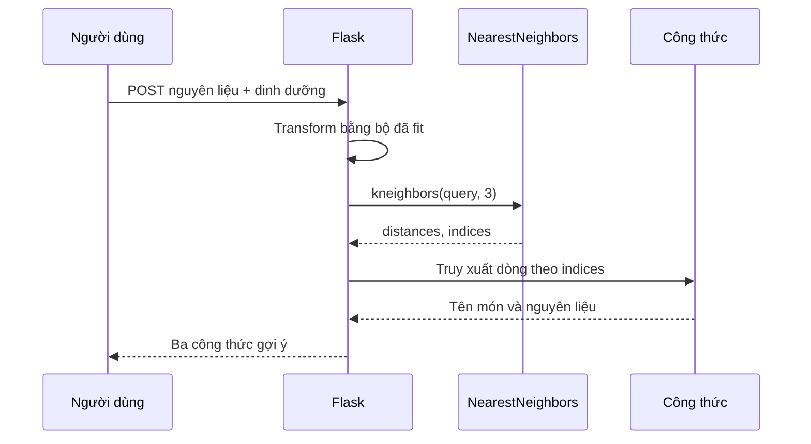

# Bài 06 — Tìm công thức gần nhất với NearestNeighbors

> **Loại:** Bài học và thực hành · **Chủ đề:** Recipe Recommendation System · **Công cụ:** Python, scikit-learn, Flask

## 1. Tóm tắt

NearestNeighbors tìm những điểm gần truy vấn nhất trong không gian đặc trưng. Trong bài toán công thức, mỗi điểm chính là một món ăn, còn truy vấn đại diện cho sở thích nguyên liệu và dinh dưỡng.

## 2. Mục tiêu học tập

- Mô tả được các bước xây chỉ mục và lấy k láng giềng.
- Phân biệt KNN phân loại với NearestNeighbors dùng để truy hồi.
- Giải thích được cosine distance và giới hạn của điểm similarity.

## 3. Trực giác của thuật toán

Giả sử có ba món A, B, C đã được biểu diễn bởi các vector. Khi có người dùng nhập một yêu cầu Q, mô hình tính khoảng cách từ Q tới các món và xếp từ gần tới xa. Nếu `k=3`, lấy ba món đứng đầu. `NearestNeighbors` được dùng trực tiếp cho tìm hàng xóm, **không cần nhãn phân loại món**.

Trong bài toán phân loại, `KNeighborsClassifier` có thể bỏ phiếu các nhãn của láng giềng. Đây là công việc khác với truy hồi công thức, nơi ta muốn danh sách các bản ghi gần nhất.

## 4. Các thước đo khoảng cách

Khoảng cách Euclidean:

$$
d_2(x,y)=\sqrt{\sum_i(x_i-y_i)^2}
$$

Khoảng cách Manhattan:

$$
d_1(x,y)=\sum_i|x_i-y_i|
$$

Khoảng cách cosine:

$$
d_{cos}(x,y)=1-\frac{x\cdot y}{\|x\|_2\|y\|_2}
$$

Dự án demo dùng cosine vì vector TF-IDF được ghép với vector dinh dưỡng. Khoảng cách cosine quan tâm chủ yếu đến **hướng vector**. Khi chuẩn hóa dinh dưỡng tạo giá trị âm, giá trị `1 - cosine_distance` không nhất thiết luôn ở [0, 1] với mọi tập dữ liệu và truy vấn; đừng gọi nó là “xác suất phù hợp”.

## 5. Triển khai với scikit-learn

```python
from sklearn.neighbors import NearestNeighbors
model = NearestNeighbors(metric="cosine", algorithm="brute")
model.fit(X_all)

distances, indices = model.kneighbors(X_query, n_neighbors=3)
for distance, idx in zip(distances[0], indices[0]):
    print(df.iloc[int(idx)]["name"], round(float(distance), 3))
```

`indices` là **vị trí dòng** trong ma trận đã fit, không phải `recipe_id`. Sau khi lọc/xáo trộn DataFrame phải đặt lại chỉ mục nhất quán hoặc lưu ánh xạ rõ ràng. Nếu số món nhỏ hơn `k`, cần giảm `n_neighbors` tương ứng.

## 6. Quy trình gợi ý



Khoảng cách chỉ mô tả gần theo mô hình. Nếu người dùng dị ứng một thành phần, phải áp dụng **lọc cứng theo dị ứng** trước khi xếp hạng; nearest-neighbor không tự đảm bảo điều này.

## 7. Thực hành tự kiểm tra

In `distances` và `indices` cho truy vấn `chicken, rice`, tự đối chiếu với tên các món của CSV. Thử `top_k=100` qua lớp demo và xác nhận hàm giới hạn về số dòng hợp lệ.

## 8. Câu hỏi ôn tập

**Câu 1.** Khác biệt chính giữa NearestNeighbors và KNeighborsClassifier?

A. NearestNeighbors truy hồi điểm gần, không cần nhãn lớp  
B. Hai lớp luôn giống nhau  
C. NearestNeighbors chỉ có cho ảnh  
D. Classifier chỉ tạo HTML  

**Đáp án: A.** Truy hồi không cần dự đoán nhãn.

**Câu 2.** indices từ kneighbors thường biểu diễn gì?

A. Tổng calo  
B. ID món mặc định  
C. Vị trí hàng trong ma trận fit  
D. URL món  

**Đáp án: C.** Không được đồng nhất vị trí với recipe_id.

**Câu 3.** Metric dùng trong mã demo là gì?

A. Manhattan  
B. Cosine  
C. Chebyshev  
D. Random  

**Đáp án: B.** Mã mẫu khởi tạo `metric="cosine"`.

**Câu 4.** Similarity từ cosine có nên diễn giải là xác suất món hợp khẩu vị?

A. Nên nếu >0,5  
B. Nên nếu có ảnh  
C. Luôn luôn  
D. Không, chỉ là độ gần theo vector  

**Đáp án: D.** Không có sự hiệu chuẩn xác suất.

**Câu 5.** Nếu k lớn hơn số dòng dữ liệu?

A. Giảm k xuống <= số dòng  
B. Cần tạo món giả  
C. Chia hết cho k  
D. Xóa toàn bộ hàng  

**Đáp án: A.** Không thể lấy nhiều hàng xóm hơn số hàng đã fit.

## 9. Tổng kết

Bài này hoàn thiện một mắt xích của hệ thống gợi ý công thức. Khi thực hành, hãy đối chiếu kết quả với tệp `thuc-hanh/` và tự giải thích lý do của từng phép biến đổi.
