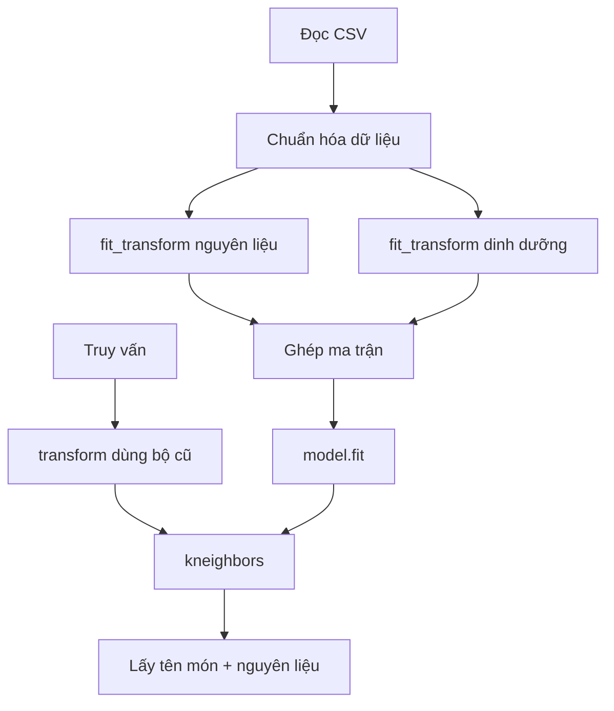

# Bài 07 — Lab Python: xây công cụ gợi ý từ CSV

> **Loại:** Bài học và thực hành · **Chủ đề:** Recipe Recommendation System · **Công cụ:** Python, scikit-learn, Flask

## 1. Tóm tắt

Bài thực hành này kết hợp pandas, TF-IDF, StandardScaler và NearestNeighbors thành một lớp có thể gọi lại được. Thay vì sao chép từng khối xử lý vào Flask, hãy đóng gói để tránh sai khác giữa quá trình khởi tạo và truy vấn.

## 2. Mục tiêu học tập

- Chạy được `RecipeRecommender` bằng dữ liệu minh họa.
- Giải thích thứ tự các phép biến đổi trong mã.
- Phát hiện lỗi fit lại bộ biến đổi và lỗi vị trí dòng.

## 3. Chuẩn bị môi trường

Từ thư mục `thuc-hanh/`:

```bash
python -m venv .venv
# Windows PowerShell:
.venv\Scripts\Activate.ps1
# Linux/macOS:
# source .venv/bin/activate
python -m pip install -r requirements.txt
```

Các thư viện chính: `pandas`, `numpy`, `scipy`, `scikit-learn` và `Flask`. Có thể dùng Jupyter Notebook để khám phá, nhưng ứng dụng hoàn chỉnh không bắt buộc phải có notebook.

## 4. Khởi tạo mô hình

```python
from recommender import load_recommender

model = load_recommender("data/recipes_demo.csv")
results = model.recommend(
    ingredients="chicken, rice",
    targets={"calories": 500, "protein_g": 35},
    top_k=3,
)
for index, item in enumerate(results, start=1):
    print(index, item["name"], item["ingredients"], item["similarity"])
```

`load_recommender()` đọc CSV và chỉ `fit()` mô hình một lần trong `__init__`. Phương thức `recommend()` sử dụng bộ biến đổi đã học để tạo vector truy vấn, gọi `kneighbors`, rồi dùng `iloc` để trả về bản ghi tương ứng.

## 5. Mốc kiểm tra quy trình



Điểm quan trọng: số cột trong ma trận khi huấn luyện và số cột của truy vấn luôn bằng nhau. Một thay đổi danh sách cột dinh dưỡng hoặc thứ tự cột khi tạo truy vấn có thể khiến phép truy hồi trả sai kết quả hoặc báo lỗi shape.

## 6. Phân tích giới hạn

Bản demo gán trung vị cho chỉ tiêu không nhập, dùng cùng trọng số cho toàn bộ nhóm dinh dưỡng và không có bộ lọc dị ứng hay hạn chế chế độ ăn. Đây là baseline có thể chạy và giải thích được, **không phải mô hình phù hợp mọi người dùng**.

## 7. Thực hành tự kiểm tra

Chạy thử lệnh trên; in số dòng `len(model.frame)`, kích thước `model.matrix.shape`, ba kết quả; thử câu hỏi chỉ có nguyên liệu và câu hỏi chỉ có `calories`.

## 8. Câu hỏi ôn tập

**Câu 1.** Dữ liệu đọc từ đâu trong bản demo?

A. API mạng  
B. CSV trong data/  
C. Ảnh PNG  
D. Form HTML  

**Đáp án: B.** `load_recommender` dùng pandas đọc CSV.

**Câu 2.** Tại sao nên đóng gói model thành lớp?

A. Để giữ bộ biến đổi được dùng thống nhất và dễ kiểm thử  
B. Để xóa các feature  
C. Để dùng JavaScript thay Python  
D. Để thay ngôn ngữ tự động  

**Đáp án: A.** Một lớp lưu trạng thái vectorizer/scaler/model.

**Câu 3.** Hàm nào lấy ba hàng gần nhất?

A. read_csv  
B. render_template  
C. isna  
D. kneighbors  

**Đáp án: D.** kneighbors là phép truy hồi của NearestNeighbors.

**Câu 4.** Biến đổi nào được phép chạy khi xử lý form?

A. fit_transform lại  
B. fit scaler lại  
C. transform bằng bộ đã fit  
D. xóa từ vựng  

**Đáp án: C.** Truy vấn không được làm thay đổi bộ tham số.

**Câu 5.** Dòng `iloc[idx]` được dùng để làm gì?

A. Dùng số thứ tự vị trí để lấy hàng dữ liệu  
B. Tạo token TF-IDF  
C. Định tuyến HTTP  
D. Khởi tạo Bootstrap  

**Đáp án: A.** indices là vị trí hàng.

## 9. Tổng kết

Bài này hoàn thiện một mắt xích của hệ thống gợi ý công thức. Khi thực hành, hãy đối chiếu kết quả với tệp `thuc-hanh/` và tự giải thích lý do của từng phép biến đổi.
