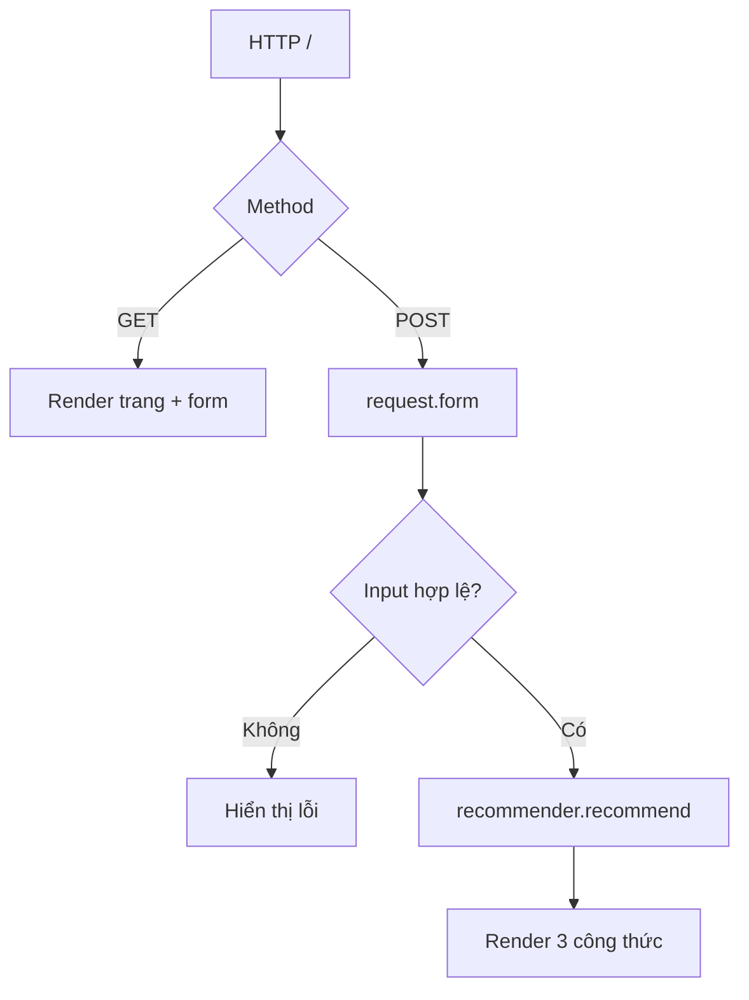

# Bài 09 — Flask backend: route, nhận form và trả kết quả

> **Loại:** Bài học và thực hành · **Chủ đề:** Recipe Recommendation System · **Công cụ:** Python, scikit-learn, Flask

## 1. Tóm tắt

Flask là cầu nối giữa trang web và mô hình gợi ý. Route GET trả trang trống, POST nhận dữ liệu, xác thực đầu vào, gọi mô hình và render danh sách món.

## 2. Mục tiêu học tập

- Tạo route xử lý GET và POST trong Flask.
- Đọc dữ liệu từ `request.form` và kiểm tra số đầu vào.
- Truyền kết quả sang Jinja an toàn bằng `render_template`.

## 3. Khởi động Flask

```python
from flask import Flask, render_template, request
app = Flask(__name__)

@app.route("/", methods=["GET", "POST"])
def home():
    if request.method == "GET":
        return render_template("index.html", results=[])
    ingredients = request.form.get("ingredients", "")
    # Kiểm tra dữ liệu, gợi ý, rồi render HTML
    return render_template("index.html", results=[])
```

Trong `thuc-hanh/app.py` đã có route hoàn chỉnh. Flask không bắt buộc phải tách API JSON nếu chỉ phục vụ trang HTML theo yêu cầu này.

## 4. Đọc và xác thực dữ liệu số

Người dùng có thể nhập chuỗi rỗng, ký tự sai hoặc số âm. Kiểm tra tại backend trước khi đưa vào scaler:

```python
raw = request.form.get("calories", "").strip()
if raw == "":
    calories = None
else:
    try:
        calories = float(raw)
        if not 0 <= calories <= 100000:
            raise ValueError("ngoài giới hạn")
    except ValueError:
        # Chuyển thông báo lỗi về trang, không gọi mô hình.
        ...
```

Giới hạn ở ví dụ nhằm ngăn các đầu vào bất thường về mặt kỹ thuật, **không** phải mức dinh dưỡng được khuyến nghị. Không dùng `eval` để phân tích số đầu vào.

## 5. Khởi tạo mô hình một lần

```python
from recommender import load_recommender
model = load_recommender("data/recipes_demo.csv")

# Mỗi yêu cầu chỉ gọi:
results = model.recommend("chicken, rice", {"calories": 500})
```

Nếu đọc CSV, fit TF-IDF và fit KNN trong hàm request cho mọi lượt tải trang, ứng dụng sẽ lãng phí thời gian và tài nguyên. Khởi tạo ở cấp ứng dụng cho demo; ở production có thể dùng artifact mô hình đã lưu, quá trình cập nhật chỉ mục riêng và cơ chế theo dõi phiên bản.

## 6. Luồng GET và POST



**Chú ý:** `debug=True` chỉ dành cho môi trường phát triển. Không bật debugger ra Internet; khi triển khai thật cần quản lý phụ thuộc, kiểm soát truy cập và bảo vệ vận hành.

## 7. Thực hành tự kiểm tra

Chạy `python app.py`, mở `http://127.0.0.1:5000/`, nhập `chicken, rice` rồi thử `calories=-100`; xác nhận backend hiển thị lỗi thay vì chạy mô hình.

## 8. Câu hỏi ôn tập

**Câu 1.** Phương thức HTTP để gửi biểu mẫu dùng trong ứng dụng?

A. PUT  
B. DELETE  
C. POST  
D. PATCH  

**Đáp án: C.** POST gửi dữ liệu biểu mẫu tới Flask.

**Câu 2.** Hàm nào render Jinja template?

A. render_template  
B. read_csv  
C. kneighbors  
D. scale  

**Đáp án: A.** render_template kết hợp HTML với biến kết quả.

**Câu 3.** Vì sao fit model ngoài mỗi request?

A. Để thay khóa name  
B. Để giảm việc tính toán lặp lại  
C. Để thay ảnh  
D. Để tạo SQL  

**Đáp án: B.** Mô hình cần được tái sử dụng giữa các yêu cầu.

**Câu 4.** Lỗi nhập calories="abc" nên xử lý thế nào?

A. Im lặng đổi thành 500  
B. Bật debugger công khai  
C. Xóa mọi dữ liệu  
D. Trả lỗi có hướng dẫn nhập số  

**Đáp án: D.** Đầu vào sai nên được xử lý rõ ràng mà không gây crash.

**Câu 5.** Debug của Flask dùng trong trường hợp nào?

A. Môi trường phát triển cục bộ  
B. Production công khai  
C. Bắt buộc mọi lúc  
D. Chỉ khi dùng Bootstrap  

**Đáp án: A.** Debugger không nên công khai trên production.

## 9. Tổng kết

Bài này hoàn thiện một mắt xích của hệ thống gợi ý công thức. Khi thực hành, hãy đối chiếu kết quả với tệp `thuc-hanh/` và tự giải thích lý do của từng phép biến đổi.
