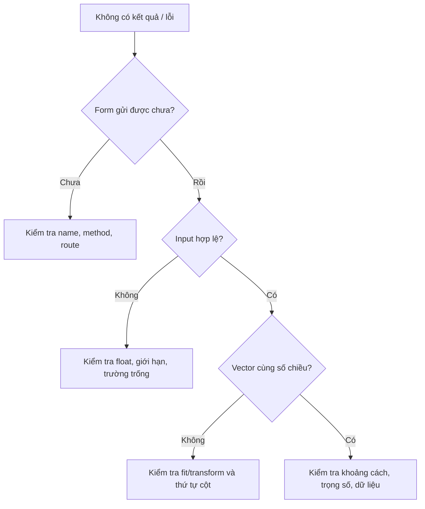

# Bài 10 — Tích hợp end-to-end và kiểm thử hệ thống

> **Loại:** Bài học và thực hành · **Chủ đề:** Recipe Recommendation System · **Công cụ:** Python, scikit-learn, Flask

## 1. Tóm tắt

Hệ thống hoàn chỉnh chỉ đúng khi dữ liệu đi trọn vẹn từ ô nhập đến vector truy vấn, truy hồi công thức và hiển thị. Kiểm thử cần bao phủ cả dữ liệu, thuật toán và giao diện.

## 2. Mục tiêu học tập

- Chạy được dự án mẫu và kiểm tra các kịch bản đầu vào.
- Giải thích được lỗi form name, thiếu cột CSV, sai shape và kết quả rỗng.
- Thiết kế bước đánh giá chất lượng khuyến nghị trước khi mở rộng.

## 3. Khởi chạy toàn hệ thống

```bash
cd thuc-hanh
python -m venv .venv
# kích hoạt .venv phù hợp hệ điều hành
python -m pip install -r requirements.txt
python -m unittest discover -s tests -v
python app.py
```

Truy cập `http://127.0.0.1:5000/`. Ứng dụng sẽ đọc `data/recipes_demo.csv` và dựng mô hình khi khởi động. Không cần Internet để huấn luyện/truy hồi; giao diện dùng Bootstrap CDN nên có thể thiếu kiểu Bootstrap nếu đang offline (CSS tự viết vẫn áp dụng).

## 4. Các trường hợp kiểm thử quan trọng

| Trường hợp | Kỳ vọng |
| --- | --- |
| Nhập `chicken, rice` | Hiển thị ba công thức hiện có |
| Chỉ nhập `protein_g=20` | Vẫn truy hồi được công thức |
| Để tất cả trường trống | Hiển thị yêu cầu nhập ít nhất một tiêu chí |
| Nhập `calories=-5` | Thông báo dữ liệu không hợp lệ |
| Nhập `calories=abc` qua HTTP | Backend không crash, báo lỗi |
| Kế hoạch `k` lớn hơn số dòng | Không gây `n_neighbors` vượt số mẫu |
| Dữ liệu không có cột `ingredients` | Dừng với lỗi schema có ý nghĩa |
| Nhập token lạ hoàn toàn | Xem xét cảnh báo không có nguyên liệu khớp |

## 5. Tư duy debug theo từng lớp

Nếu form không gửi giá trị, kiểm tra `name` của `input` có trùng với key trong `request.form` hay không. Nếu truy hồi lỗi shape, so sánh số cột và thứ tự số của tập fit và truy vấn. Nếu kết quả không trực giác, kiểm tra chuẩn hóa nguyên liệu, trọng số các nhóm và đơn vị dinh dưỡng.



## 6. Đánh giá chất lượng gợi ý

Chạy được không đồng nghĩa gợi ý tốt. Tạo tập kịch bản như: chỉ có gà và gạo, món nhiều rau, mục tiêu ít năng lượng, ưu tiên protein. Với mỗi kịch bản, ghi kết quả nào hợp lý và công thức có nguyên liệu nào ngoài danh sách người dùng. Có thể đo precision@k nếu có nhãn phù hợp do con người gán; không bịa số đo benchmark khi chưa đánh giá.

## 7. Thực hành tự kiểm tra

Chạy bốn unit tests có sẵn. Tự thêm một unit test với nguyên liệu `tomato, basil` và kiểm tra danh sách trả về có ba dòng. Sau đó kiểm thử trực tiếp form sai số.

## 8. Câu hỏi ôn tập

**Câu 1.** Đâu là chỉ báo chắc chắn hệ thống gợi ý đúng sở thích?

A. Server chạy được  
B. Màu Bootstrap đẹp  
C. Không có traceback  
D. Đánh giá trên tập truy vấn có nhãn phù hợp  

**Đáp án: D.** Chất lượng phải được kiểm tra bằng kỳ vọng thực tế.

**Câu 2.** Lỗi Flask không lấy được calories thường cần kiểm tra gì?

A. name của input  
B. Từ vựng TF-IDF  
C. Số vector cosine  
D. Màu CSS  

**Đáp án: A.** `request.form` đọc theo name.

**Câu 3.** Lỗi sai số chiều giữa query và train liên quan nhất đến?

A. URL ảnh  
B. Thao tác fit/transform, schema cột  
C. Độ rộng màn hình  
D. CSS  

**Đáp án: B.** Feature space phải nhất quán.

**Câu 4.** Trường hợp tất cả ô trống hợp lý nhất?

A. Lấy 3 món ngẫu nhiên không thông báo  
B. Fit lại model  
C. Yêu cầu ít nhất một tiêu chí  
D. Crash ứng dụng  

**Đáp án: C.** Không có đủ thông tin truy hồi có nghĩa.

**Câu 5.** Nội dung nào thuộc đánh giá chất lượng retrieval?

A. Kiểm tra top-k có khớp nhu cầu thực  
B. Chỉ đo màu UI  
C. Tăng chiều cao ảnh  
D. Đổi tên thư mục  

**Đáp án: A.** Cần đánh giá gợi ý có phù hợp với người dùng.

## 9. Tổng kết

Bài này hoàn thiện một mắt xích của hệ thống gợi ý công thức. Khi thực hành, hãy đối chiếu kết quả với tệp `thuc-hanh/` và tự giải thích lý do của từng phép biến đổi.
