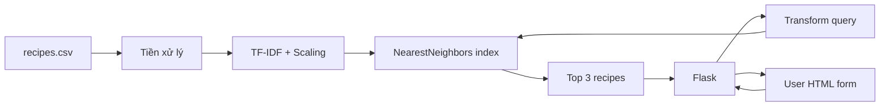

# Đồ án cuối khóa — Recipe Recommendation System hoàn chỉnh

> **Loại:** Project · **Phạm vi:** Python + CSV + TF-IDF + StandardScaler + NearestNeighbors + Flask

## 1. Bài toán

Tạo website nhận nguyên liệu và tùy chọn một hoặc nhiều chỉ tiêu dinh dưỡng, trả về ba công thức gần nhất trong bộ sưu tập đã có. Cần mô tả được vì sao các công thức được xếp hạng cao và đảm bảo giao diện không mất ổn định khi người dùng bỏ trống dữ liệu.

## 2. Yêu cầu chức năng

1. Đọc CSV, xác thực schema và dữ liệu cần thiết.
2. Tạo vector nguyên liệu bằng TF-IDF, dùng bộ từ vựng duy nhất khi truy hồi.
3. Scale 7 đặc trưng số bằng `StandardScaler`, xử lý giá trị thiếu có giải thích.
4. Ghép hai phần vector, tìm tối đa ba láng giềng gần nhất.
5. Dùng Flask phục vụ form GET/POST, kiểm tra số và hiển thị kết quả.
6. Tạo ít nhất 8 kịch bản kiểm thử đầu vào đúng/sai.

## 3. Kiến trúc

## 4. Mốc triển khai

### 4.1. Milestone A — Tập dữ liệu

Định nghĩa schema, kiểm tra đơn vị, danh sách nguyên liệu và bản ghi trùng. Deliverable: CSV hợp lệ + đoạn kiểm tra bằng pandas.

### 4.2. Milestone B — Retrieval

Fit TF-IDF và StandardScaler; viết hàm `recommend()` dùng `transform()`. Deliverable: kết quả có thể gọi bằng Python.

### 4.3. Milestone C — Flask UI

Tạo form, validate và hiển thị kết quả. Deliverable: demo chạy local + ảnh chụp giao diện (tự chụp khi hoàn thành).

### 4.4. Milestone D — Quality check

Đo thử các kịch bản theo nguyên liệu, theo dinh dưỡng, trống input, sai kiểu số, dữ liệu thiếu. Ghi hạn chế và hướng cải tiến.

## 5. Đánh giá (100 điểm)

| Tiêu chí | Điểm |
| --- | ---: |
| Kiểm tra dữ liệu và schema | 20 |
| Biến đổi nhất quán và truy hồi chính xác | 30 |
| Giao diện và xử lý form | 20 |
| Kiểm thử, debug | 20 |
| Tài liệu chạy và giải thích kết quả | 10 |

## 6. Definition of Done

- [ ] `python -m unittest discover -s tests -v` chạy thành công.
- [ ] Nhập `chicken, rice` trả ba công thức.
- [ ] Nhập `calories=-1` báo lỗi, không crash.
- [ ] Nếu tất cả input trống, trang đưa ra hướng dẫn rõ.
- [ ] Có README mô tả cách chạy, nguồn dữ liệu và giới hạn của hệ thống.
- [ ] Nêu rõ đây là công cụ gợi ý công thức **có sẵn**, không phải hệ thống tự sinh công thức.

## 7. Câu hỏi ôn tập

**Câu 1.** Vì sao phải dùng bộ TF-IDF đã fit khi biến đổi truy vấn?

A. Để có cùng không gian đặc trưng.  
B. Để tăng kích thước ảnh.  
C. Để bỏ qua nhập liệu.  
D. Để thêm nhãn món mới.

**Đáp án: A.** Truy vấn cần cùng tọa độ đặc trưng với tập công thức.

**Câu 2.** Đâu là phép kiểm thử backend bắt buộc?

A. Chỉ kiểm tra heading.  
B. Chỉ kiểm tra responsive.  
C. Gửi số âm và ký tự không hợp lệ.  
D. Chỉ xem màu nút.

**Đáp án: C.** Validation backend phải xử lý input bị sửa hoặc không hợp lệ.

**Câu 3.** Có nên diễn giải top-3 là ba món chắc chắn hợp khẩu vị nhất không?

A. Có nếu dùng TF-IDF.  
B. Không, chỉ là gần nhất theo metric/feature đã chọn.  
C. Có nếu thêm Bootstrap.  
D. Có nếu số calo trùng.

**Đáp án: B.** Sự phù hợp thực tế cần kiểm chứng bổ sung.
