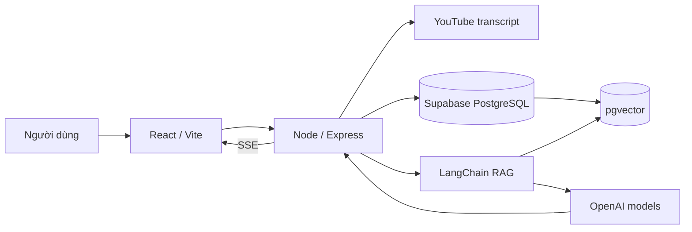

# Xây dựng ứng dụng trò chuyện với video YouTube bằng RAG

> **Khóa học:** YouTube Conversational RAG · **Bài 01/20** · **Module:** Nền tảng RAG và chuẩn bị môi trường

## Tóm tắt

Ứng dụng nhận URL YouTube, phân tích transcript và cho phép hỏi đáp tiếp nối trong cùng một cuộc trò chuyện. Trọng tâm là pipeline AI và backend; giao diện là lớp tương tác tối thiểu nhưng đủ dùng.

## Mục tiêu học tập

- Mô tả được yêu cầu chức năng và phi chức năng của ứng dụng.
- Phân biệt đúng vai trò của React/Vite, Node/Express, Supabase/PostgreSQL, pgvector và LangChain.
- Phác họa được các luồng nhập tài liệu và hỏi đáp.

## 1. Bài toán và hành vi mong muốn

Một video dài thường chứa nhiều kiến thức, nhưng việc xem lại toàn bộ chỉ để tìm một chi tiết rất tốn thời gian. Ứng dụng chuyển lời nói trong video thành nội dung có thể tìm kiếm theo ý nghĩa. Người dùng nhập liên kết, chờ xử lý rồi đặt câu hỏi tự nhiên: “Tóm tắt”, “Điểm quan trọng nhất?”, “Có đề xuất dùng Supabase không?”, “Giải thích kỹ hơn ý thứ hai”.

**Đầu vào** gồm URL hợp lệ, transcript có thể truy xuất, câu hỏi và ID cuộc trò chuyện. **Đầu ra** là câu trả lời sinh bởi LLM dựa trên các đoạn nội dung liên quan, hiển thị dần qua streaming. Hệ thống phải giữ mạch hội thoại, tránh trộn nội dung của video A với video B.

## 2. Kiến trúc ba thành phần

| Thành phần | Công nghệ | Trách nhiệm |
| --- | --- | --- |
| Frontend | React + Vite + TypeScript | Nhập URL, chuyển màn hình sang chat, gửi câu hỏi, hiển thị token dần |
| Backend dữ liệu | Supabase + PostgreSQL | Lưu `conversations`, `documents`, `conversation_documents`, `conversation_messages` |
| Kho vector | PostgreSQL + `pgvector` | Lưu từng chunk và vector embedding, truy xuất theo cosine similarity |
| RAG service | Node.js + Express + LangChain | Tải transcript, chia chunk, tạo embedding, tìm ngữ cảnh, gọi chat model, stream |
| Model provider | OpenAI | Cung cấp embedding model và chat model |

Sơ đồ nhấn mạnh: trình duyệt **không** nắm khóa quản trị Supabase hoặc khóa OpenAI. Node là nơi thực thi logic nhạy cảm. Kho vector không thay thế database quan hệ, mà là khả năng mở rộng của PostgreSQL.

## 3. Hai luồng độc lập

**Luồng nhập video (ingestion):** URL → loader lấy transcript → bổ sung title/metadata → splitter tạo chunks → embedding model tạo vectors → `document_embeddings` trong PostgreSQL. Một tài liệu gốc có thể sinh hàng chục hoặc hàng trăm chunks.

**Luồng hỏi đáp (retrieval/generation):** câu hỏi → lấy lịch sử chat → viết lại câu hỏi nếu thiếu chủ ngữ → embedding truy vấn → tìm top-k chunks theo video → đưa chunks vào prompt → chat model trả lời → SSE hiển thị → lưu câu trả lời.

Hai luồng nên tách thành service vì chúng có tần suất, độ trễ và kiểu lỗi khác nhau. Không tính embedding lại toàn bộ transcript sau mỗi câu hỏi.

## 4. Những gì cần lưu

- `documents`: một bản ghi cho video được nhập.
- `document_embeddings`: nhiều hàng; mỗi hàng là một chunk + vector + metadata.
- `conversations`: phiên hội thoại.
- `conversation_documents`: bảng nối many-to-many giữa chat và document.
- `conversation_messages`: câu hỏi/câu trả lời theo thứ tự.

Nếu ngày mai mở rộng sang PDF hay audio, chỉ thay loader và quy trình tiền xử lý; phần truy xuất dùng chung mô hình Document của LangChain.

## 5. Tiêu chí hoàn thành

Người học cần chứng minh được: một URL tạo dữ liệu trong database; câu hỏi trả về nội dung có liên quan; câu hỏi nối tiếp hiểu đại từ tham chiếu; hai video không làm lẫn dữ liệu; token được stream và bản trả lời hoàn chỉnh được ghi lại.

**Lưu ý hiệu năng:** mốc xử lý khoảng 5 giây hoặc phản hồi stream sau 2–3 giây chỉ là số liệu demo trong điều kiện cụ thể, không phải cam kết; thời gian thực tế phụ thuộc độ dài video, transcript, mạng và provider.

## 6. Thực hành ngắn

Vẽ sequence diagram cho hai trường hợp: nhập video thành công và người dùng đặt câu hỏi “Ý thứ hai có hạn chế gì?”. Chỉ rõ bước nào bắt buộc mang theo `conversation_id` và `document_id`.

## 7. Tổng kết

RAG ứng dụng cho YouTube là sự phối hợp giữa quản trị dữ liệu có cấu trúc và tìm kiếm ngữ nghĩa; LLM chỉ trả lời tốt khi nhận được ngữ cảnh đúng, đủ và gắn với lịch sử chat.

## 8. Câu hỏi ôn tập trắc nghiệm

### Câu 1

Thành phần nào cần giữ khóa quản trị Supabase?

A. Ứng dụng React  
B. CSS của Vite  
C. Node backend  
D. URL YouTube  

**Đáp án:** C. **Giải thích:** Khóa quản trị chỉ tồn tại ở server.

### Câu 2

Tại sao không gọi embedding cho toàn bộ video mỗi khi có câu hỏi?

A. Tốn chi phí và chậm không cần thiết  
B. Vì không thể tạo embedding  
C. Vì PostgreSQL không lưu được văn bản  
D. Vì React không có form  

**Đáp án:** A. **Giải thích:** Embedding của các chunk được tái sử dụng.

### Câu 3

`conversation_documents` giải quyết quan hệ nào?

A. Một-một  
B. Nhiều-nhiều  
C. Một-nhiều từ message đến embedding  
D. Không có quan hệ  

**Đáp án:** B. **Giải thích:** Một chat có nhiều tài liệu và ngược lại.

### Câu 4

Streaming chủ yếu cải thiện điều gì?

A. Độ chính xác truy xuất  
B. Kích thước embedding  
C. Khả năng đăng nhập  
D. Trải nghiệm phản hồi từng phần  

**Đáp án:** D. **Giải thích:** Có thể hiển thị trước khi toàn bộ câu trả lời hoàn tất.

### Câu 5

Khâu nào chọn dữ liệu liên quan trước khi gọi LLM?

A. CSS  
B. TextDecoder  
C. Retriever / pgvector  
D. UUID  

**Đáp án:** C. **Giải thích:** Retriever cung cấp top-k chunks cho prompt.

## Tài liệu tham khảo để kiểm tra API hiện hành

- [Supabase LangChain integration](https://supabase.com/docs/guides/ai/langchain)
- [Supabase vector columns](https://supabase.com/docs/guides/ai/vector-columns)
- [Supabase vector indexes](https://supabase.com/docs/guides/ai/vector-indexes)
- [Supabase HNSW indexes](https://supabase.com/docs/guides/ai/vector-indexes/hnsw-indexes)
- [LangChain JS API reference](https://reference.langchain.com/javascript/)
- [LangChain recursive text splitter](https://reference.langchain.com/javascript/langchain-textsplitters/RecursiveCharacterTextSplitter)
- [LangChain SupabaseVectorStore](https://reference.langchain.com/javascript/langchain-community/vectorstores/supabase)

**Lưu ý phiên bản:** các ví dụ `createHistoryAwareRetriever`, `createStuffDocumentsChain`, `createRetrievalChain` dùng chain API truyền thống. Nếu major `langchain` đang cài không còn export đường dẫn đó, dùng phiên bản tương thích hoặc cập nhật theo reference hiện hành. Các đoạn code trong từng bài giải thích thành phần cốt lõi và được ghép cùng các helper trong cùng module; chúng không phải tất cả là file chạy độc lập.
