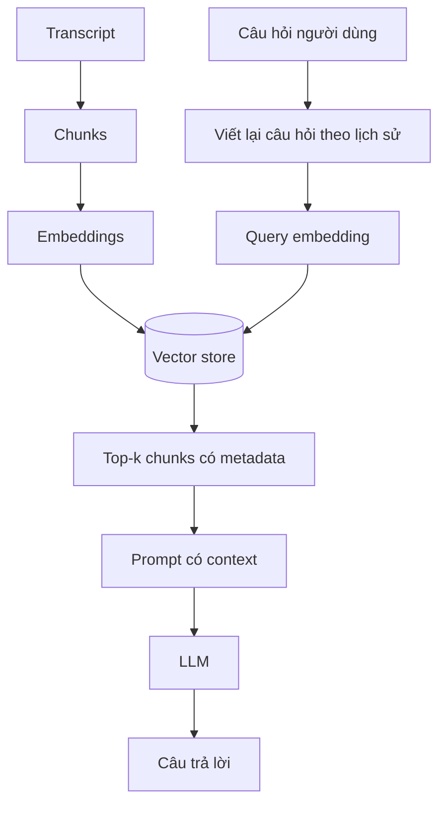

# RAG, embeddings và lý do phải truy xuất theo đoạn

> **Khóa học:** YouTube Conversational RAG · **Bài 02/20** · **Module:** Nền tảng RAG và chuẩn bị môi trường

## Tóm tắt

RAG không chỉ là việc gọi ChatGPT với một đoạn văn bản dài. Cơ chế cốt lõi là truy xuất bằng ngữ nghĩa trước, rồi mới sinh câu trả lời.

## Mục tiêu học tập

- Giải thích giới hạn context và chi phí token.
- So sánh tìm theo từ khóa với tìm theo embedding.
- Phân biệt chunk, embedding, retriever, prompt và chat history.

## 1. Vì sao không gửi cả transcript vào LLM?

Hãy tưởng tượng một video kéo dài 5 giờ trong khi câu hỏi chỉ cần 5 phút đầu. Nếu luôn gửi toàn bộ transcript, yêu cầu sẽ chứa nhiều nội dung không liên quan; chi phí tính theo token tăng, thời gian xử lý lâu hơn, và cửa sổ ngữ cảnh của model có giới hạn. Khi lịch sử trò chuyện tăng lên, lượng dữ liệu lại càng lớn. Vì thế, **chọn đúng đoạn** thường hiệu quả hơn **gửi nhiều đoạn**.

LLM mặc định không lưu trạng thái qua mỗi lời gọi API. Muốn nó hiểu “Giải thích ý này kỹ hơn”, ta phải cung cấp lịch sử liên quan hoặc một bản tóm lược. Trí nhớ hội thoại và ngữ cảnh tài liệu là hai nguồn dữ liệu khác nhau.

## 2. Biểu diễn ngữ nghĩa bằng embeddings

Embedding model ánh xạ một chuỗi ký tự sang vector thực nhiều chiều. Với `text-embedding-3-large` ở cấu hình mặc định, vector có 3072 chiều. Những biểu đạt có ý nghĩa gần nhau có thể nằm gần nhau trong không gian embedding. Ví dụ “Ai sáng lập công ty?” và “Founder của công ty là ai?” có thể trả về cùng một đoạn dù từ ngữ không trùng khít.

Cosine similarity được mô tả bởi:

$$
\operatorname{sim}(\mathbf{a},\mathbf{b})=\frac{\mathbf{a}\cdot\mathbf{b}}{\|\mathbf{a}\|\|\mathbf{b}\|}
$$

Trong `pgvector`, toán tử cosine distance là `<=>`; nếu lấy `1 - distance`, số càng lớn càng gần theo thước đo này. Embedding **không chứa tri thức dạng ngôn ngữ có thể đọc trực tiếp**; muốn trả lời, hệ thống vẫn phải lấy `content` gốc của những hàng được tìm thấy.

## 3. Chunking là gì?

Transcript nguyên bản có thể là một văn bản liền rất dài. Nếu chỉ tạo một vector cho toàn video, biểu diễn sẽ pha loãng nhiều chủ đề. Ngược lại, các chunk quá ngắn mất bối cảnh. Vì thế splitter chia thành các khối có độ dài kiểm soát được và cho các khối kề nhau **chồng lấn** để tránh cắt mất luận điểm ở ranh giới.

Ví dụ cấu hình khởi đầu: `chunkSize: 1000`, `chunkOverlap: 200` (đơn vị ký tự đối với splitter mặc định). Đây là tham số để thử nghiệm, không phải chuẩn tối ưu chung. Cần kiểm tra transcript tiếng Việt, tiếng Anh, video có code hoặc nhiều đoạn đổi chủ đề.

## 4. Pipeline RAG chuẩn

**Retrieval** chọn đoạn. **Generation** suy luận và viết lời đáp. Chất lượng đầu ra có thể kém dù chat model mạnh nếu retriever tìm sai đoạn, tài liệu bị thiếu hoặc system prompt không buộc trả lời trong giới hạn chứng cứ.

## 5. Bảng các khái niệm dễ nhầm

| Khái niệm | Là gì | Không phải |
| --- | --- | --- |
| Embedding | Vector biểu diễn văn bản | Toàn bộ nội dung trả lời |
| Vector store | Lưu/tìm embeddings và content | Chat model |
| Retriever | Chọn các Documents liên quan | Công cụ sinh văn bản |
| History | Các lượt hỏi đáp đã có | Nguồn tri thức từ video |
| Prompt | Chỉ dẫn + câu hỏi + ngữ cảnh | Kết quả tìm kiếm tự động |

## 6. Ví dụ suy luận

Một video có phần giới thiệu, so sánh công nghệ và kết luận. Khi người dùng hỏi “Vì sao tác giả không chọn dịch vụ A?”, retriever nên ưu tiên các chunk của phần so sánh, không nhất thiết lấy mở đầu. Nếu lượt tiếp theo là “Nhược điểm thứ hai là gì?”, cần viết lại câu hỏi theo lịch sử trước khi tìm kiếm.

## 7. Tổng kết

Kết quả RAG phụ thuộc đồng thời vào chất lượng transcript, chiến lược chia đoạn, khả năng lọc đúng tài liệu, độ chính xác tìm kiếm và prompt. Cân bằng các bước quan trọng hơn việc chỉ thay model lớn hơn.

## 8. Câu hỏi ôn tập trắc nghiệm

### Câu 1

Vấn đề chính khi gửi toàn bộ transcript ở mọi lượt hỏi?

A. Không có cách lưu trong PostgreSQL  
B. Tăng token, độ trễ và nhiễu  
C. React không hiển thị được  
D. UUID bị trùng  

**Đáp án:** B. **Giải thích:** Không phải tất cả đoạn đều liên quan.

### Câu 2

`<=>` trong pgvector thường biểu diễn gì?

A. Nối chuỗi  
B. Độ dài vector  
C. Cosine distance  
D. JSON containment  

**Đáp án:** C. **Giải thích:** Đó là toán tử khoảng cách cosine.

### Câu 3

Lợi ích của chunk overlap?

A. Không phải tính embedding  
B. Giữ nội dung ở ranh giới chunk  
C. Xóa transcript  
D. Tăng giới hạn context của model  

**Đáp án:** B. **Giải thích:** Chồng lấn giảm nguy cơ mất ý giữa hai chunk.

### Câu 4

Chat model có tự nhớ lượt gọi API trước đó?

A. Có, luôn luôn  
B. Có nếu pgvector được bật  
C. Chỉ với React  
D. Không, cần gửi lại history liên quan  

**Đáp án:** D. **Giải thích:** Mỗi request độc lập nếu không bổ sung history.

### Câu 5

Retriever tạo ra thứ gì?

A. Danh sách đoạn nội dung liên quan  
B. JWT  
C. Giao diện React  
D. Database SQL mới  

**Đáp án:** A. **Giải thích:** Retriever trả về Documents để model tham chiếu.

## Tài liệu tham khảo để kiểm tra API hiện hành

- [Supabase LangChain integration](https://supabase.com/docs/guides/ai/langchain)
- [Supabase vector columns](https://supabase.com/docs/guides/ai/vector-columns)
- [Supabase vector indexes](https://supabase.com/docs/guides/ai/vector-indexes)
- [Supabase HNSW indexes](https://supabase.com/docs/guides/ai/vector-indexes/hnsw-indexes)
- [LangChain JS API reference](https://reference.langchain.com/javascript/)
- [LangChain recursive text splitter](https://reference.langchain.com/javascript/langchain-textsplitters/RecursiveCharacterTextSplitter)
- [LangChain SupabaseVectorStore](https://reference.langchain.com/javascript/langchain-community/vectorstores/supabase)

**Lưu ý phiên bản:** các ví dụ `createHistoryAwareRetriever`, `createStuffDocumentsChain`, `createRetrievalChain` dùng chain API truyền thống. Nếu major `langchain` đang cài không còn export đường dẫn đó, dùng phiên bản tương thích hoặc cập nhật theo reference hiện hành. Các đoạn code trong từng bài giải thích thành phần cốt lõi và được ghép cùng các helper trong cùng module; chúng không phải tất cả là file chạy độc lập.
