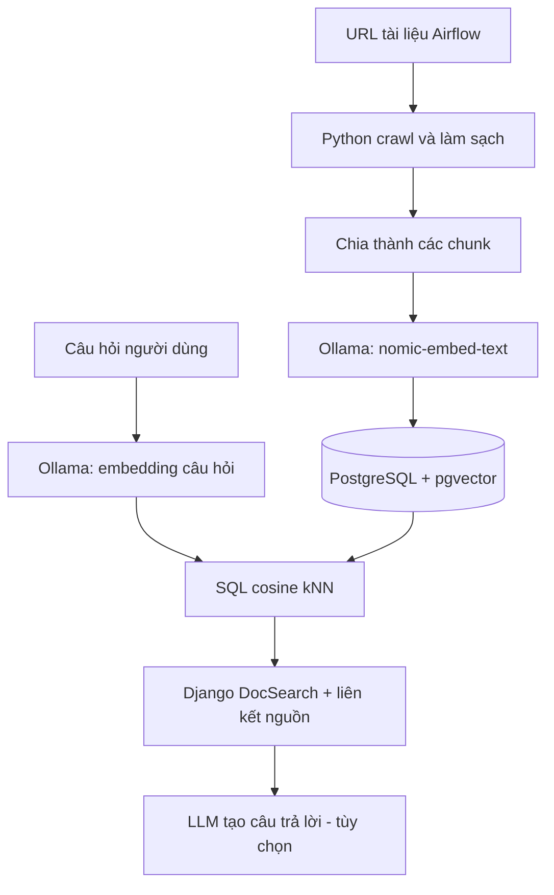

# Bài 01 — PostgreSQL, pgvector và bài toán tìm kiếm ngữ nghĩa

## 1. Tóm tắt

Một ứng dụng tra cứu tài liệu thường có sẵn PostgreSQL để lưu người dùng, quyền truy cập, tài liệu và lịch sử. Khi cần hỏi bằng ngôn ngữ tự nhiên, tìm kiếm `LIKE` hoặc khớp từ khóa không đủ: câu hỏi “khởi tạo môi trường Airflow” có thể liên quan đến trang viết “installation and setup” dù không trùng cụm từ. `pgvector` bổ sung kiểu dữ liệu vector và các toán tử đo khoảng cách ngay trong PostgreSQL. Không cần tạo một dịch vụ vector database riêng cho bài thực hành này.

**Sản phẩm xuyên suốt:** DocSearch — người học nạp khoảng 10 trang tài liệu Apache Airflow, lưu từng đoạn cùng embedding, gõ câu hỏi và nhận các đoạn liên quan kèm URL nguồn. Phần cuối mở rộng thành RAG có sinh câu trả lời.

## 2. Mục tiêu học tập

- Giải thích được hạn chế của tìm kiếm theo từ khóa.
- Vẽ được luồng ingest và truy vấn của semantic search.
- Phân biệt thành phần `PostgreSQL`, extension `pgvector`, mô hình embedding `Ollama`, Django và mô hình tạo câu trả lời.
- Quyết định khi nào nên dùng PostgreSQL thay vì thêm một vector database chuyên dụng.

## 3. Kiến trúc hệ thống

Nhánh bên trái chạy lúc **lập chỉ mục (indexing)**; nhánh bên phải chạy mỗi lần **truy vấn (retrieval)**. Embedding là vector biểu diễn nội dung, không phải câu trả lời. PostgreSQL quản lý bảng dữ liệu và giao dịch; `pgvector` cung cấp kiểu `vector(768)`, toán tử `<=>` và HNSW; Ollama tạo biểu diễn cho văn bản; Django cung cấp giao diện và endpoint.

## 4. Semantic search khác RAG thế nào?

| Khái niệm | Đầu vào | Đầu ra | Vai trò |
| --- | --- | --- | --- |
| Keyword search | Từ khóa | Các dòng khớp chữ | Tìm chính xác thuật ngữ |
| Semantic search | Câu hỏi | Các đoạn gần về ngữ nghĩa | Lấy bằng chứng |
| RAG | Câu hỏi + bằng chứng | Câu trả lời được tổng hợp | Tạo câu trả lời có căn cứ |

**Retrieval không bắt buộc phải có LLM sinh văn bản.** Video demo dừng ở trả về các đoạn tài liệu được xếp hạng; khóa học sau đó thêm một tầng tổng hợp câu trả lời, có ghi rõ đó là phần mở rộng.

## 5. Vì sao tận dụng PostgreSQL?

PostgreSQL tiếp tục cung cấp `JOIN`, `WHERE`, transaction, backup và cơ chế quyền truy cập. Có thể lọc `tenant_id`, ngôn ngữ, hoặc phiên bản tài liệu trước khi xét độ gần vector. Một hệ thống có dữ liệu vừa phải và đã chạy Postgres sẽ giảm khối lượng vận hành khi sử dụng pgvector.

Tuy nhiên, tải cực lớn, nhu cầu phân tán, latency nghiêm ngặt hay tính năng tìm kiếm đặc thù có thể khiến vector database chuyên dụng phù hợp hơn. Quyết định cần dựa trên lượng vector, chất lượng retrieval, chi phí và số truy vấn mỗi giây, không dựa vào một benchmark chưa đo.

## 6. Ví dụ hành trình của một truy vấn

Giả sử tài liệu có đoạn “LocalExecutor executes tasks locally on the scheduler node”. Khi hỏi “executor chạy tác vụ trên máy scheduler là gì?”, hệ thống sẽ:

1. Chuẩn hóa câu hỏi và gọi embedding với **cùng model** đã dùng khi nạp dữ liệu.
2. Truy vấn `ORDER BY embedding <=> query_embedding LIMIT 5`.
3. Trả các đoạn, điểm cosine similarity và URL cho phép người đọc kiểm tra.
4. Nếu bật RAG, yêu cầu LLM chỉ trả lời dựa trên các đoạn đã truy xuất.

Không nên coi điểm cosine là “xác suất câu trả lời đúng”; đó chỉ là độ tương đồng theo một phép đo và mô hình cụ thể.

## 7. Thực hành ngắn và tiêu chí hoàn thành

Tự phác thảo hai luồng ingest và query với ít nhất sáu thành phần. Viết một câu hỏi “How do I install Airflow with Docker?” và xác định kết quả kỳ vọng: tài liệu hướng dẫn cài đặt được xếp hạng cao. Phân biệt rõ “đoạn liên quan” với “câu trả lời do LLM tạo”.

## 8. Tổng kết

PostgreSQL + pgvector thích hợp để bổ sung semantic search vào một ứng dụng quan hệ; embedding và retrieval là lõi kỹ thuật, còn chatbot RAG chỉ là một tầng phía trên.

## 9. Câu hỏi ôn tập

### Câu 1

Vai trò trực tiếp của pgvector là gì?

A. Sinh câu trả lời từ prompt  
B. Bổ sung kiểu dữ liệu và toán tử vector cho PostgreSQL  
C. Thu thập HTML từ URL  
D. Chạy container Docker  

**Đáp án:** B  
**Giải thích:** pgvector cung cấp khả năng lưu và tìm vector trong PostgreSQL.

### Câu 2

Vì sao câu “thiết lập Airflow” có thể tìm thấy bài viết “Airflow installation”?

A. Vì có cùng URL  
B. Vì model embedding biểu diễn ý nghĩa gần nhau  
C. Vì SQL tự dịch ngôn ngữ  
D. Vì Docker thay đổi câu hỏi  

**Đáp án:** B  
**Giải thích:** Embeddings đưa văn bản gần nghĩa vào không gian vector gần nhau.

### Câu 3

Trong pipeline, bước nào thực hiện trước khi lưu một tài liệu vào bảng vector?

A. Sinh embedding của chunk  
B. Sinh câu trả lời cuối cùng  
C. Huấn luyện PostgreSQL  
D. Chạy truy vấn của người dùng  

**Đáp án:** A  
**Giải thích:** Mỗi chunk cần embedding để phục vụ tìm kiếm về sau.

### Câu 4

Đầu ra trực tiếp của retrieval là gì?

A. Một câu trả lời luôn đúng  
B. Một tập đoạn tài liệu được xếp hạng  
C. Một container mới  
D. Một mô hình đã fine-tune  

**Đáp án:** B  
**Giải thích:** Retrieval chỉ lấy bằng chứng, không đảm bảo sinh câu trả lời.

### Câu 5

Lợi thế quan trọng khi đã dùng PostgreSQL là gì?

A. Không cần quản lý backup  
B. Tái sử dụng quan hệ, transaction và cơ chế quản trị dữ liệu  
C. Embedding không tốn bộ nhớ  
D. Mọi truy vấn tự động O(1)  

**Đáp án:** B  
**Giải thích:** Dữ liệu có cấu trúc và vector có thể ở cùng hạ tầng database.

