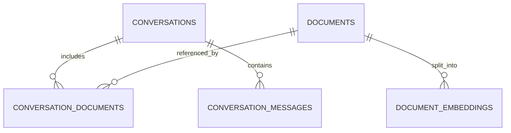

# Thiết kế Supabase: conversations, documents và bảng nối

> **Khóa học:** YouTube Conversational RAG · **Bài 04/20** · **Module:** Thiết kế cơ sở dữ liệu và vector search

## Tóm tắt

Dữ liệu vector chỉ là một phần của hệ thống. Muốn chat tiếp nối và tái sử dụng video, cần mô hình quan hệ độc lập với dữ liệu embeddings.

## Mục tiêu học tập

- Thiết kế các bảng và khóa ngoại.
- Giải thích nhiều-nhiều giữa chat và document.
- Tạo được schema SQL có thể kiểm thử.

## 1. Thiết kế dữ liệu trước khi lưu vector

Một `document` đại diện cho một video; một `conversation` đại diện cho chuỗi trao đổi. Không đặt `conversation_id` trực tiếp vào document vì như vậy một video chỉ thuộc một chat hoặc buộc sao chép dữ liệu. Tạo bảng nối giúp **một chat tham chiếu nhiều video**, đồng thời **một video được tái sử dụng ở nhiều chat**.



## 2. SQL khởi tạo cấu trúc

Mở Supabase Dashboard → SQL Editor. Chạy đoạn sau. Bài lab dùng UUID tạo server hoặc `gen_random_uuid()`; với môi trường triển khai thực tế cần thêm `owner_user_id` để kiểm soát truy cập.

```sql
create table if not exists public.conversations (
  id uuid primary key default gen_random_uuid(),
  created_at timestamptz not null default now()
);

create table if not exists public.documents (
  id uuid primary key default gen_random_uuid(),
  source_type text not null default 'youtube',
  source_url text not null,
  title text,
  status text not null default 'processing',
  created_at timestamptz not null default now()
);

create table if not exists public.conversation_documents (
  conversation_id uuid not null references public.conversations(id) on delete cascade,
  document_id uuid not null references public.documents(id) on delete cascade,
  linked_at timestamptz not null default now(),
  primary key (conversation_id, document_id)
);

create table if not exists public.conversation_messages (
  id uuid primary key default gen_random_uuid(),
  conversation_id uuid not null references public.conversations(id) on delete cascade,
  role text not null check (role in ('user', 'assistant')),
  content text not null,
  created_at timestamptz not null default now()
);

create index if not exists idx_message_conversation_order
  on public.conversation_messages (conversation_id, created_at, id);
```

Định nghĩa `created_at` với timezone để các máy ở múi giờ khác nhau xử lý đồng nhất. Ràng buộc `role` ngăn các chuỗi bất kỳ lọt vào lịch sử model. Composite primary key của bảng nối ngăn liên kết trùng lặp.

## 3. Ví dụ dữ liệu và cách truy vấn

Giả sử chat C1 gắn với video D1, D2; chat C2 gắn D1. Bảng nối có ba hàng `(C1,D1)`, `(C1,D2)`, `(C2,D1)` nhưng bảng `documents` chỉ có hai hàng. Embedding của D1 cũng chỉ lưu một lần nếu có cơ chế chống nhập trùng.

```sql
select d.id, d.title
from public.conversation_documents cd
join public.documents d on d.id = cd.document_id
where cd.conversation_id = 'CONVERSATION_UUID_HERE';
```

Trước khi truy xuất vector, backend phải kiểm tra `document_id` thực sự liên kết với `conversation_id` hiện tại; không tin tưởng danh sách ID do client tự khai báo.

## 4. Vòng đời document

Khuyến nghị các trạng thái `processing`, `ready`, `failed`. Đừng trả video “sẵn sàng chat” khi chỉ mới tạo record trong `documents` mà vẫn chưa tạo embeddings. Khi thất bại, lưu lỗi đã được làm sạch và cho phép retry. Với hệ thống thật, cần transaction hoặc cơ chế bù trừ để tránh tài liệu rỗng.

## 5. Kiểm tra kết quả

Sau khi chạy SQL, xem Table Editor. Thử insert một conversation, một document, một liên kết, hai message; thử chèn liên kết trùng và role `bot` để xác nhận constraint được kích hoạt. Chú ý `on delete cascade`: xóa conversation sẽ xóa bản ghi nối và message, **không** xóa document độc lập.

## 6. Bài tập ngắn

Viết query liệt kê số video trong mỗi conversation; query chỉ lấy các message của một conversation sắp theo `created_at, id` tăng dần.

## 7. Tổng kết

Chuẩn hóa dữ liệu tạo điều kiện tái sử dụng video, tìm lịch sử và mở rộng sang nhiều nguồn khác nhau. Vector retrieval không thay được khóa ngoại, unique constraint và access control.

## 8. Câu hỏi ôn tập trắc nghiệm

### Câu 1

Vì sao dùng `conversation_documents`?

A. Để đổi embedding model  
B. Để biểu diễn quan hệ nhiều-nhiều  
C. Để stream SSE  
D. Để lưu API key  

**Đáp án:** B. **Giải thích:** Một video có thể tham gia nhiều cuộc trò chuyện.

### Câu 2

Khi xóa conversation với `on delete cascade`, điều gì xảy ra?

A. Xóa tất cả video toàn hệ thống  
B. Xóa Supabase project  
C. Xóa links và messages liên quan  
D. Xóa embedding model  

**Đáp án:** C. **Giải thích:** Cascade áp dụng trên các khóa ngoại tham chiếu conversation.

### Câu 3

Status nào báo vector đã nạp xong?

A. ready  
B. processing  
C. queued  
D. failed  

**Đáp án:** A. **Giải thích:** Chỉ khi hoàn thành ingestion mới sẵn sàng truy xuất.

### Câu 4

Ràng buộc nào ngăn liên kết chat-video trùng?

A. Text title  
B. created_at  
C. model API  
D. Primary key kép  

**Đáp án:** D. **Giải thích:** Cặp khóa phân biệt duy nhất.

### Câu 5

Vì sao backend xác minh document thuộc conversation?

A. Để tạo CSS  
B. Để ngăn truy xuất chéo dữ liệu  
C. Để tăng chunkSize  
D. Để đổi thứ tự model  

**Đáp án:** B. **Giải thích:** Không nên tin ID gửi từ client.


## Tài liệu tham khảo để kiểm tra API hiện hành

- [Supabase LangChain integration](https://supabase.com/docs/guides/ai/langchain)
- [Supabase vector columns](https://supabase.com/docs/guides/ai/vector-columns)
- [Supabase vector indexes](https://supabase.com/docs/guides/ai/vector-indexes)
- [Supabase HNSW indexes](https://supabase.com/docs/guides/ai/vector-indexes/hnsw-indexes)
- [LangChain JS API reference](https://reference.langchain.com/javascript/)
- [LangChain recursive text splitter](https://reference.langchain.com/javascript/langchain-textsplitters/RecursiveCharacterTextSplitter)
- [LangChain SupabaseVectorStore](https://reference.langchain.com/javascript/langchain-community/vectorstores/supabase)

**Lưu ý phiên bản:** các ví dụ `createHistoryAwareRetriever`, `createStuffDocumentsChain`, `createRetrievalChain` dùng chain API truyền thống. Nếu major `langchain` đang cài không còn export đường dẫn đó, dùng phiên bản tương thích hoặc cập nhật theo reference hiện hành. Các đoạn code trong từng bài giải thích thành phần cốt lõi và được ghép cùng các helper trong cùng module; chúng không phải tất cả là file chạy độc lập.
