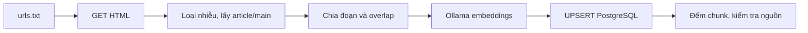

# Bài 06 — Thu thập tài liệu Airflow, chunking và nạp PostgreSQL

## 1. Tổng quan lab

Xây dựng pipeline đi qua từng URL tài liệu, trích xuất nội dung chính, chia chunk, gửi Ollama tạo embedding và upsert vào `document_chunks`. Phải bảo toàn `title`, `source_url` và chỉ số chunk. Demo giới hạn khoảng 10 URL để dễ đối chiếu với kết quả trong cơ sở dữ liệu.

## 2. Mục tiêu và đầu vào

- Viết scraper có timeout, xử lý HTTP, bỏ menu/navigation/script.
- Chia văn bản có giới hạn kích thước và overlap hợp lý.
- Đăng ký kiểu pgvector với `psycopg` để ghi vector đúng định dạng.
- Re-ingest an toàn, không tích lũy dữ liệu cũ cùng URL.

Chuẩn bị `.env` và `init.sql` từ bài PostgreSQL. Chọn tài liệu công khai được phép thu thập; tôn trọng điều khoản sử dụng và `robots.txt`. Không chạy crawler quét vô hạn các link. Tạo `urls.txt` — mỗi dòng một URL tài liệu thực tế đã kiểm tra, ví dụ:

```text
https://airflow.apache.org/docs/apache-airflow/stable/index.html
https://airflow.apache.org/docs/apache-airflow/stable/howto/docker-compose/index.html
```

Có thể bổ sung các trang còn hợp lệ về executor, cấu hình và cài đặt để đạt 10 URL. Đường dẫn tài liệu có thể thay đổi theo phiên bản Airflow; kiểm tra status 200 trước khi nạp.

## 3. Thư viện và luồng xử lý

File `requirements.txt` tối thiểu:

```text
requests
beautifulsoup4
psycopg[binary]
pgvector
python-dotenv
```

Cài đặt:

```bash
python -m pip install -r requirements.txt
```

Pipeline:



## 4. Mã `ingest.py` hoàn chỉnh cho lab

```python
import os
from pathlib import Path
import requests
import psycopg
from bs4 import BeautifulSoup
from dotenv import load_dotenv
from pgvector import Vector
from pgvector.psycopg import register_vector

load_dotenv()
DB = os.environ['DATABASE_URL']
OLLAMA = os.getenv('OLLAMA_URL', 'http://localhost:11434').rstrip('/')
MODEL = os.getenv('EMBED_MODEL', 'nomic-embed-text')


def fetch_page(url: str) -> tuple[str, str]:
    response = requests.get(url, timeout=25,
                            headers={'User-Agent': 'DocSearchCourse/1.0 (learning lab)'})
    response.raise_for_status()
    soup = BeautifulSoup(response.text, 'html.parser')
    title = soup.title.get_text(' ', strip=True) if soup.title else url
    main = soup.find('main') or soup.find('article') or soup.body
    if main is None:
        raise ValueError(f'Không tìm thấy HTML content tại {url}')
    for node in main.select('nav, header, footer, aside, script, style'):
        node.decompose()
    text = main.get_text(' ', strip=True)
    text = ' '.join(text.split())
    if len(text) < 50:
        raise ValueError(f'Nội dung quá ngắn: {url}')
    return title, text


def chunk_text(text: str, size: int = 1000, overlap: int = 150) -> list[str]:
    if not (0 <= overlap < size):
        raise ValueError('Yêu cầu 0 <= overlap < size')
    chunks = []
    start = 0
    while start < len(text):
        end = min(len(text), start + size)
        chunks.append(text[start:end])
        if end == len(text):
            break
        start = end - overlap
    return chunks


def get_embedding(text: str) -> list[float]:
    resp = requests.post(f'{OLLAMA}/api/embed',
        json={'model': MODEL, 'input': text, 'truncate': False}, timeout=180)
    resp.raise_for_status()
    vector = resp.json()['embeddings'][0]
    if len(vector) != 768:
        raise ValueError(f'Embedding {len(vector)} chiều, bảng yêu cầu 768')
    return vector


def ingest_url(conn, url: str) -> int:
    title, text = fetch_page(url)
    chunks = chunk_text(text)
    # Tạo embeddings trước khi xóa dữ liệu của URL trong database.
    rows = [(i, chunk, Vector(get_embedding('search_document: ' + chunk)))
            for i, chunk in enumerate(chunks)]
    with conn.transaction():
        with conn.cursor() as cur:
            # Dùng DELETE + INSERT trong 1 transaction để loại chunk cũ.
            cur.execute('DELETE FROM document_chunks WHERE source_url = %s', (url,))
            for i, chunk, vector in rows:
                cur.execute("""
                    INSERT INTO document_chunks
                      (source_url, title, chunk_index, content, embedding)
                    VALUES (%s, %s, %s, %s, %s)
                """, (url, title, i, chunk, vector))
    return len(rows)


def main():
    urls = [line.strip() for line in Path('urls.txt').read_text(encoding='utf-8').splitlines()
            if line.strip() and not line.lstrip().startswith('#')]
    with psycopg.connect(DB, autocommit=True) as conn:
        register_vector(conn)
        for url in dict.fromkeys(urls):
            try:
                count = ingest_url(conn, url)
                print(f'Đã nạp {count:3} chunk | {url}')
            except (requests.RequestException, ValueError, psycopg.Error) as exc:
                print(f'LỖI {url}: {exc}')

if __name__ == '__main__':
    main()
```

**Giải thích lựa chọn:** dùng `autocommit=True` để mỗi `with conn.transaction()` là transaction độc lập; nếu insert một URL thất bại, dữ liệu trước đó không bị mất vì `DELETE` và `INSERT` được rollback cùng nhau. `dict.fromkeys(urls)` loại URL trùng mà giữ thứ tự. Tạo embeddings trước khi mở transaction tránh giữ khóa database trong khi chờ Ollama. Cách chia theo số ký tự chỉ phục vụ lab; production cần tách theo cấu trúc heading/đoạn, token budget và phiên bản tài liệu.

## 5. Thực thi, kiểm chứng và debug

```bash
python ingest.py
docker compose exec postgres psql -U rag -d vector_db -c \
  'SELECT count(*) AS chunks, count(DISTINCT source_url) AS pages FROM document_chunks;'
```

Kiểm tra cụ thể:

```sql
SELECT source_url, COUNT(*) AS chunks, MIN(chunk_index), MAX(chunk_index)
FROM document_chunks
GROUP BY source_url ORDER BY chunks DESC;

SELECT title, source_url, left(content, 120) AS preview
FROM document_chunks ORDER BY id LIMIT 5;
```

Nếu tài liệu demo gồm 10 URL hợp lệ, số trang có thể là 10 nhưng số chunk thường lớn hơn; **không có bảo đảm** chính xác 10 bản ghi vì một trang có nhiều chunk.

## 6. Mở rộng đáng làm sau lab

Bổ sung `sha256(content)` để bỏ qua nội dung không đổi; lưu `etag`/`last-modified`; giới hạn cùng host và delay lịch sự; chống SSRF nếu URL do người dùng cung cấp; kiểm tra `Content-Type: text/html`; thêm progress logging và retry có backoff. Khi trang chứa code block, nên lấy cấu trúc `<pre>` riêng thay vì dùng `get_text` phẳng vì có thể làm mất xuống dòng và cú pháp.

## 7. Checkpoint

- [ ] Gọi `/api/embed` thành công trước khi ingest.
- [ ] Có hàng trong `document_chunks` và vector đúng 768 chiều.
- [ ] `source_url` và `title` có dữ liệu thật, không bị trùng URL.
- [ ] Ingest lần hai không tăng bản ghi theo kiểu nhân đôi cùng trang.
- [ ] Có log lỗi rõ ràng khi gặp URL hỏng.

## 8. Tổng kết

Ingestion quyết định chất lượng dữ liệu và khả năng cập nhật. Lỗi crawl, chunk sai hoặc không đồng nhất model sẽ đi thẳng vào kết quả tìm kiếm; HNSW không sửa được các lỗi ấy.

## 9. Câu hỏi ôn tập

### Câu 1

Vì sao cần loại navigation/menu trước khi embed?

A. Để tăng số chiều vector  
B. Để giảm nhiễu và nội dung lặp  
C. Để Docker chạy nhanh  
D. Để đổi tên bảng  

**Đáp án:** B  
**Giải thích:** Menu xuất hiện trên mọi trang dễ lấn át nội dung hữu ích.

### Câu 2

Điểm nào giúp re-ingest URL mà không giữ chunk cũ?

A. Xóa chunk cũ và ghi mới trong một transaction  
B. Tạo database mới mỗi lần  
C. Bỏ trường source_url  
D. Tăng HNSW m lên 128  

**Đáp án:** A  
**Giải thích:** DELETE và INSERT cùng transaction tránh trạng thái dữ liệu một phần.

### Câu 3

Vì sao sinh embedding trước transaction ghi?

A. Vì PostgreSQL không hỗ trợ HTTP  
B. Để hạn chế giữ transaction trong lúc chờ Ollama  
C. Để bỏ bước tạo bảng  
D. Để tạo vector 3 chiều  

**Đáp án:** B  
**Giải thích:** Gọi HTTP có thể chậm; làm trước sẽ rút ngắn thời gian giữ transaction.

### Câu 4

Với 10 URL và mỗi URL 5 chunk, bảng dự kiến có bao nhiêu bản ghi?

A. 5  
B. 10  
C. 50  
D. 500  

**Đáp án:** C  
**Giải thích:** Mỗi URL có 5 chunk tạo 10 × 5 = 50 hàng, nếu các URL đều hợp lệ.

### Câu 5

Trường nào giúp truy ngược kết quả tới trang gốc?

A. chunk_index riêng lẻ  
B. source_url  
C. embedding dimension  
D. Docker image ID  

**Đáp án:** B  
**Giải thích:** URL nguồn cho phép mở trực tiếp trang chứa đoạn.

