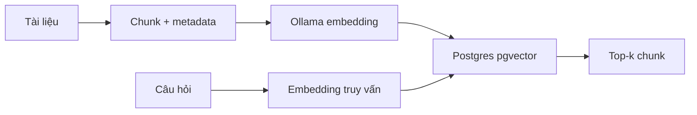

# Lộ trình học và chuẩn bị môi trường

> **Tóm tắt:** Xác định chuỗi dữ liệu từ văn bản đến PostgreSQL, chuẩn bị công cụ và kiểm tra các dịch vụ cần thiết.

## 1. Mục tiêu học tập

- Mô tả được 6 bước trong pipeline ingestion/retrieval.
- Cài và kiểm tra Docker, Node.js, Supabase CLI, Python và Ollama.
- Phân biệt dữ liệu gốc, chunk, embedding và kết quả truy xuất.

## 2. Bài toán đầu ra

Một RAG retriever cần lấy đúng bằng chứng từ tài liệu. Mô hình ngôn ngữ không nên phải đọc lại toàn bộ tập báo cáo ở mỗi câu hỏi. Ta chuyển tài liệu thành các đoạn nhỏ, lưu chúng kèm ngữ cảnh, chuyển thành vector và xây bộ máy truy xuất.



Mũi tên đi vào database từ hai phía: **index-time** lưu dữ liệu; **query-time** biến câu hỏi thành vector cùng không gian và so khớp.

## 3. Công cụ và yêu cầu

Chuẩn bị Docker Desktop (đang chạy), Node.js/npm, Python 3.10+ (khuyến nghị), Ollama và terminal. Supabase CLI có thể cài cục bộ trong project thông qua npm. Cần dung lượng cho Docker images và model embedding; kiểm tra bộ nhớ, disk trước khi tải.

```bash
docker --version
node --version
npm --version
python --version
ollama --version
```

Nếu dùng Windows, khởi động Docker Desktop và kiểm tra WSL2 phù hợp. Câu lệnh `python` có thể là `py` tùy cấu hình.

## 4. Quy tắc thực hành an toàn

Dùng môi trường local, không tự mở cổng ra Internet. Bất kỳ khóa `secret` hoặc `service_role` của Supabase chỉ được giữ trong `.env` ở backend. Không commit `.env`, không paste khóa vào README hay mã nguồn công khai. Không chạy `supabase db reset` nếu cần giữ dữ liệu: lệnh reset xóa database local rồi tạo lại từ migration.

Một lần thực hành hoàn chỉnh cần ba điểm kiểm chứng: `supabase status` có URL và key; `ollama list` thấy model; SQL `select count(*) from public.chunks` tăng sau ingestion.

## 5. Thực hành và tự kiểm tra

1. Kiểm tra 5 công cụ bằng các lệnh ở trên. 2. Vẽ lại pipeline thành 6 hộp. 3. Tạo thư mục project sạch. **Checkpoint:** có thể giải thích sự khác biệt giữa lưu dữ liệu và tìm dữ liệu mà không nhầm với bước sinh câu trả lời của LLM.

## 6. Câu hỏi ôn tập

### Câu 1

Embedding được tạo ở đâu trong sơ đồ?

A. Trước khi chia tài liệu thành chunk  
B. Sau khi có nội dung chunk  
C. Chỉ sau khi gọi LLM  
D. Trong bảng FTS  

**Đáp án:** B

**Giải thích:** Embedding biểu diễn một đoạn đã có nội dung.

### Câu 2

Công cụ nào chạy PostgreSQL/Supabase stack cục bộ?

A. Ollama  
B. Pip  
C. Docker-compatible runtime  
D. Markdown renderer  

**Đáp án:** C

**Giải thích:** Supabase CLI khởi động các container thông qua runtime tương thích Docker.

### Câu 3

Khóa secret/service-role đặt ở đâu?

A. Frontend JavaScript  
B. Commit vào Git  
C. URL công khai  
D. Biến môi trường backend  

**Đáp án:** D

**Giải thích:** Không tiết lộ khóa quyền cao ra client.

### Câu 4

Lệnh nào có thể phá hủy dữ liệu dev local?

A. supabase db reset  
B. supabase status  
C. ollama list  
D. python --version  

**Đáp án:** A

**Giải thích:** Reset sẽ xây lại DB và có thể xóa row đã nhập.

### Câu 5

Lúc query-time cần tạo embedding của gì?

A. Toàn bộ source code  
B. Câu hỏi của người dùng  
C. Metadata schema  
D. Docker image  

**Đáp án:** B

**Giải thích:** Câu hỏi được vector hóa cùng mô hình với các chunk.

## 7. Tổng kết

Xác định chuỗi dữ liệu từ văn bản đến PostgreSQL, chuẩn bị công cụ và kiểm tra các dịch vụ cần thiết. Hoàn thành phần thực hành và trả lời được các câu hỏi là đạt yêu cầu của bài.
