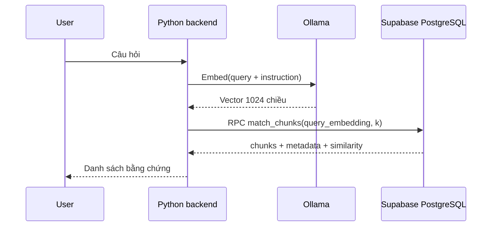

# Semantic search với pgvector và Supabase RPC

> **Tóm tắt:** Tạo embedding cho truy vấn, gọi match_chunks và diễn giải danh sách kết quả theo cosine similarity.

## 1. Mục tiêu học tập

- Thực hiện truy vấn end-to-end.
- Đọc similarity và metadata trả về.
- Phát hiện khác biệt giữa topic similarity và evidence relevance.

## 2. Luồng truy vấn

Khi người dùng đặt câu hỏi: tạo query embedding bằng cùng Qwen3 model đã dùng để index, gửi vector tới hàm `match_chunks` của PostgreSQL, chọn top-k theo cosine distance tăng dần, trả content và metadata cho backend.



## 3. Mã Supabase Python

```python
question = 'financial records with exceptionally strong quarterly performance'
prompt = 'Instruct: Given a document query, retrieve the most relevant passage.\nQuery: ' + question
vector = ollama.embed(model=MODEL, input=prompt).embeddings[0]
results = supabase.rpc('match_chunks', {
    'query_embedding': vector,
    'match_count': 5
}).execute().data
for row in results:
    print(row['similarity'], row['content'], row['metadata'])
```

Đối với dữ liệu mẫu, các đoạn báo cáo doanh thu và kết quả tài chính là ứng viên liên quan; **thứ hạng thực tế phải xem output khi chạy**, không suy ra chắc chắn từ lời mô tả.

## 4. Hiểu score và hạn chế

`similarity = 1 - cosine distance`. Giá trị cao hơn có nghĩa vector gần hơn trong mô hình, **không** xác nhận nội dung đúng hay kết quả là bằng chứng đầy đủ. Cần giữ metadata để hiển thị nguồn, dùng ngưỡng thận trọng, và cuối cùng đánh giá chính xác trên tập query–relevance labels. Khi áp dụng filter metadata cùng ANN, có thể gặp ít kết quả hơn k do lựa chọn ứng viên của index; kiểm tra tài liệu pgvector về iterative scans.

## 5. Thực hành và tự kiểm tra

Chạy `python tai-nguyen/search.py`, ghi top-5 kết quả semantic kèm similarity. So sánh với một truy vấn khác về cơ sở hạ tầng. Chọn một kết quả phù hợp và một kết quả gần chủ đề nhưng chưa đủ bằng chứng.

## 6. Câu hỏi ôn tập

### Câu 1

Query vector nên sinh từ model nào?

A. Model tùy ý  
B. Chính embedding model của corpus  
C. Chat LLM bất kỳ  
D. Không cần embedding  

**Đáp án:** B

**Giải thích:** Các vector cần cùng không gian biểu diễn.

### Câu 2

RPC trả về những gì?

A. Mã nguồn Docker  
B. Mật khẩu  
C. Chunk, metadata, similarity  
D. Mỗi token riêng  

**Đáp án:** C

**Giải thích:** Hàm match_chunks định nghĩa chính xác các cột trả về.

### Câu 3

Similarity cao có bảo đảm câu trả lời đúng?

A. Có  
B. Có nếu top-1  
C. Có nếu JSONB  
D. Không  

**Đáp án:** D

**Giải thích:** Vector closeness không thay cho fact checking.

### Câu 4

Muốn nhiều kết quả hơn nên chỉnh gì?

A. match_count  
B. embedding dimension  
C. PostgreSQL password  
D. Số container  

**Đáp án:** A

**Giải thích:** match_count là giới hạn số dòng tối đa.

### Câu 5

Muốn hiển thị nguồn truy vấn nên giữ gì?

A. Chỉ score  
B. metadata/source  
C. Chỉ vector  
D. Docker logs  

**Đáp án:** B

**Giải thích:** Metadata hỗ trợ dẫn chứng và kiểm tra.

## 7. Tổng kết

Tạo embedding cho truy vấn, gọi match_chunks và diễn giải danh sách kết quả theo cosine similarity. Hoàn thành phần thực hành và trả lời được các câu hỏi là đạt yêu cầu của bài.
