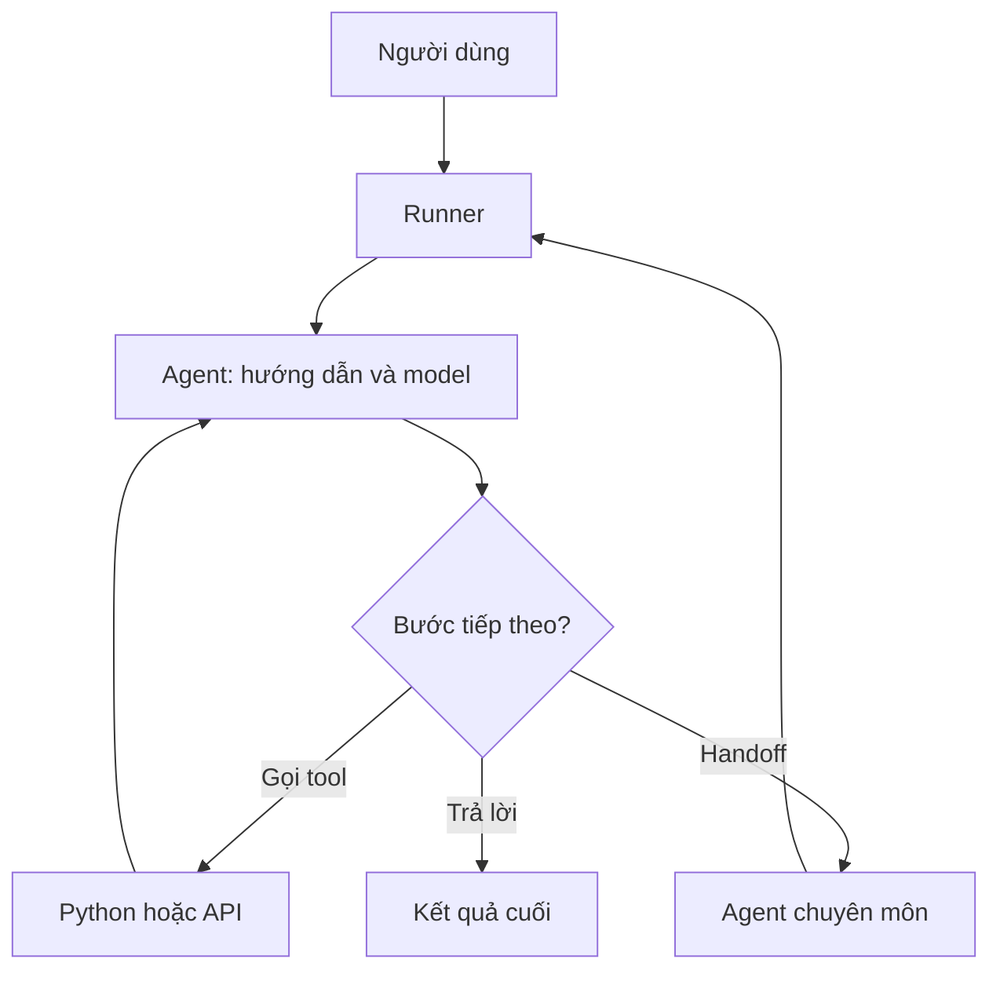

# Bài 01 — Kiến thức nền tảng: Tổng quan AI Agents

> **Module 01 · Lesson** · Video: [xem từ 00:00:00](https://www.youtube.com/watch?v=gFcAfU3V1Zo&t=0s).

**Tổng quan:** Agent là mô hình ngôn ngữ được định hướng bằng nhiệm vụ, có thể sử dụng công cụ và phối hợp với agent khác.

## 1. Kết quả cần đạt

Sau bài này, bạn có thể giải thích sự khác nhau giữa chatbot hỏi–đáp và agent có khả năng thực hiện nhiệm vụ, vẽ được vòng lặp thực thi và nhận diện các trường hợp nên dùng một agent hoặc nhiều agent.

## 2. Từ chatbot đến AI Agent

Chatbot truyền thống nhận một thông điệp và tạo một câu trả lời. Agent được cấu hình thêm **mục tiêu, hướng dẫn, công cụ và quyền điều phối**. Khi nhận câu hỏi “Lên lịch ngày mai”, agent có thể kiểm tra lịch trống, lấy danh sách công việc, sắp thứ tự ưu tiên rồi soạn đề xuất. Lời trả lời cuối cùng chỉ là bước cuối của một quá trình có thể chứa nhiều hành động.

Không phải câu trả lời nào cũng cần công cụ. Nếu người dùng hỏi “Giải thích thuật toán tìm kiếm nhị phân”, agent có thể trả lời trực tiếp. Nếu người dùng hỏi “Lịch của tôi chiều nay còn trống không?”, cần dữ liệu thực tế từ công cụ được cấp quyền.

Một agent cũng không đồng nghĩa với hệ thống tự trị hoàn toàn: chỉ những công cụ đã được lập trình và cho phép mới có thể chạy. Quyết định của mô hình cần đặt trong giới hạn quyền hạn và kiểm chứng của ứng dụng.

## 3. Kiến trúc căn bản

`Runner` phụ trách vòng lặp: gửi input đến mô hình, nhận yêu cầu gọi công cụ, thực thi và đưa kết quả trở lại mô hình; khi có handoff thì chuyển agent; khi có final output thì kết thúc. Đây là nền tảng để đọc toàn bộ khóa học.

## 4. Các thành phần bạn sẽ gặp

| Thành phần | Mục đích | Ví dụ |
| --- | --- | --- |
| `Agent` | Xác định vai trò, nhiệm vụ, công cụ | Trợ lý lập kế hoạch |
| `Runner` | Tổ chức vòng lặp chạy agent | Nhận yêu cầu, trả kết quả |
| `function_tool` | Cho model sử dụng hàm Python | Kiểm tra lịch |
| `handoffs` | Chuyển quyền xử lý | Trợ lý → chuyên gia |
| `output_type` | Yêu cầu đầu ra có cấu trúc | `Recipe` bằng Pydantic |
| `guardrails` | Kiểm tra các ràng buộc | Chặn hành vi không hợp lệ |
| `tracing` | Quan sát đường đi thực thi | Theo dõi tool và handoff |
| `session` | Giữ lịch sử qua nhiều lượt | Hội thoại đang diễn ra |

## 5. Khi nào nên tách nhiều agent?

Tách agent nếu công việc có những vai trò thực sự khác nhau: tạo truy vấn nghiên cứu, thu thập dữ kiện, đánh giá độ đủ, viết báo cáo. Mỗi agent có instructions riêng, đầu vào rõ ràng và tiêu chí hoàn thành. Nếu chỉ cần trả lời một câu ngắn, nhiều agent có thể làm tăng độ trễ, chi phí và độ khó kiểm thử.

Một quy tắc thực tế: **bắt đầu với một agent và vài tool; chỉ tách thêm agent khi có lý do đo được** như yêu cầu chuyên môn hóa hoặc đầu ra cần kiểm định độc lập.

## 6. Chuẩn bị kiến thức

Cần Python cơ bản (`def`, kiểu dữ liệu, `async/await`), thao tác terminal, biến môi trường và hiểu sơ bộ LLM. API key có thể phát sinh chi phí; không nhúng key vào source code. Những bài đầu không cần giao diện web, vì bài toán cần hiểu là vòng lặp Agent trước khi xây UI.

## 7. Tổng kết

Agent = mô hình được điều phối để hoàn thành mục tiêu trong giới hạn công cụ và quy tắc. Phần quan trọng nhất không phải prompt dài, mà là thiết kế khả năng hành động, quan sát và kiểm soát của toàn bộ hệ thống.

## 8. Câu hỏi ôn tập trắc nghiệm

### Câu 1

Điểm khác biệt trọng tâm giữa một chatbot và agent là gì?

A. Agent có thể điều phối tool và hành động trong phạm vi được cấp quyền  
B. Agent luôn nhiều mô hình hơn chatbot  
C. Agent không cần mô hình ngôn ngữ  
D. Agent chắc chắn đúng  

**Đáp án:** A. **Giải thích:** Khả năng dùng công cụ và thực thi theo mục tiêu là khác biệt chính.

### Câu 2

Bộ phận nào thực hiện vòng lặp gọi mô hình và công cụ?

A. `Pydantic`  
B. `Runner`  
C. `.env`  
D. `Graphviz`  

**Đáp án:** B. **Giải thích:** Runner tổ chức các bước cho tới khi nhận final output.

### Câu 3

Người dùng hỏi một định nghĩa thuần lý thuyết, phương án phù hợp nhất?

A. Luôn gọi web  
B. Luôn handoff  
C. Trả lời trực tiếp nếu đủ dữ kiện  
D. Luôn tạo file  

**Đáp án:** C. **Giải thích:** Lạm dụng tool làm tăng chi phí và độ trễ.

### Câu 4

Tại sao không nên mặc định chia mọi nhiệm vụ thành nhiều agent?

A. Vì SDK không cho phép nhiều agent  
B. Vì một agent không thể dùng tools  
C. Vì output_type không hỗ trợ  
D. Vì tăng phức tạp, độ trễ và chi phí khi không cần thiết  

**Đáp án:** D. **Giải thích:** Phân vai chỉ có ích khi vai trò riêng tạo giá trị.

### Câu 5

Đối với một công cụ thay đổi trạng thái như gửi nhắc nhở, điều gì quan trọng?

A. Kiểm soát quyền và xác nhận thao tác  
B. Cho phép model tự động gửi mọi lúc  
C. Đưa API key vào prompt  
D. Ẩn tool khỏi logs  

**Đáp án:** A. **Giải thích:** Hành động có tác dụng thực cần rào chắn ở tầng ứng dụng.

**Tài liệu tra cứu:** [OpenAI Agents SDK](https://openai.github.io/openai-agents-python/) · [1](https://openai.github.io/openai-agents-python/) · [2](https://openai.github.io/openai-agents-python/running_agents/)
