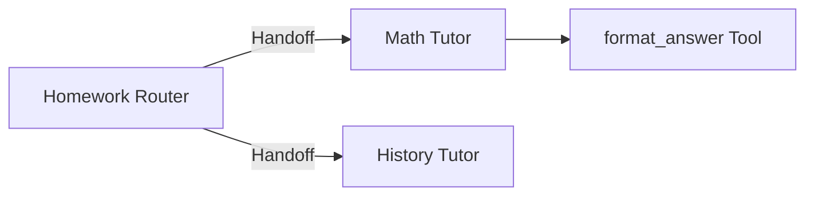

# Bài 02 — Thực hành có hướng dẫn: Visualizing: vẽ sơ đồ mạng Agent

> **Module 11 · Lab** · Video: [xem từ 01:31:34](https://www.youtube.com/watch?v=gFcAfU3V1Zo&t=5494s).

**Tổng quan:** Sử dụng tùy chọn visualization và Graphviz để quan sát quan hệ agent, tool và handoff.

## 1. Đề bài

Vẽ mạng agent hỗ trợ học tập có một router, hai chuyên gia và ít nhất một tool. Sau đó tự vẽ lại bằng Mermaid để giải thích kiến trúc.

## 2. Các bước

1. Cài `openai-agents[viz]` vào đúng venv.
2. Cài Graphviz và kiểm tra `dot -V`.
3. Chạy đoạn code trong bài lý thuyết bằng Python hoặc notebook.
4. Ghi nhận tên node và quan hệ handoff.
5. Bổ sung tool cho agent phù hợp, chạy lại và so sánh.

## 3. Mermaid để đối chiếu

Sơ đồ này là kiến trúc **khả năng**, không phải một trace của một cuộc chạy. Để đối chiếu runtime, chạy hai câu hỏi toán và lịch sử, sau đó xem trace.

## 4. Kiểm thử lỗi cài đặt

- `ExecutableNotFound`: Graphviz executable chưa trong PATH.
- Có package Python nhưng thiếu `dot`: cài Graphviz hệ thống.
- Notebook không tìm thấy module: chọn đúng kernel.
- Đồ thị không thể hiện tool: kiểm tra tool có gắn lên đúng agent và phiên bản visualization đang dùng.

## 5. Deliverable

Nộp ảnh hoặc file đồ thị từ công cụ visualization (nếu môi trường hỗ trợ) và file Markdown vẽ kiến trúc bằng Mermaid; giải thích điểm khác nhau giữa thiết kế tĩnh và hành vi runtime.

## 6. Checklist

Tên các agent đúng; tool đặt đúng vai trò; `dot -V` chạy; không đưa thông tin riêng tư vào label đồ thị.

## 7. Câu hỏi ôn tập trắc nghiệm

### Câu 1

Visualization khác tracing ở điểm nào?

A. Cả hai là guardrail  
B. Visualization thay được API key  
C. Visualization cho thấy cấu trúc, tracing cho thấy hành vi thực thi  
D. Tracing chỉ dành cho frontend  

**Đáp án:** C. **Giải thích:** Đồ thị tĩnh và trace runtime phục vụ câu hỏi khác nhau.

### Câu 2

Bộ cài nào thường cần để tạo đồ thị visualization?

A. Chỉ `python-dotenv`  
B. Chỉ SQLite  
C. Chỉ Pydantic  
D. Graphviz và phần tùy chọn SDK `viz`  

**Đáp án:** D. **Giải thích:** Thư viện có thể gọi chương trình `dot` của Graphviz.

### Câu 3

Lệnh nào xác nhận Graphviz executable khả dụng?

A. `dot -V`  
B. `python -V`  
C. `pip freeze`  
D. `git status`  

**Đáp án:** A. **Giải thích:** Phiên bản `dot` chứng minh công cụ đã trên PATH.

### Câu 4

Nhìn thấy cạnh handoff trong sơ đồ có nghĩa gì?

A. Handoff chắc chắn đã diễn ra  
B. Agent có thể chuyển quyền theo cạnh đó  
C. Tool đã gọi  
D. Output đã qua kiểm duyệt  

**Đáp án:** B. **Giải thích:** Sơ đồ cấu trúc không chứng minh sự kiện runtime.

### Câu 5

Nếu Graphviz không nhận `dot` sau cài đặt, nên thử gì?

A. Xóa mã nguồn Agent  
B. Bỏ .env  
C. Kiểm tra PATH và mở lại terminal  
D. Thêm tool giả  

**Đáp án:** C. **Giải thích:** Thay đổi PATH thường chỉ áp dụng cho process mới.

**Tài liệu tra cứu:** [OpenAI Agents SDK](https://openai.github.io/openai-agents-python/) · [1](https://openai.github.io/openai-agents-python/visualization/)
