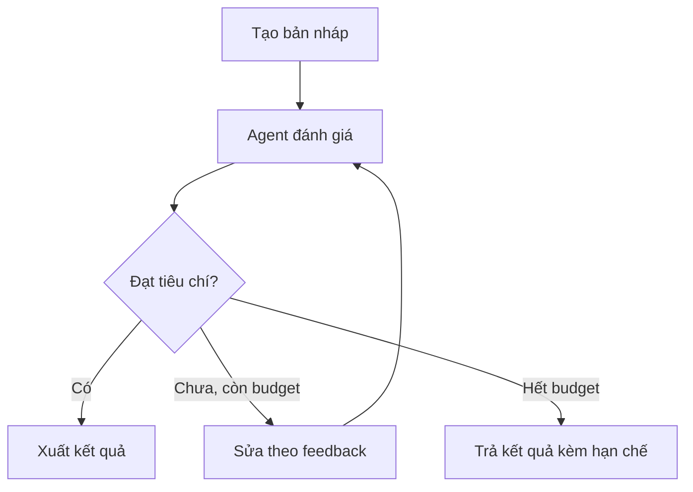

# Bài 01 — Kiến thức nền tảng: Agentic Patterns và điều phối đa Agent

> **Module 12 · Lesson** · Video: [xem từ 01:34:20](https://www.youtube.com/watch?v=gFcAfU3V1Zo&t=5660s).

**Tổng quan:** So sánh deterministic flow, router/handoff, agent-as-tool và evaluator–optimizer có giới hạn vòng lặp.

## 1. Mục tiêu

Chọn mẫu điều phối phù hợp cho từng bài toán, xây quy trình có người đánh giá chất lượng và ngăn vòng lặp agent không kết thúc.

## 2. Deterministic flow

Nếu pipeline luôn là *outline → evaluator → writer*, code Python có thể gọi từng agent theo thứ tự. Ưu điểm: dễ hiểu, dễ kiểm thử, không phụ thuộc model quyết định luồng; nhược điểm: kém linh hoạt khi người dùng có nhiều ý định.

```python
from agents import Agent, Runner

planner = Agent(name="Planner", instructions="Tạo dàn ý 3 gạch đầu dòng")
writer = Agent(name="Writer", instructions="Viết bài từ dàn ý")
plan = Runner.run_sync(planner, "AI Agents là gì?")
article = Runner.run_sync(writer, plan.final_output)
print(article.final_output)
```

## 3. LLM routing bằng handoff

Router phân loại yêu cầu, chuyển cho agent chuyên trách. Có ích khi câu hỏi thay đổi và cần nhiều kỹ năng. Tuy nhiên model có thể định tuyến sai, nên dùng mô tả handoff rõ ràng và test case cho từng nhóm.

## 4. Agents as tools

Nếu một agent quản lý cần hỏi nhiều chuyên gia rồi tự tổng hợp, `Agent.as_tool()` phù hợp hơn handoff: nó gọi chuyên gia như công cụ, nhận kết quả và **quyền điều khiển quay về agent quản lý**.

```python
from agents import Agent, Runner

spanish = Agent(name="Spanish Translator", instructions="Dịch nội dung sang tiếng Tây Ban Nha")
french = Agent(name="French Translator", instructions="Dịch nội dung sang tiếng Pháp")
manager = Agent(
    name="Translation Manager",
    instructions="Sử dụng các công cụ dịch theo ngôn ngữ người dùng yêu cầu, sau đó tổng hợp.",
    tools=[
        spanish.as_tool(tool_name="translate_spanish", tool_description="Dịch sang tiếng Tây Ban Nha"),
        french.as_tool(tool_name="translate_french", tool_description="Dịch sang tiếng Pháp"),
    ],
)
print(Runner.run_sync(manager, "Dịch câu 'Xin chào' sang tiếng Pháp và Tây Ban Nha").final_output)
```

## 5. Evaluator–Optimizer (LLM-as-a-judge)

Một agent tạo nội dung, agent thứ hai chấm chất lượng dựa trên rubric. Nếu chưa đạt, trả feedback để sửa. Luồng này cần điều kiện dừng và giới hạn số vòng:



Đừng để evaluator tự quyết định vô hạn. Đặt giới hạn iteration, token budget, timeout và có đường ra khi không đạt chuẩn.

## 6. Chọn pattern bằng bài toán

| Pattern | Nên dùng | Tránh khi |
| --- | --- | --- |
| Sequential deterministic | Bước bắt buộc cố định | Nhiều nhánh linh hoạt |
| Handoff | Chuyên gia tiếp quản lượt chat | Manager cần tổng hợp nhiều kết quả |
| Agent as tool | Manager cần lấy nhiều kết quả con | Muốn chuyên gia tiếp tục tương tác trực tiếp |
| Evaluator–optimizer | Cần cải thiện chất lượng có rubric | Không có tiêu chí kiểm tra rõ ràng |
| Parallelization | Các tác vụ con độc lập | Có phụ thuộc dữ liệu tuần tự |

## 7. Tổng kết

Mẫu điều phối là quyết định thiết kế phần mềm, không phải “nâng cấp IQ” tự động. Càng nhiều agent, càng cần hợp đồng input/output và khả năng kiểm thử.

## 8. Câu hỏi ôn tập trắc nghiệm

### Câu 1

Pattern nào cho phép lập trình viên kiểm soát chính xác thứ tự agent?

A. Deterministic sequential flow  
B. Handoff tự động  
C. Một WebSearchTool duy nhất  
D. Guardrail  

**Đáp án:** A. **Giải thích:** Code Python gọi tuần tự từng agent.

### Câu 2

`Agent.as_tool()` khác handoff thế nào?

A. Luôn chuyển quyền vĩnh viễn  
B. Agent quản lý nhận kết quả rồi tiếp tục điều phối  
C. Xóa lịch sử  
D. Không dùng được với model  

**Đáp án:** B. **Giải thích:** Tool trả kết quả con cho agent chủ.

### Câu 3

Evaluator–optimizer cần điều kiện gì quan trọng?

A. Luôn lặp vô hạn  
B. Chỉ dùng một agent  
C. Giới hạn số vòng và tiêu chí đạt rõ ràng  
D. Không cần feedback  

**Đáp án:** C. **Giải thích:** Cần ràng buộc chi phí và tránh loop vô hạn.

### Câu 4

Một evaluator LLM trả `passed=True` bảo đảm điều gì?

A. Mọi dữ kiện chắc chắn đúng  
B. Không có hallucination  
C. Không tốn token  
D. Chỉ là đánh giá của mô hình, vẫn cần kiểm chứng nếu quan trọng  

**Đáp án:** D. **Giải thích:** Evaluator có thể sai như generator.

### Câu 5

Nên dùng handoff khi nào?

A. Chuyên gia cần tiếp quản giải quyết yêu cầu  
B. Manager luôn cần tổng hợp  
C. Bước phải cố định 100%  
D. Không có agent khác  

**Đáp án:** A. **Giải thích:** Handoff chuyển vai trò xử lý.


**Tài liệu tra cứu:** [OpenAI Agents SDK](https://openai.github.io/openai-agents-python/) · [1](https://openai.github.io/openai-agents-python/multi_agent/) · [2](https://openai.github.io/openai-agents-python/handoffs/)
