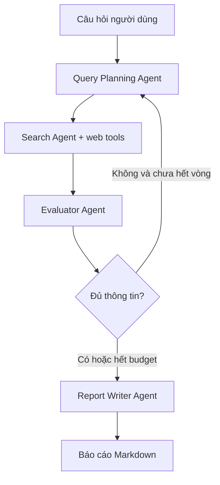

# Bài 01 — Kiến thức nền tảng: Dự án cuối khóa — Deep Research Agent

> **Module 13 · Lesson** · Video: [xem từ 01:43:02](https://www.youtube.com/watch?v=gFcAfU3V1Zo&t=6182s).

**Tổng quan:** Xây ứng dụng console phối hợp Query Planner, Search Agent, Evaluator và Report Writer để xuất báo cáo Markdown có nguồn.

## 1. Bài toán và kết quả sản phẩm

Ứng dụng nhận một câu hỏi nghiên cứu mở, tự đề xuất các truy vấn con, thu thập tài liệu, đánh giá độ bao phủ, nghiên cứu bổ sung nếu cần rồi tạo báo cáo Markdown. Sản phẩm chạy trong terminal; giao diện web là phần mở rộng, không phải nội dung triển khai chính.

Kết quả cần có: tiêu đề, tóm tắt, mục lục, các chủ đề chính, kết luận, danh sách nguồn và ghi chú về mức độ chắc chắn. Không được tự nhận là đã tìm kiếm khi tool chưa thực sự trả dữ liệu.

## 2. Thiết kế kiến trúc



Agent Query Planning tạo 3–5 truy vấn cụ thể; Search Agent tìm nguồn và rút ý có URL; Evaluator đánh giá thiếu gì; Writer kết hợp dữ kiện. Vòng lặp do code orchestrator quản lý. Không cần handoff cho từng bước nếu trình tự luôn được lập trình rõ.

## 3. Cấu trúc dự án tham khảo

```text
deep_research/
├── main.py
├── orchestrator.py
├── models.py
├── specialists/
│   ├── query_planner.py
│   ├── search_agent.py
│   ├── evaluator.py
│   └── report_writer.py
├── tools/
│   ├── search.py
│   └── scrape.py
├── reports/
├── requirements.txt
├── .env.example
└── .gitignore
```

`models.py` chứa Pydantic schema; `tools/` chứa code truy vấn dữ liệu bên ngoài; `orchestrator.py` điều phối agent. Tách phần này giúp debug, thay nhà cung cấp search và test từng bước.

## 4. Trách nhiệm của từng agent

| Thành phần | Nhận | Trả | Tiêu chí |
| --- | --- | --- | --- |
| Query Planner | Câu hỏi/feedback | Danh sách truy vấn | Có độ bao phủ chủ đề |
| Search Agent | Một truy vấn | Các nguồn + tóm tắt | Nguồn có URL kiểm chứng |
| Evaluator | Câu hỏi + các phát hiện | `is_sufficient`, gaps | Nêu thiếu sót cụ thể |
| Writer | Dữ kiện có nguồn | Markdown report | Trích dẫn phù hợp nguồn |

## 5. Vòng lặp tối thiểu

```python
# Pseudocode ở cấp điều phối
question = ask_user()
findings = []
feedback = ""
for iteration in range(MAX_RESEARCH_ROUNDS):
    queries = plan_queries(question, feedback)
    findings.extend(search_queries(queries))
    assessment = evaluate(question, findings)
    if assessment.is_sufficient:
        break
    feedback = assessment.missing_topics
report = write_markdown(question, findings, assessment)
save(report)
```

Mọi vòng phải có hạn mức tìm kiếm, số trang, thời gian và token. Khi hết budget nhưng thiếu dữ liệu, báo cáo cần nói rõ phạm vi hạn chế thay vì tạo kết luận chắc chắn.

## 6. Rủi ro trong bài toán Research

Tìm kiếm có thể trả trùng URL, tài liệu lỗi thời, trang quảng cáo hoặc nội dung nguy hiểm (prompt injection) cố hướng dẫn agent làm sai. Tool scraping không nên chạy code từ trang web hay đưa API key vào requests. Kết luận cần gắn với nguồn; việc có URL không tự chứng minh URL hỗ trợ đúng câu đã viết.

## 7. Tiêu chí hoàn thành

Có pipeline end-to-end chạy với query; có ít nhất một test offline dùng dữ liệu giả; có báo cáo `.md`; có trạng thái lỗi của search; có danh mục nguồn; có giới hạn tối đa ba vòng nghiên cứu (một mặc định demo, không phải yêu cầu bắt buộc của SDK); có kiểm tra liên kết nguồn.

## 8. Câu hỏi ôn tập trắc nghiệm

### Câu 1

Bước đầu của pipeline Deep Research là gì?

A. Lập các truy vấn con từ câu hỏi  
B. Viết kết luận ngay  
C. Xóa nguồn  
D. Xuất HTML trực tiếp  

**Đáp án:** A. **Giải thích:** Planning định hướng các khía cạnh cần tìm.

### Câu 2

Evaluator trong research nên trả gì?

A. Một API key  
B. Đánh giá độ đủ và các chủ đề còn thiếu  
C. Một câu chào  
D. Giá token hiện tại  

**Đáp án:** B. **Giải thích:** Feedback giúp vòng nghiên cứu bổ sung có chủ đích.

### Câu 3

Vì sao cần giới hạn vòng lặp nghiên cứu?

A. Để bỏ qua mọi nguồn  
B. Để ẩn lỗi tìm kiếm  
C. Kiểm soát chi phí, thời gian và tránh vô hạn  
D. Vì Python không có while  

**Đáp án:** C. **Giải thích:** Research có thể lặp lại nếu không có điều kiện dừng.

### Câu 4

Báo cáo nghiên cứu đáng tin cần đặc điểm nào?

A. Chỉ Markdown đẹp  
B. Chỉ nhiều chữ  
C. Không cần liên kết  
D. Có nguồn gắn với nhận định và nói rõ giới hạn  

**Đáp án:** D. **Giải thích:** Khả năng truy nguyên nguồn là yêu cầu trọng tâm.

### Câu 5

URL trong một Finding có tự bảo đảm kết luận đúng?

A. Không, cần đối chiếu claim với nội dung nguồn  
B. Có, luôn luôn  
C. Có nếu model mạnh  
D. Có nếu dùng trace  

**Đáp án:** A. **Giải thích:** Có link không đồng nghĩa trích dẫn đúng.


**Tài liệu tra cứu:** [OpenAI Agents SDK](https://openai.github.io/openai-agents-python/) · [1](https://openai.github.io/openai-agents-python/) · [2](https://github.com/openai/openai-agents-python)
