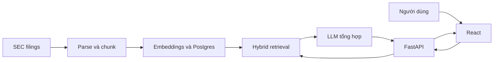

# Bài 1. Document Copilot và bài toán hỏi đáp có căn cứ

> **Module 01 — Tổng quan hệ thống GenAI Full Stack**  
> Thời điểm tham chiếu: [0:00:00](https://www.youtube.com/watch?v=qF5il_9IwME&t=0s).  
> Hình thức: bài học kết hợp thực hành.

## 1. Tóm tắt

Xác định một Document Copilot khác gì chatbot thông thường và nắm toàn bộ vòng đời của một câu hỏi từ trình duyệt tới bằng chứng trong tài liệu.

## 2. Mục tiêu học tập

- Giải thích được cơ chế và lý do kỹ thuật của chủ đề **Document Copilot và bài toán hỏi đáp có căn cứ**.
- Tự triển khai hoặc mô phỏng các bước thực hành và kiểm tra kết quả theo tiêu chí được nêu.
- Nhận diện các lỗi thiết kế/triển khai phổ biến và lựa chọn biện pháp xử lý có căn cứ.

## 3. Bối cảnh và vấn đề cần giải quyết

Một mô hình ngôn ngữ có thể tạo câu trả lời trôi chảy nhưng không tự biết toàn bộ dữ liệu nội bộ hoặc những hồ sơ vừa được đưa vào hệ thống. Đưa hàng trăm tài liệu trực tiếp vào prompt cũng không khả thi vì giới hạn ngữ cảnh, chi phí và khả năng kiểm chứng. Document Copilot giải quyết bằng cách lưu tài liệu có cấu trúc, tìm phần liên quan rồi mới yêu cầu mô hình tổng hợp câu trả lời.

## 4. Kiến thức cốt lõi

### 4.1. RAG là gì

Retrieval-Augmented Generation (RAG) nối hai công việc: retrieval tìm bằng chứng và generation soạn đáp án. Phần truy xuất quyết định mô hình được nhìn thấy gì, vì vậy chất lượng trích xuất, chunking và ranking ảnh hưởng trực tiếp tới độ chính xác.

### 4.2. Grounded answer và citation

Grounded answer là câu trả lời có cơ sở trong đoạn tài liệu đã truy xuất. Citation phải liên kết được đến tài liệu và vị trí bằng chứng cụ thể; chỉ in tên công ty hoặc một đường link chung chưa đủ để người đọc kiểm tra một con số.

### 4.3. Luồng online và offline

Offline ingestion gồm tải hồ sơ, chuyển định dạng, chia chunk, tạo embedding và lưu database. Online query gồm xác thực, nhận câu hỏi, tìm kiếm, kiểm chứng bằng chứng, tạo đáp án và lưu lịch sử. Hai luồng độc lập về thời điểm nhưng cùng dùng bảng tài liệu/chunk.

## 5. Quy trình áp dụng từng bước

Các bước dưới đây là phương án thực hành để tái tạo và kiểm chứng các nguyên tắc đã học. Điều chỉnh tên file, biến môi trường và phiên bản dependency theo dự án của bạn.

**Bước 1.** Viết một câu hỏi phân tích có câu trả lời nằm trong hồ sơ SEC, chẳng hạn so sánh cơ cấu doanh thu giữa các năm.

**Bước 2.** Liệt kê các điểm kiểm chứng: tên công ty, kỳ báo cáo, đoạn bằng chứng, con số và đường dẫn gốc.

**Bước 3.** Vẽ hai luồng ingestion và question-answering trước khi chọn framework.

**Bước 4.** Định nghĩa thông điệp trả về gồm answer, citations và trạng thái truy xuất; không chỉ mỗi chuỗi answer.

## 6. Ví dụ minh họa

Ví dụ sau tập trung vào một nguyên lý triển khai. Đây là mã/giả mã dùng cho học tập, có thể cần bổ sung các thành phần vận hành và kiểm thử khi tích hợp vào repository thực tế.

## 7. Kiểm tra kết quả và tiêu chí hoàn thành

- [ ] Tự mô tả được dữ liệu nào chạy offline và dữ liệu nào phát sinh từ mỗi cuộc hội thoại.
- [ ] Mỗi claim quan trọng của câu trả lời đều có đường dẫn về chunk và tài liệu gốc.

**Checkpoint:** Người học cần trình bày được dữ liệu đầu vào, biến đổi hoặc hành động chính, đầu ra quan sát được và tình huống thất bại của phần này. Nếu chưa chứng minh được bằng lệnh chạy, ảnh chụp, test hoặc bảng so sánh, chưa nên đánh dấu hoàn tất.

## 8. Lỗi thường gặp và cách tự debug

1. Không coi RAG là một lời bảo đảm tuyệt đối chống hallucination: retrieval có thể chọn nhầm tài liệu.

2. Không trộn chuỗi prompt dài với toàn bộ tài liệu khi số lượng hồ sơ tăng.

Khi gặp lỗi, hãy thu nhỏ tình huống về một input cụ thể, kiểm tra log/request id, xác nhận từng lớp độc lập và chỉ sửa một giả thuyết tại một thời điểm. Cách làm này giúp phân biệt sai dữ liệu, sai hợp đồng API và sai cấu hình môi trường.

## 9. Bài tập ứng dụng

Tạo một sơ đồ hai luồng; kèm JSON mẫu trả về có `answer`, `citations`, `conversation_id`, `status` và giải thích vì sao từng trường cần thiết.

**Sản phẩm nộp:** một README ngắn mô tả cách chạy, dữ liệu/case thử, bằng chứng đã kiểm tra và tối thiểu một tình huống lỗi được xử lý. Nếu thực hành với tài khoản thật, loại bỏ mọi secret và dữ liệu nhạy cảm khỏi bản nộp.

## 10. Câu hỏi ôn tập trắc nghiệm

**Câu 1.** Bước nào cung cấp bằng chứng trước khi LLM trả lời?

A. Truy xuất các chunk liên quan.  
B. Khi ánh xạ được câu trả lời tới tài liệu và đoạn cụ thể.  
C. Pipeline ingestion không phụ thuộc từng câu hỏi.  
D. Để tiền xử lý tài liệu trước và phục vụ truy vấn với độ trễ thấp hơn.  

**Đáp án: A.** Không có retrieval, mô hình dễ dựa vào kiến thức sẵn có thay vì hồ sơ được cấp.

**Câu 2.** Citation hữu ích nhất khi nào?

A. Pipeline ingestion không phụ thuộc từng câu hỏi.  
B. Để tiền xử lý tài liệu trước và phục vụ truy vấn với độ trễ thấp hơn.  
C. Nêu rõ giới hạn và không khẳng định dữ kiện không kiểm chứng.  
D. Khi ánh xạ được câu trả lời tới tài liệu và đoạn cụ thể.  

**Đáp án: D.** Một liên kết xác minh được giúp nhà phân tích kiểm tra claim.

**Câu 3.** Việc tạo embedding cho toàn bộ corpus nên nằm ở đâu?

A. Để tiền xử lý tài liệu trước và phục vụ truy vấn với độ trễ thấp hơn.  
B. Nêu rõ giới hạn và không khẳng định dữ kiện không kiểm chứng.  
C. Pipeline ingestion không phụ thuộc từng câu hỏi.  
D. Truy xuất các chunk liên quan.  

**Đáp án: C.** Tính embedding lặp lại cho mọi yêu cầu vừa chậm vừa tốn chi phí.

**Câu 4.** Tại sao cần tách offline và online?

A. Nêu rõ giới hạn và không khẳng định dữ kiện không kiểm chứng.  
B. Để tiền xử lý tài liệu trước và phục vụ truy vấn với độ trễ thấp hơn.  
C. Truy xuất các chunk liên quan.  
D. Khi ánh xạ được câu trả lời tới tài liệu và đoạn cụ thể.  

**Đáp án: B.** Hai luồng có vòng đời và đặc tính tải khác nhau.

**Câu 5.** Điều gì cần làm khi thiếu bằng chứng?

A. Nêu rõ giới hạn và không khẳng định dữ kiện không kiểm chứng.  
B. Truy xuất các chunk liên quan.  
C. Khi ánh xạ được câu trả lời tới tài liệu và đoạn cụ thể.  
D. Pipeline ingestion không phụ thuộc từng câu hỏi.  

**Đáp án: A.** Tính đáng tin cậy quan trọng hơn một đáp án nghe hợp lý.

## 11. Tổng kết

Bài học tập trung vào **Document Copilot và bài toán hỏi đáp có căn cứ** như một mắt xích của Document Copilot. Giá trị quan trọng nhất không chỉ là chạy được một chức năng mà còn là lý giải được thiết kế, truy vết được dữ liệu và kiểm chứng bằng trường hợp thực tế.

**Mốc học video:** [0:00:00](https://www.youtube.com/watch?v=qF5il_9IwME&t=0s) — 0:04:32.
