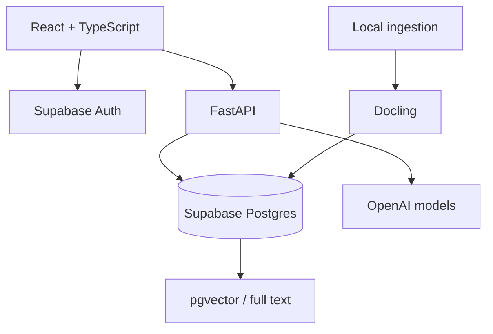

# Bài 1. Thiết kế kiến trúc frontend, backend, database và ingestion

> **Module 03 — Stack công nghệ và kiến trúc**  
> Thời điểm tham chiếu: [0:18:45](https://www.youtube.com/watch?v=qF5il_9IwME&t=1125s).  
> Hình thức: bài học kết hợp thực hành.

## 1. Tóm tắt

Phác họa kiến trúc triển khai được, xác định rõ ownership của mỗi thành phần và ranh giới bảo mật giữa client–server.

## 2. Mục tiêu học tập

- Giải thích được cơ chế và lý do kỹ thuật của chủ đề **Thiết kế kiến trúc frontend, backend, database và ingestion**.
- Tự triển khai hoặc mô phỏng các bước thực hành và kiểm tra kết quả theo tiêu chí được nêu.
- Nhận diện các lỗi thiết kế/triển khai phổ biến và lựa chọn biện pháp xử lý có căn cứ.

## 3. Bối cảnh và vấn đề cần giải quyết

Ứng dụng chạy trong trình duyệt nhưng không để trình duyệt trực tiếp dùng khóa bí mật của mô hình hoặc quyền quản trị database. Frontend React/TypeScript gọi FastAPI. Supabase cung cấp Postgres và authentication, pgvector lưu embeddings; ingestion chạy tách biệt với đường phục vụ hỏi đáp. Railway dùng để host các dịch vụ ứng dụng.

## 4. Kiến thức cốt lõi

### 4.1. Phân trách nhiệm lớp

Frontend chịu trách nhiệm phiên đăng nhập, danh sách hội thoại, input và trình bày citations. Backend kiểm chứng access token, quyết định truy vấn, gọi LLM và ghi log. Database lưu records bền vững; pipeline nhập dữ liệu chuẩn hóa các hồ sơ.

### 4.2. Hai dạng dữ liệu

Dữ liệu có cấu trúc gồm user, conversation, message và citations. Dữ liệu tra cứu gồm source_document, document_chunk, embedding và metadata. Postgres có thể lưu cả hai, nhưng không vì vậy mà bỏ qua phân quyền giữa người dùng.

### 4.3. Một request hỏi đáp

Trình duyệt lấy session, gửi token kèm câu hỏi tới API; API xác minh người dùng, tìm chunks được phép truy cập, tổng hợp đáp án và đưa về các citation records. Nếu thiếu bằng chứng, trạng thái phải phản ánh sự thiếu này.

## 5. Quy trình áp dụng từng bước

Các bước dưới đây là phương án thực hành để tái tạo và kiểm chứng các nguyên tắc đã học. Điều chỉnh tên file, biến môi trường và phiên bản dependency theo dự án của bạn.

**Bước 1.** Vẽ đường đi của một message cùng từng datastore được đọc/ghi.

**Bước 2.** Chọn thành phần chịu trách nhiệm xác thực JWT và thành phần chịu trách nhiệm RLS.

**Bước 3.** Phân biệt biến public của client với bí mật `DATABASE_URL`, LLM key và service credential.

**Bước 4.** Đặt API contract tối thiểu để frontend không phụ thuộc chi tiết truy xuất phía sau.

## 6. Ví dụ minh họa

Ví dụ sau tập trung vào một nguyên lý triển khai. Đây là mã/giả mã dùng cho học tập, có thể cần bổ sung các thành phần vận hành và kiểm thử khi tích hợp vào repository thực tế.

## 7. Kiểm tra kết quả và tiêu chí hoàn thành

- [ ] Mỗi mũi tên có chủ thể, dữ liệu chuyển và cách xác thực.
- [ ] Secret server-side không xuất hiện trong source bundle frontend.

**Checkpoint:** Người học cần trình bày được dữ liệu đầu vào, biến đổi hoặc hành động chính, đầu ra quan sát được và tình huống thất bại của phần này. Nếu chưa chứng minh được bằng lệnh chạy, ảnh chụp, test hoặc bảng so sánh, chưa nên đánh dấu hoàn tất.

## 8. Lỗi thường gặp và cách tự debug

1. Không gọi OpenAI bằng secret từ browser.

2. Không cho tất cả người dùng đọc chat của nhau chỉ vì database dùng chung.

Khi gặp lỗi, hãy thu nhỏ tình huống về một input cụ thể, kiểm tra log/request id, xác nhận từng lớp độc lập và chỉ sửa một giả thuyết tại một thời điểm. Cách làm này giúp phân biệt sai dữ liệu, sai hợp đồng API và sai cấu hình môi trường.

## 9. Bài tập ứng dụng

Dựng sơ đồ container và đánh dấu public/private cho mỗi credential sử dụng.

**Sản phẩm nộp:** một README ngắn mô tả cách chạy, dữ liệu/case thử, bằng chứng đã kiểm tra và tối thiểu một tình huống lỗi được xử lý. Nếu thực hành với tài khoản thật, loại bỏ mọi secret và dữ liệu nhạy cảm khỏi bản nộp.

## 10. Câu hỏi ôn tập trắc nghiệm

**Câu 1.** Thành phần xác thực phiên cho browser?

A. Supabase Auth kết hợp kiểm tra token phía API.  
B. Postgres có pgvector.  
C. Điều phối truy xuất, LLM và quyền truy cập dữ liệu.  
D. API key bí mật và database admin credential.  

**Đáp án: A.** Không nên chỉ kiểm tra trạng thái đăng nhập tại UI.

**Câu 2.** Embeddings được lưu ở đâu trong stack này?

A. Điều phối truy xuất, LLM và quyền truy cập dữ liệu.  
B. API key bí mật và database admin credential.  
C. Tiến trình riêng, không nằm trên request chat của người dùng.  
D. Postgres có pgvector.  

**Đáp án: D.** pgvector là phần mở rộng phục vụ phép toán vector.

**Câu 3.** Backend giữ vai trò gì?

A. API key bí mật và database admin credential.  
B. Tiến trình riêng, không nằm trên request chat của người dùng.  
C. Điều phối truy xuất, LLM và quyền truy cập dữ liệu.  
D. Supabase Auth kết hợp kiểm tra token phía API.  

**Đáp án: C.** Backend không chỉ là proxy HTTP.

**Câu 4.** Điều gì không được đưa vào frontend bundle?

A. Tiến trình riêng, không nằm trên request chat của người dùng.  
B. API key bí mật và database admin credential.  
C. Supabase Auth kết hợp kiểm tra token phía API.  
D. Postgres có pgvector.  

**Đáp án: B.** Code trên browser có thể bị đọc bởi người dùng.

**Câu 5.** Pipeline ingestion thường chạy ở đâu?

A. Tiến trình riêng, không nằm trên request chat của người dùng.  
B. Supabase Auth kết hợp kiểm tra token phía API.  
C. Postgres có pgvector.  
D. Điều phối truy xuất, LLM và quyền truy cập dữ liệu.  

**Đáp án: A.** Tiền xử lý giúp request nhanh và dễ retry.

## 11. Tổng kết

Bài học tập trung vào **Thiết kế kiến trúc frontend, backend, database và ingestion** như một mắt xích của Document Copilot. Giá trị quan trọng nhất không chỉ là chạy được một chức năng mà còn là lý giải được thiết kế, truy vết được dữ liệu và kiểm chứng bằng trường hợp thực tế.

**Mốc học video:** [0:18:45](https://www.youtube.com/watch?v=qF5il_9IwME&t=1125s) — 0:28:34.
